# Widgetkeeper

Extra dashboard widgets for Homey Pro, made to sit naturally next to Homey's own with the same look and feel.

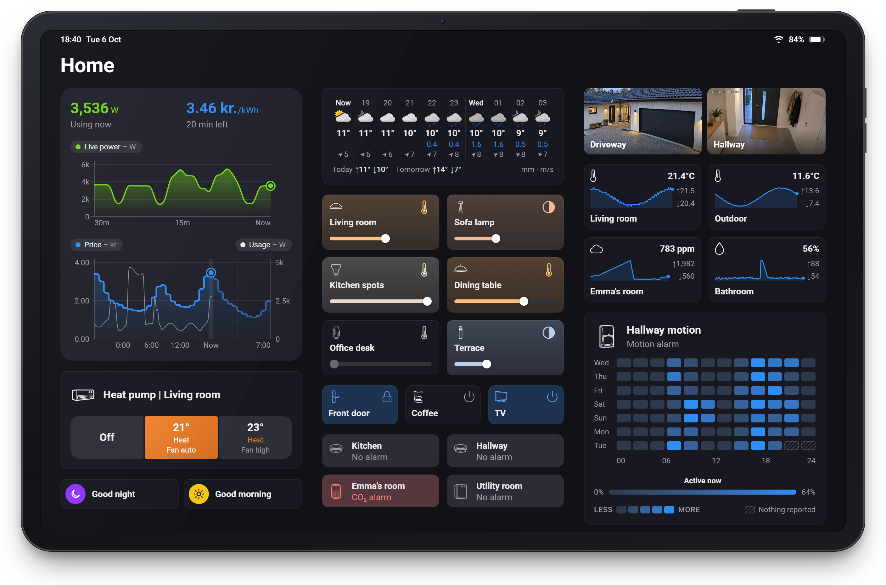

**Contents:** [Widgets](#widgets) · [Web dashboards](#web-dashboards) · [Dashboard examples](#dashboard-examples) · [Colour style](#colour-style) · [Device names](#device-names) · [Tile names](#tile-names) · [API key](#api-key) · [Installation](#installation) · [Troubleshooting](#troubleshooting)

## Widgets
Every widget follows Homey's light and dark mode and is translated into all 13 of Homey's languages. Tap one for what it does and its settings.

<a href="#activity-dots"><picture><source media="(prefers-color-scheme: dark)" srcset="docs/previews/sensordots-dark.png"></picture></a>
<a href="#activity-dots"><b>Activity Dots</b></a> 
Many motion, contact and vibration sensors at a glance, as dots that change colour when active 

<a href="#cameras"><picture><source media="(prefers-color-scheme: dark)" srcset="docs/previews/cameras-dark.png">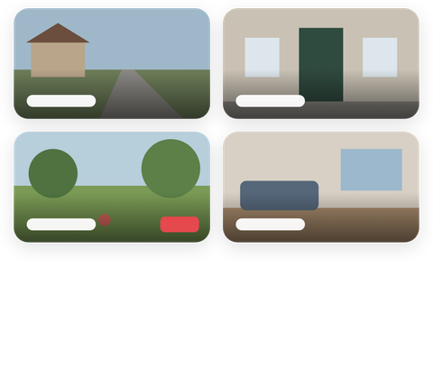</picture></a>
<a href="#cameras"><b>Cameras</b></a> 
Two to six cameras in one grid of snapshots; tap one to watch it live 

<a href="#chart--basic"><picture><source media="(prefers-color-scheme: dark)" srcset="docs/previews/charts-dark.png"></picture></a>
<a href="#chart--basic"><b>Chart · Basic</b></a> 
How did it go? One value over any span, from minutes to two years, or against the period before or a second value 

<a href="#chart--daily-profile"><picture><source media="(prefers-color-scheme: dark)" srcset="docs/previews/typicalday-dark.png">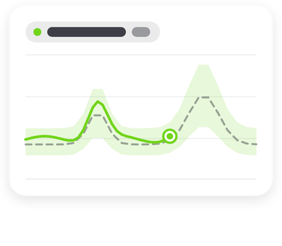</picture></a>
<a href="#chart--daily-profile"><b>Chart · Daily Profile</b></a> 
Today's line over the usual day and its spread: is today unusual? 

<a href="#chart--lines"><picture><source media="(prefers-color-scheme: dark)" srcset="docs/previews/lines-dark.png">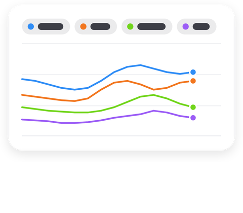</picture></a>
<a href="#chart--lines"><b>Chart · Lines</b></a> 
Up to six values over time on one chart, a line each: every room's temperature side by side 

<a href="#chart--minmax"><picture><source media="(prefers-color-scheme: dark)" srcset="docs/previews/dailyrange-dark.png">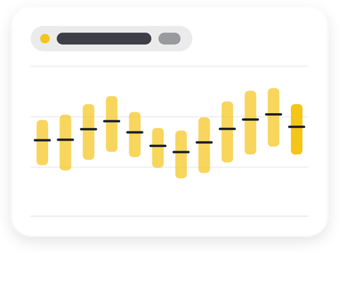</picture></a>
<a href="#chart--minmax"><b>Chart · Min/Max</b></a> 
Each day's lowest to highest as a bar, its average across it: how much did it swing? 

<a href="#chart--ranking"><picture><source media="(prefers-color-scheme: dark)" srcset="docs/previews/compare-dark.png">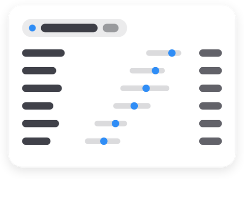</picture></a>
<a href="#chart--ranking"><b>Chart · Ranking</b></a> 
One value across devices, now and its range today, sorted: which room is warmest? 

<a href="#chart--scatter-xy"><picture><source media="(prefers-color-scheme: dark)" srcset="docs/previews/scatter-dark.png">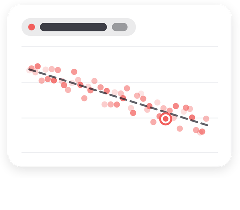</picture></a>
<a href="#chart--scatter-xy"><b>Chart · Scatter (XY)</b></a> 
One value against another, a dot an hour, with the line that fits them: does the heat pump work harder when it's colder? 

<a href="#chart--stacked"><picture><source media="(prefers-color-scheme: dark)" srcset="docs/previews/stacked-dark.png">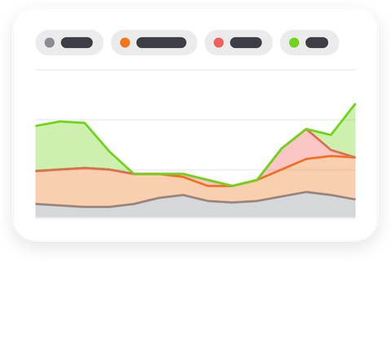</picture></a>
<a href="#chart--stacked"><b>Chart · Stacked</b></a> 
Several values stacked on one time axis, the rest of a total as Other: who uses the power? 

<a href="#chart--timeline"><picture><source media="(prefers-color-scheme: dark)" srcset="docs/previews/timeline-dark.png">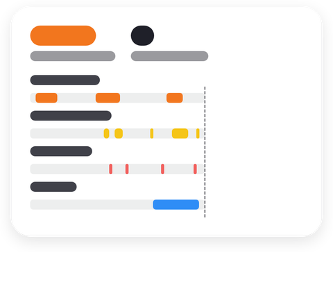</picture></a>
<a href="#chart--timeline"><b>Chart · Timeline</b></a> 
When was it on, open, moving or past a threshold? A row per value over the day, bands where it was true 

<a href="#chart--totals"><picture><source media="(prefers-color-scheme: dark)" srcset="docs/previews/totals-dark.png">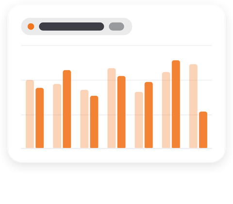</picture></a>
<a href="#chart--totals"><b>Chart · Totals</b></a> 
How much a value went up per hour, day or month (kWh, rain, hours of TV), like the Energy tab, over any span, beside the period before if you like 

<a href="#clock"><picture><source media="(prefers-color-scheme: dark)" srcset="docs/previews/clock-dark.png"></picture></a>
<a href="#clock"><b>Clock</b></a> 
The time and the date, with the weather now and today's high and low 

<a href="#curtains"><picture><source media="(prefers-color-scheme: dark)" srcset="docs/previews/curtains-dark.png"></picture></a>
<a href="#curtains"><b>Curtains</b></a> 
Curtains and blinds that open or close with one tap, with a slider for anything in between 

<a href="#dashboard-shortcuts"><picture><source media="(prefers-color-scheme: dark)" srcset="docs/previews/shortcuts-dark.png"></picture></a>
<a href="#dashboard-shortcuts"><b>Dashboard Shortcuts</b></a> (web dashboards only) 
Your other web dashboards as buttons in your colours and icons, a menu for every dashboard 

<a href="#days-since"><picture><source media="(prefers-color-scheme: dark)" srcset="docs/previews/dayssince-dark.png"></picture></a>
<a href="#days-since"><b>Days Since</b></a> 
How long since the plants were watered or the filter changed, amber and then red when it's due; tap to reset 

<a href="#device-quick-actions"><picture><source media="(prefers-color-scheme: dark)" srcset="docs/previews/quickactions-dark.png"></picture></a>
<a href="#device-quick-actions"><b>Device Quick Actions</b></a> 
Compact tiles that run a device's quick action with one tap 

<a href="#device-values"><picture><source media="(prefers-color-scheme: dark)" srcset="docs/previews/values-dark.png"></picture></a>
<a href="#device-values"><b>Device Values</b></a> 
Compact tiles that each show one value, such as a temperature, power or on/off 

<a href="#electricity-overview"><picture><source media="(prefers-color-scheme: dark)" srcset="docs/previews/electricity-dark.png">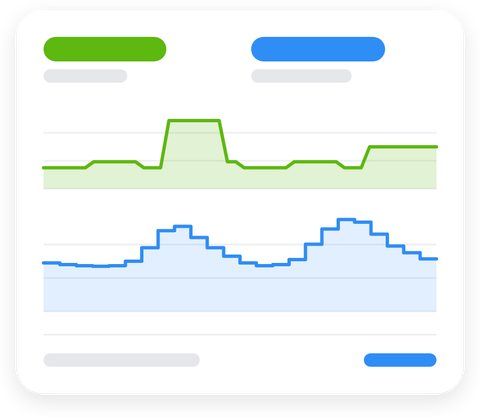</picture></a>
<a href="#electricity-overview"><b>Electricity Overview</b></a> 
Live power use, hourly electricity prices and usage history on one card 

<a href="#energy-price-strip"><picture><source media="(prefers-color-scheme: dark)" srcset="docs/previews/price-dark.png"></picture></a>
<a href="#energy-price-strip"><b>Energy Price Strip</b></a> 
The electricity price now and the coming hours as small bars, green, yellow or red 

<a href="#flow-buttons"><picture><source media="(prefers-color-scheme: dark)" srcset="docs/previews/flows-dark.png"></picture></a>
<a href="#flow-buttons"><b>Flow Buttons</b></a> 
Start flows with one tap: a round button in the colour and icon you pick, with the flow's name 

<a href="#insights-heatmap"><picture><source media="(prefers-color-scheme: dark)" srcset="docs/previews/heatmap-dark.png"></picture></a>
<a href="#insights-heatmap"><b>Insights Heatmap</b></a> 
A week of one value (light, temperature, motion …) as a grid of weekdays and hours 

<a href="#keypad"><picture><source media="(prefers-color-scheme: dark)" srcset="docs/previews/keypad-dark.png"></picture></a>
<a href="#keypad"><b>Keypad</b></a> 
Up to three buttons behind an optional code that start Flows or set a device or variable, with its state beside them 

<a href="#light-controls"><picture><source media="(prefers-color-scheme: dark)" srcset="docs/previews/lights-dark.png"></picture></a>
<a href="#light-controls"><b>Light Controls</b></a> 
Compact light tiles with brightness, colour and colour temperature: six lights in the space of three 

<a href="#lights-by-room"><picture><source media="(prefers-color-scheme: dark)" srcset="docs/previews/lightrooms-dark.png"></picture></a>
<a href="#lights-by-room"><b>Lights by Room</b></a> 
Every room's lights on a card: switch and dim a room, or open it for each light and the room's Moods 

<a href="#locks-and-doors"><picture><source media="(prefers-color-scheme: dark)" srcset="docs/previews/locks-dark.png"></picture></a>
<a href="#locks-and-doors"><b>Locks and Doors</b></a> 
One line that says whether every lock and door is locked and closed 

<a href="#media"><picture><source media="(prefers-color-scheme: dark)" srcset="docs/previews/media-dark.png">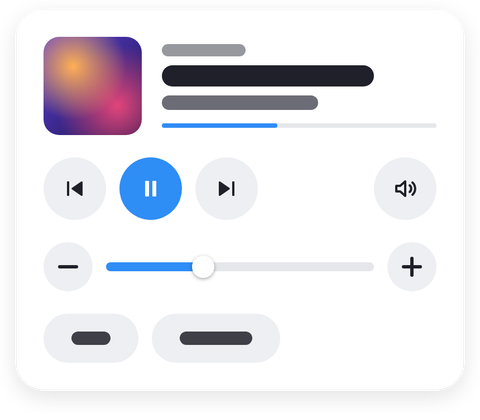</picture></a>
<a href="#media"><b>Media</b></a> 
A speaker with its album art, mute, a volume that never overshoots and buttons for its sources 

<a href="#notes"><picture><source media="(prefers-color-scheme: dark)" srcset="docs/previews/textline-dark.png"></picture></a>
<a href="#notes"><b>Notes</b></a> 
A note on a tile or a handwritten Post-it, typed in or written by your Flows 

<a href="#pollen-and-uv"><picture><source media="(prefers-color-scheme: dark)" srcset="docs/previews/pollen-dark.png"></picture></a>
<a href="#pollen-and-uv"><b>Pollen and UV</b></a> 
Today's pollen levels and the UV peak, in Europe 

<a href="#popups"><picture><source media="(prefers-color-scheme: dark)" srcset="docs/previews/popups-dark.png"></picture></a>
<a href="#popups"><b>Popups</b></a> 
A Flow's message or question with buttons of your own, with a picture if you like, in front of everything on a phone, tablet or web dashboard 

<a href="#room-health"><picture><source media="(prefers-color-scheme: dark)" srcset="docs/previews/roomhealth-dark.png"></picture></a>
<a href="#room-health"><b>Room Health</b></a> 
Each room's temperature, humidity and air quality at a glance, turning yellow to red when something is off 

<a href="#sensor-alarms"><picture><source media="(prefers-color-scheme: dark)" srcset="docs/previews/sensoralarms-dark.png"></picture></a>
<a href="#sensor-alarms"><b>Sensor Alarms</b></a> 
Tiles that show a sensor's alarm and turn red when one is on 

<a href="#smart-stack"><picture><source media="(prefers-color-scheme: dark)" srcset="docs/previews/stack-dark.png">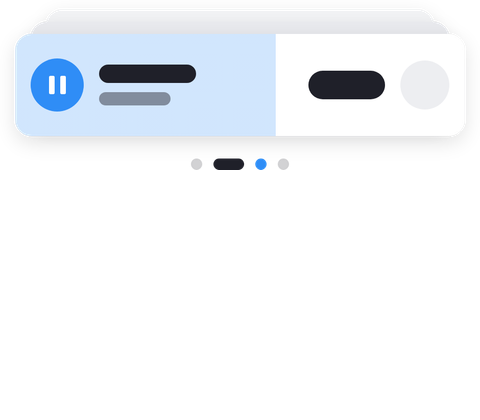</picture></a>
<a href="#smart-stack"><b>Smart Stack</b></a> 
Several widgets in one spot, one at a time, with the one that matters brought forward 

<a href="#spacer"><picture><source media="(prefers-color-scheme: dark)" srcset="docs/previews/spacer-dark.png"></picture></a>
<a href="#spacer"><b>Spacer</b></a> 
Empty space of the height you set, to line up widgets across columns 

<a href="#sparklines"><picture><source media="(prefers-color-scheme: dark)" srcset="docs/previews/sparklines-dark.png">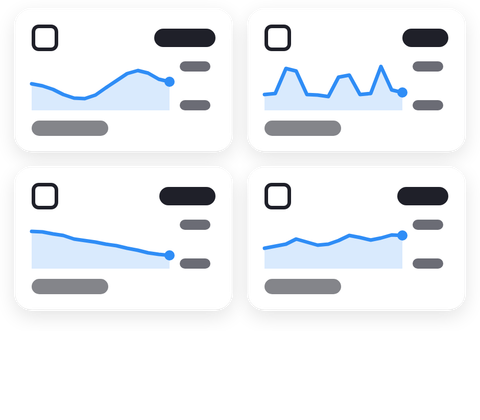</picture></a>
<a href="#sparklines"><b>Sparklines</b></a> 
Tiles with a small chart of a value over the last hour, day or week, with its lowest and highest 

<a href="#thermostat-presets"><picture><source media="(prefers-color-scheme: dark)" srcset="docs/previews/thermostat-dark.png">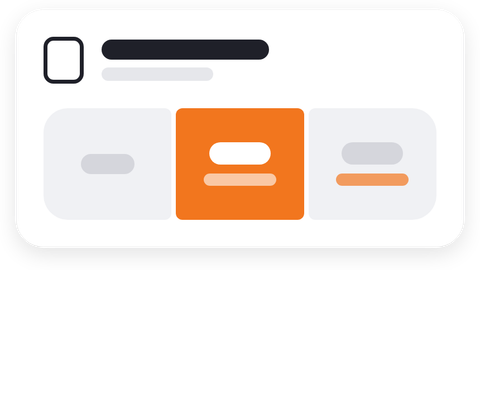</picture></a>
<a href="#thermostat-presets"><b>Thermostat Presets</b></a> 
Three one-tap presets for a thermostat, heat pump or air conditioner 

<a href="#timers"><picture><source media="(prefers-color-scheme: dark)" srcset="docs/previews/timers-dark.png"></picture></a>
<a href="#timers"><b>Timers</b></a> 
Kitchen timers from one-tap presets, with a Flow card when one runs out 

<a href="#value-matrix"><picture><source media="(prefers-color-scheme: dark)" srcset="docs/previews/valuematrix-dark.png"></picture></a>
<a href="#value-matrix"><b>Value Matrix</b></a> 
Devices or rooms against the values you choose, in one table, each cell green, orange or red by its range 

<a href="#variable-presets"><picture><source media="(prefers-color-scheme: dark)" srcset="docs/previews/varpresets-dark.png"></picture></a>
<a href="#variable-presets"><b>Variable Presets</b></a> 
Two to four one-tap buttons that set a variable to the values you pick, like Thermostat Presets 

<a href="#variables"><picture><source media="(prefers-color-scheme: dark)" srcset="docs/previews/variables-dark.png">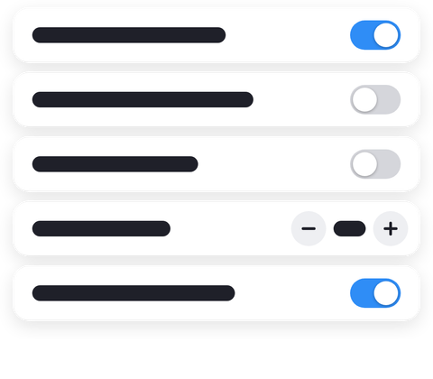</picture></a>
<a href="#variables"><b>Variables</b></a> 
Compact rows to switch variables on and off or change a number or text, with the full name 

<a href="#weather-forecast"><picture><source media="(prefers-color-scheme: dark)" srcset="docs/previews/weather-dark.png">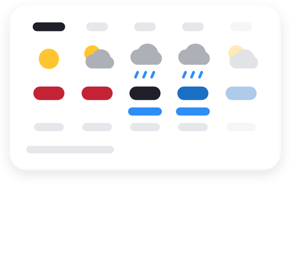</picture></a>
<a href="#weather-forecast"><b>Weather Forecast</b></a> 
The next 36 hours, hour by hour, from MET Norway (yr.no) 

<a href="#web-page"><picture><source media="(prefers-color-scheme: dark)" srcset="docs/previews/webpage-dark.png"></picture></a>
<a href="#web-page"><b>Web Page</b></a> 
Any web page, scaled to fill the widget, with buttons to switch between addresses 

## Activity Dots
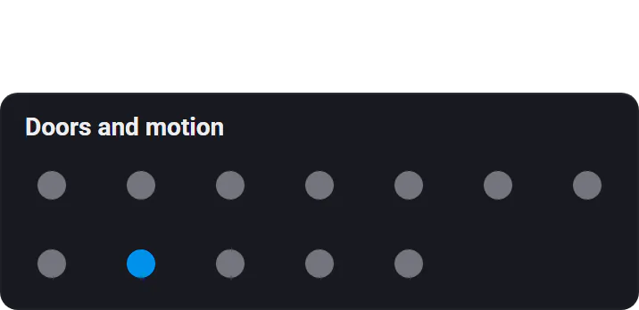

Motion, contact, vibration and camera sensors as a grid of dots that light up while active. Tap a dot for its name and since when, such as *Garage · Open since 18:17*.

**Settings:** sensors, title, idle and active colours, [colour style](#colour-style), time format.

## Cameras
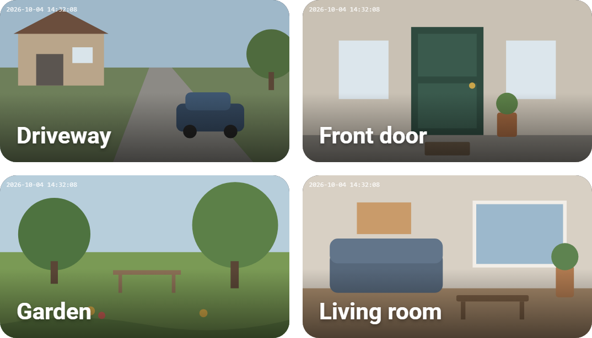

Your cameras as a grid of snapshots that refresh every few seconds (cameras with only a video stream show a still from it). Tap one to watch it live.

**Settings:** cameras, layout (a large camera at the top or bottom, or one per row), refresh interval, how long live view stays on, time format, [rename tiles](#tile-names).

## Chart · Basic

How did it go? Any value that Homey logs in Insights, over any [time span](#time-spans) from minutes to two years, as a line, an area or bars, drawn like Electricity Overview's charts. The value now sits at the top in the chart's colour; tap the chart to see the value at that moment.

It also compares. Put two values on one chart to see a value against the period before it (today over yesterday, this month over last, of the same value), or against a second value with its own scale (the power use against the outdoor temperature). Or stack two charts in one widget.

**Settings:** one value, two values stacked or two values on one chart (they share chart 1's time span, or compare whole periods of one unit: today with yesterday, this week with last, and so on), and on one chart one scale for both; per chart the value, [time span](#time-spans), style (line with area, line or bars), colour, scale (fitted or from zero), below zero in yellow, smooth line and title; the values at the top (a finished period shows its average there); the legend above or below the chart; [colour style](#colour-style).

For how much a value went up in each hour, day or month (a meter's kWh, rain, hours of TV), as bars, see [Chart · Totals](#chart--totals). For more than two values on one chart (every room's temperature), see [Chart · Lines](#chart--lines).

**Time spans** (both chart widgets): a number and a unit. Minutes, hours, days, weeks, months or years are the last so many up to now (40 minutes, 24 hours, 18 months). Days from midnight, weeks from Monday, months from the 1st and years from 1 January are whole periods, the current one included (1 day from midnight is today, 3 months from the 1st this month and the two before), or with *Leave out the current period* the ones before it (yesterday, last week, the three months before this one). Up to two years: Insights keeps no more. A chart set up before 1.2.0 keeps its span.

## Chart · Daily Profile
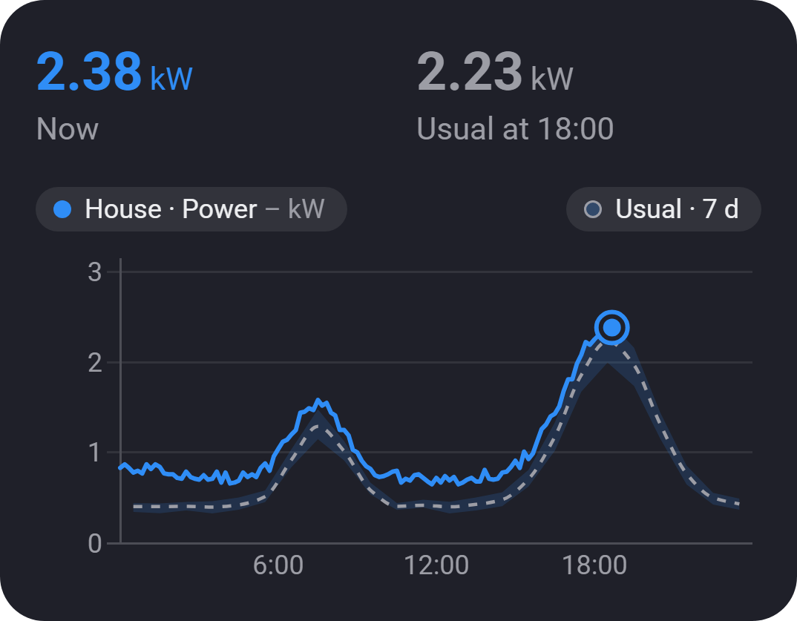

A value today against its usual day: each hour's average over the last 7 days (or 3), today left out, dashed, with their lowest to highest as a band, and today's line over it up to now. The value now and the usual one for this hour sit at the top; tap the chart for another hour.

It takes any value that Homey logs in Insights, read from its hourly log (which reaches a week back).

**Settings:** the value, usual day from (the last 7 or 3 days), show the spread, smooth line, scale (fitted or from zero), title, the values at the top, colour, [colour style](#colour-style).

## Chart · Lines
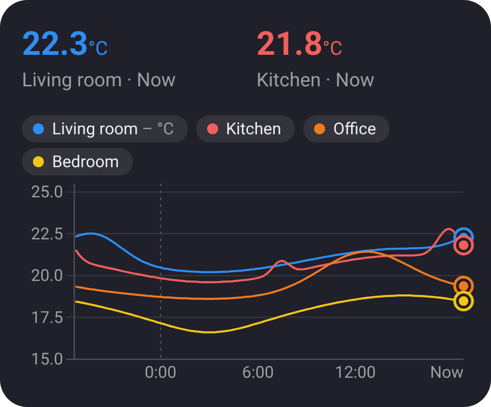

Up to six values over time on one chart, a line each in its own colour: every room's temperature, each radiator's power, the outdoor and indoor humidity, or the heat pump's power among the temperatures. The last 24 hours by default, or any other [time span](#time-spans). The first two values now sit at the top (over a finished span, such as yesterday, their averages); tap the chart for the line nearest your finger at that time, with a dot on each line there.

The first value's kind sets the scale on the left (W and kW go on one scale), and a second kind of value, such as power beside temperatures, gets a scale on the right; each kind's units show on its first chip. A value in a third kind of units is left out, its chip saying so. To compare one value with the period before it (today over yesterday), use [Chart · Basic](#chart--basic).

**Settings:** values 1 to 6 each with its colour, [time span](#time-spans), style (lines, or lines with areas), scale (fit to the values or from zero), smooth lines, the legend above or below the chart, title, the values at the top, [colour style](#colour-style).

## Chart · Min/Max
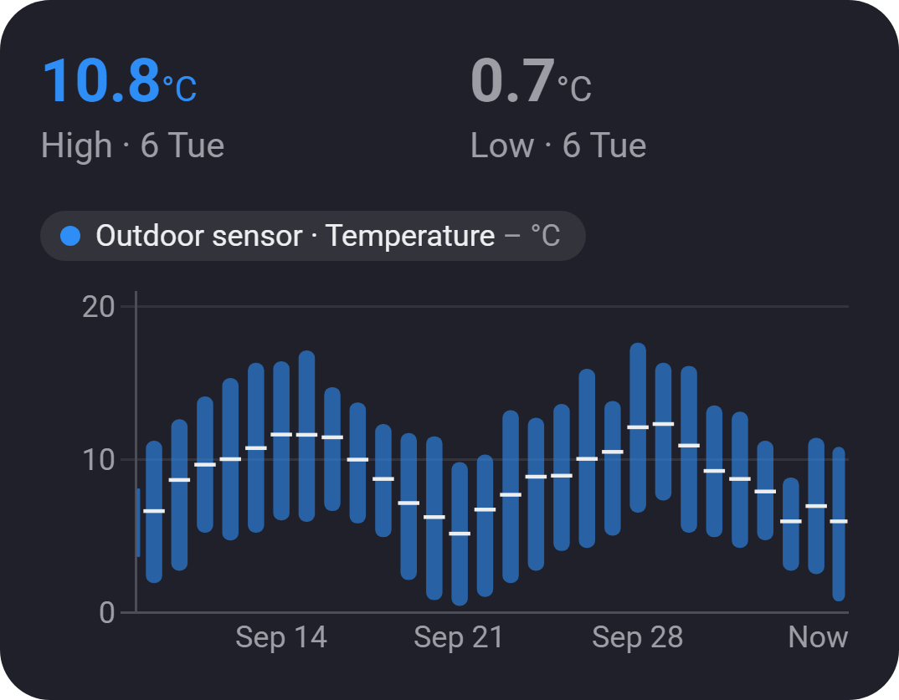

A value's lowest to highest in each day as a floating bar, its average as a tick across it: how cold the nights and how warm the afternoons were, how much the humidity swung. The last four weeks by default, a bar a day; another [time span](#time-spans) gets its own bars (an hour each over a day, a month each over a year). The latest bar's high and low sit at the top; tap a bar for its own.

It takes any value that Homey logs in Insights. Insights keeps spans over eight days in 6-hour averages, so a day's low and high there are those of its 6-hour steps, a little milder than the real ones.

**Settings:** the value, [time span](#time-spans), average tick, scale (fitted or from zero), title, the values at the top, colour, [colour style](#colour-style).

## Chart · Ranking
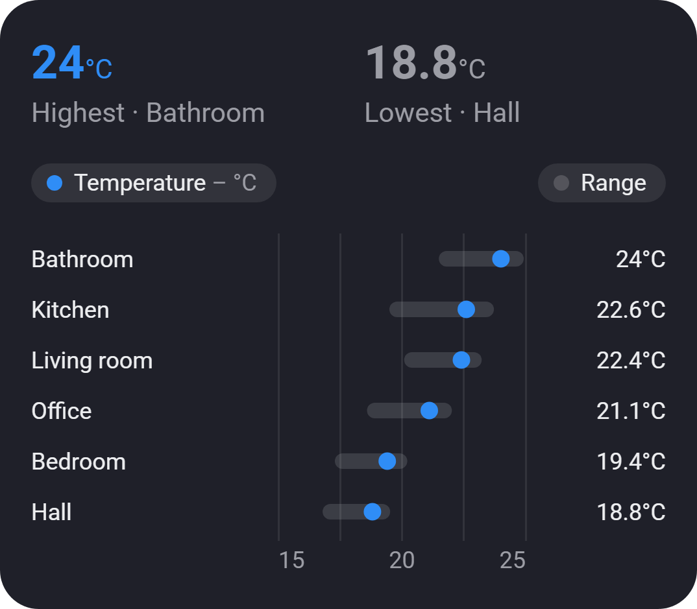

One value from up to eight devices side by side, a row each on one shared scale: the value now as a dot and its lowest to highest today (or over another [time span](#time-spans)) as a bar, warmest first (or coldest first, or as you picked them). The highest and the lowest sit at the top; tap a row for its value and range. A device with several values picked shows them by name.

**Settings:** values 1 to 8, [time span](#time-spans) for the ranges, order (highest first, lowest first or as picked), show the range, title, the values at the top, colour, [colour style](#colour-style).

## Chart · Scatter (XY)
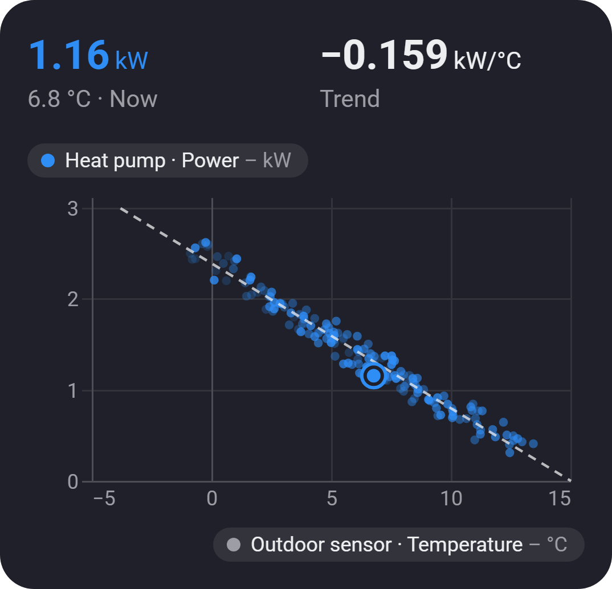

One value against another: each dot is where both were at the same time, their averages over an hour (or, by the [time span](#time-spans), a minute to a week). The newer dots are stronger, the newest is ringed, and a dashed line shows the trend through them, its slope at the top: how much more the heat pump draws for each degree colder, how much the humidity rises with the temperature. Tap a dot to see its values and when.

It takes any two values that Homey logs in Insights. Over spans longer than eight days Insights keeps 6-hour steps, so a dot is at least 6 hours there.

**Settings:** the value across (x) and the value up (y), [time span](#time-spans), one dot per (automatic, hour or day), trend line, fade older dots, title, the values at the top, colour, [colour style](#colour-style).

## Chart · Stacked
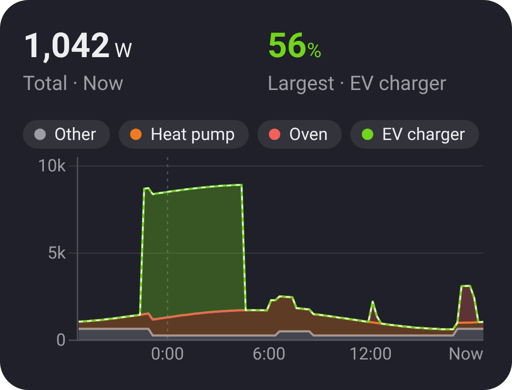

Who uses the power? Up to six values stacked on one time axis, the last 24 hours by default (or any other [time span](#time-spans)): the heat pump, the oven, the EV charger. Pick a total too, such as the house's meter, and what the others don't cover shows as Other at the bottom. A value below zero, such as solar or a battery charging, stacks downwards from the zero line. The total now and the largest part's share of the span sit at the top; tap the chart for a moment's total and the part under your finger.

The values must be the same kind, such as power: W and kW are put on one scale, and a value in other units is left out, its chip saying so.

**Settings:** the total (optional), values 1 to 6 each with its colour, [time span](#time-spans), style (areas or bars), the legend above or below the chart, title, the values at the top, [colour style](#colour-style).

## Chart · Timeline
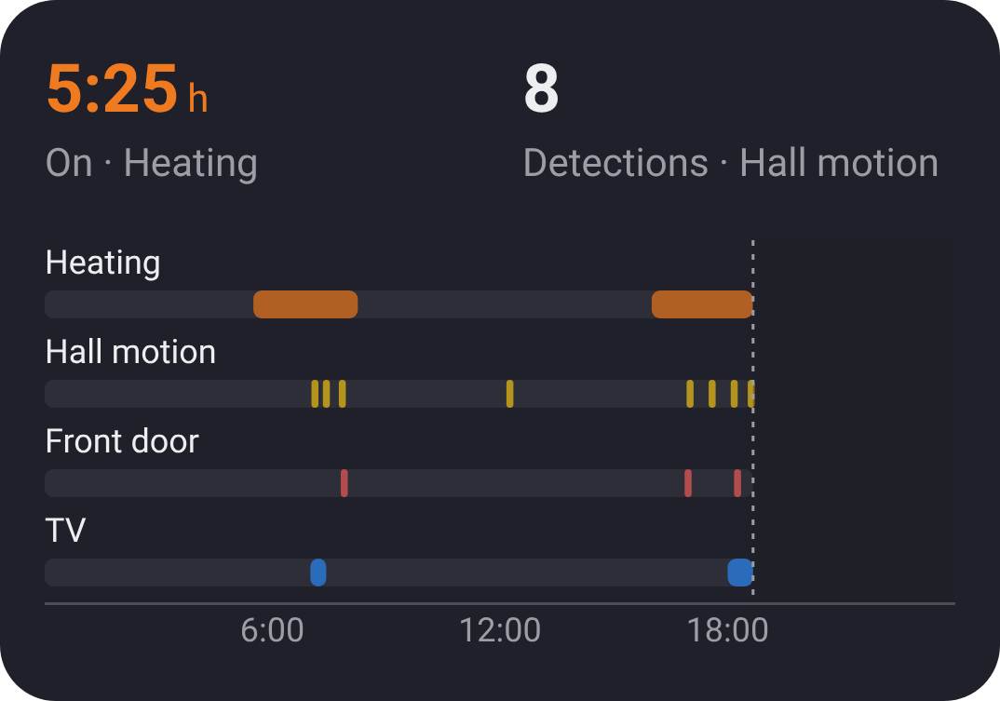

When was it on, open or moving? A row for each of up to eight on/off values (the heating, a motion sensor, a door, the TV) over today, or any other [time span](#time-spans) up to about two weeks, with a band where it was on, open or moving. The time the first was on and how often the second turned on sit at the top; tap a row for its own, or a band for when it was.

Homey's Insights keeps only a value's last 50 changes, so the app records each one itself from the first time it's shown, as the [Insights Heatmap](#insights-heatmap) does (the two share it). Before the first change it knows of, a row is a dotted line rather than a guess.

A row can also be a number, on while it's above (or below) a threshold you set: the heater above 50 W, the bedroom below 18 °C, the humidity above 70 %. Its history comes from Insights, so it's there from the start, but Insights keeps averages (5 minutes over a day, an hour over a week), so a peak of a minute or two over a week may not show.

**Settings:** values 1 to 8 each with its colour, and for a number its threshold and whether it's on above or below it, [time span](#time-spans), title, the values at the top, [colour style](#colour-style).

## Chart · Totals
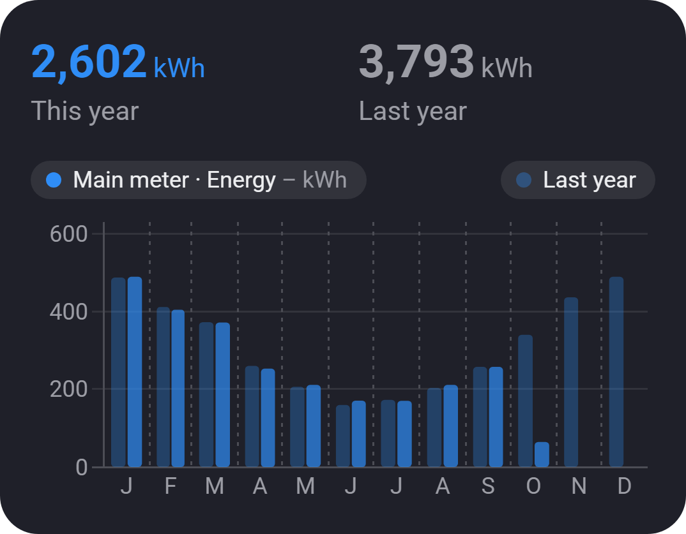

How much a value went up in each hour, day or month, like the Homey app's Energy tab: a bar an hour for a day, a day for a week or a month, a month for a year, and for other spans about 12 to 28 bars on the clock. Turn on *Compare with the period before* for last week's, last month's or last year's bar beside each (the 3rd of the month beside the 3rd, March beside March). The totals sit at the top; tap a bar for its own.

It takes any value that only counts up and that Homey logs in Insights: an electricity, water or gas meter's kWh or m³, a rain gauge's millimetres, hours of TV, a car's odometer, or a utility meter that starts again each week, month or year (it counts on across the reset). The bars come from Insights, which keeps a month or a year in 6-hour steps, so a day's bar in a month view can be off by an hour or two at its edges.

**Settings:** the value (meters first), [time span](#time-spans) (any number of hours, days, weeks, months or years, or whole ones: this week, last month …), compare with the period before, title, the totals at the top, colour, [colour style](#colour-style).

## Clock

The time and the date in one tile, with the weather now and today's high and low from [MET Norway](https://www.met.no/en), the Weather Forecast's data. The time follows your phone, tablet or browser (24 or 12 hours) unless you pick one, the date Homey's language.

**Settings:** show the weather, time format (automatic, 24-hour or 12-hour).

## Curtains
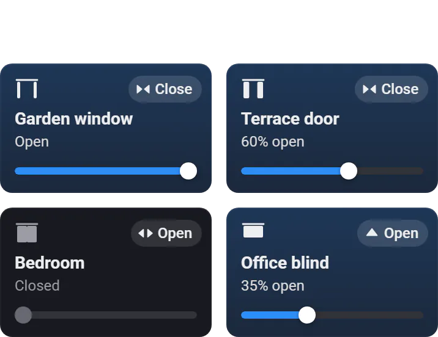

Curtains and blinds as tiles: tap to open or close (the corner label says which), or use the slider for anything between. A tap while it moves sends it back.

**Settings:** devices, what a tap does halfway, inverted position (leave it off when the device's own invert setting already flips it), how close to the end counts as open or closed, state line, group by room, colour, [colour style](#colour-style), [rename tiles](#tile-names).

## Dashboard Shortcuts

For [web dashboards](#web-dashboards) only: your other web dashboards as buttons, each with a round icon in the colour and icon you pick; a tap opens that dashboard. The one you're on is ringed, so the same widget can go on every dashboard as a menu.

**Settings:** up to eight dashboards, each with a colour and an icon; 1 or 2 columns; [colour style](#colour-style); [rename tiles](#tile-names).

## Days Since

Counters for things you do every so often, such as watering the plants or changing the vacuum filter, in a list on one card. Each bar fills up towards the day the counter is due, with the time left under it; it turns amber, then red, after the days you set, and then shows how long it's overdue (*+2 d*). Tap a row when it's done to start again from *Today* (with **Undo** for a few seconds). Counters are kept on Homey by name, so every widget and screen with the same counter shows the same one.

Flow cards: *Reset [counter]*, *Set [counter] to [days] days ago*, the trigger *[counter] became overdue* (even with no dashboard open) and the condition *[counter] is overdue*; the last two also take *Any counter*.

**Settings:** days only or days, weeks and months; all counters, or only those that are amber and red (or only red), so the ones far from due don't take up room; [colour style](#colour-style); up to eight counters, each with a name, an icon and the days until amber and red.

## Device Quick Actions

Half-height tiles that run a device's quick action with one tap (on/off, lock, play/pause, a button), highlighted while it's on.

**Settings:** devices, active style, colour, [colour style](#colour-style), single, double or long press (for every tile, or only locks and garage doors, so a stray tap can't unlock a door), [rename tiles](#tile-names).

## Device Values
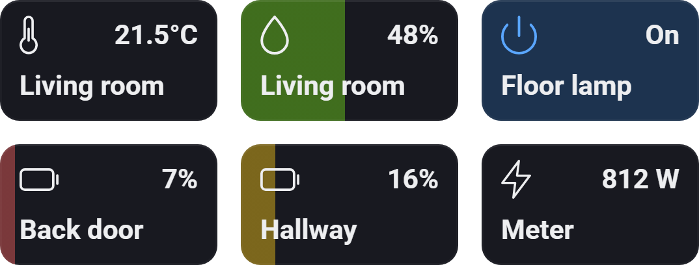

Half-height tiles that each show one live device value, optionally with a second value of the same device beside the name, such as a room's humidity next to its temperature. Percentages can fill their tile by level, and the Flow card **Set the tile colour of … to …** colours a tile, such as a fridge going red when it's too warm.

**Settings:** up to six values, each with an optional second value; 3 or 2 per row; compact or pill tiles (like Sensor Alarms'); percentage fill and its limits; [colour style](#colour-style); [rename tiles](#tile-names).

## Electricity Overview
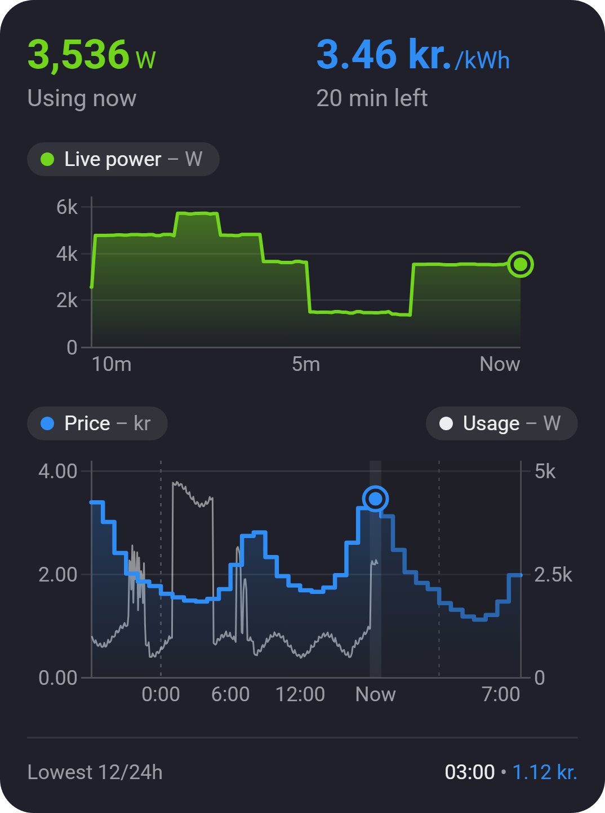

Live power use, the hourly price from yesterday to 12 hours ahead (with your tariffs and taxes from Homey Energy), the last 24 hours of usage and the cheapest hour ahead. Tap a chart to see its values. Works with a fixed price too, and shows solar export below zero.

**Settings:** power meter, live time span, prices, tariffs and taxes, usage history, smooth lines, lowest price in 12 h / 24 h, compact layout, [colour style](#colour-style).

## Energy Price Strip
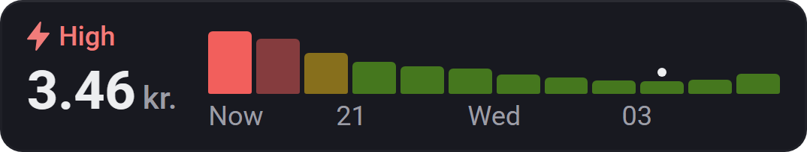

The electricity price now, and the coming 12, 24 or 36 hours as small bars in one tile: green, yellow or red by each hour's level in its day, with a dot over the cheapest. Uses the Electricity Overview's prices and needs no meter.

**Settings:** hours ahead, colour by level, [colour style](#colour-style), tariffs and taxes.

## Flow Buttons

Flows and Advanced Flows as rows with a round button in your colour and icon. Tap a row to start the flow. Needs an [API key](#api-key) with **Start Flows**. The Flow card **Set the button colour of … to …** colours the buttons that start a flow, such as green while an e-bike charges; **Default** gives them their own colour again.

**Settings:** up to eight flows, each with a colour, an icon and an optional name; 1 or 2 columns; [colour style](#colour-style).

## Insights Heatmap
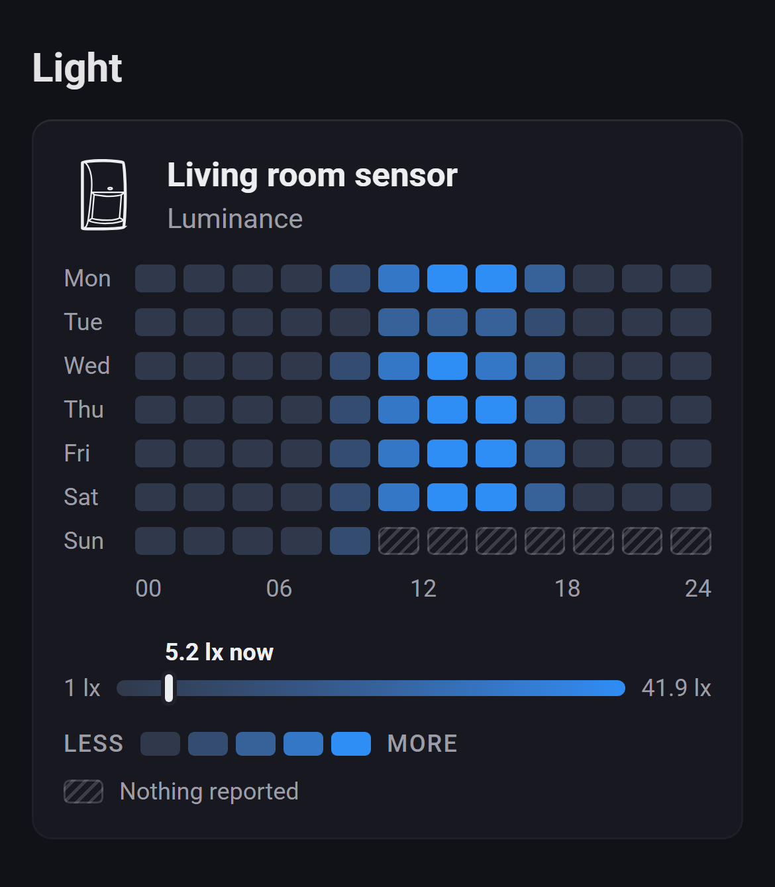

A week of one Insights value as a grid of days and hours: numbers such as light or temperature, or how much of each hour a sensor was on.

**Settings:** device and value, a title in place of the device's name, this week or the last 3–14 days, hours per column, colour, [colour style](#colour-style), scale, legend.

## Keypad

Up to three buttons, each behind an optional 3–6 digit code: arm an alarm, unlock a door, allow an hour of TV. A button starts a Flow, or, without one, sets the widget's state to its value; a button with only a label just starts the Keypad's Flow card (below). The state is a device value or a Logic variable, shown on the left; the button with its value is ticked. A list value, such as an alarm's *Armed*, *Partially armed* and *Disarmed*, or a yes/no one, gets a button per value when none is set up, all behind the code.

A tap on a button that wants the code opens a phone's keypad beside the state (in compact, in place of the widget); it sends the code with the last digit. With **Show the keypad: Always**, the keypad stays beside the state with the buttons under it: type the code, then tap the button, or tap the button first. With just one button behind the code, the code alone runs it.

The codes are made under **Apps → Widgetkeeper → Configure → Keypad codes**: a name, such as *Alarm* or *Kids*, and the digits, typed twice. A widget's **Code** setting picks one by name, so several widgets can share a code and you change it in one place (changing it takes the current code, and adding another takes one of the codes already made; removing it doesn't, and its widgets then refuse their buttons until another is picked). Or it picks **Any code**: then everyone's code works, and the Flow card tells whose it was, so give each person their own (no two codes can share digits). While the codes have different lengths, the keypad has an OK key. Widgetkeeper checks the code on your Homey and keeps only a fingerprint of it, made with a secret only the app has, so the digits are never stored or shown. Five wrong codes in a row lock that code for 30 s, doubling each time up to 15 min, and ten in a row, whichever codes they were, lock them all. The code guards the dashboard (a wall tablet, the children, guests), not your Homey: anyone who can open the Homey app can still start the Flow or change the device there.

**Flow cards:** *A Keypad button was tapped by [code]* (Anyone, Anyone with a code, or one code by name), once a button ran, with the tags **Code** (the code's name, such as *Anna*; empty without one), **Button** and **Keypad** (the widget's title). A Flow started by the button itself gets no tags, so for *Anna disarmed the alarm* use this card. *A wrong code was typed on a Keypad*, at a Keypad or a [web dashboard's code](#code), with **Button**, **Keypad** (the widget's title or the dashboard's name), **Locked** (this try locked the code) and **Tries left**.

Starting a Flow needs an [API key](#api-key) with **Start Flows**, setting a variable one with **Variables**; setting a device needs no key.

**Background: State colour** fills the whole widget with the ticked button's colour, so a small Keypad still shows from across the room whether the alarm is armed: red for *Armed*, green for *Disarmed*. It's a light tint, stronger with Vivid. A grey button, or a state no button has, leaves it plain, which is also the default.

**Settings:** a title, the state (a device value or a variable), the code (one, or Any code), show the keypad (when a button needs it, or always), compact layout, [colour style](#colour-style), background (plain or the state's colour), and per button: a Flow, the state's value it stands for, a label, an icon, a colour and whether it needs the code.

## Light Controls
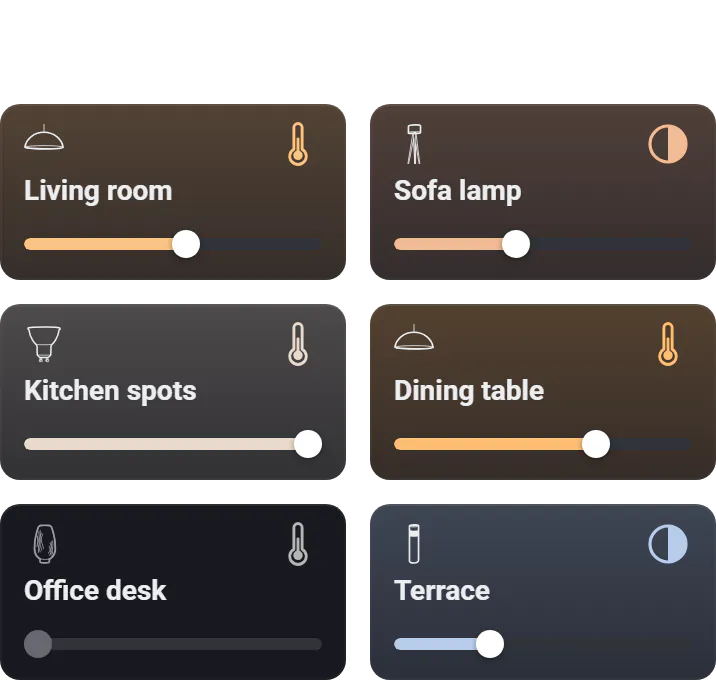

Six lights in the space of three of Homey's light cards. Tap a tile to switch it, drag or tap the bar to dim, and tap the colour button for colours and whites. Lights in a room can share one tile, whose bar shows how bright its dimmable lights that are on are: their average, or the brightest. With the *Room's Moods* palette, the colour button starts the room's Homey Moods instead (needs an [API key](#api-key) with **Set Moods**).

**Settings:** lights, group by room, room brightness (average or brightest), widen the last tile, what the bar's far left does, colour palette, [colour style](#colour-style), [rename tiles](#tile-names).

## Lights by Room
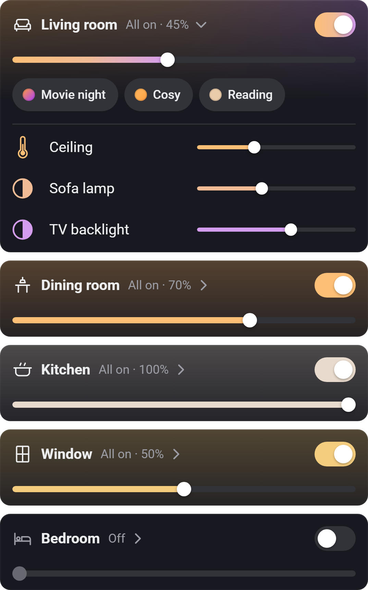

For many lights in many rooms. The lights you pick are grouped by their Homey room, a card each with the room's icon, how many lights are on and how bright (the dimmable lights that are on: their average, or the brightest), a switch for the whole room and a bar that dims all of it. Tap a room's name to open it: its Homey Moods as a row of buttons, then a row per light that works as in Light Controls (tap to switch, tap or drag the bar to dim, the colour button for colours and whites). Rooms start closed; open as many as you like. Starting a Mood needs an [API key](#api-key) with **Set Moods**.

**Settings:** lights, show the room's Moods, colour palette, room brightness (average or brightest), what the bar's far left does, [colour style](#colour-style), [rename tiles](#tile-names) (the rooms and lights).

## Locks and Doors

Locks, doors, windows and garage doors in one line: *All locked and closed*, or what isn't, on a red tile. Tap it for the list, with **Lock** and **Close** buttons. A lock that can pull the latch can also get an **Open** button (pick its capability, such as *open_lock* or *open*); tap it twice to open the door.

**Settings:** devices, one line or the full list, allow unlocking, the open door button, [colour style](#colour-style), time format, [rename tiles](#tile-names).

## Media
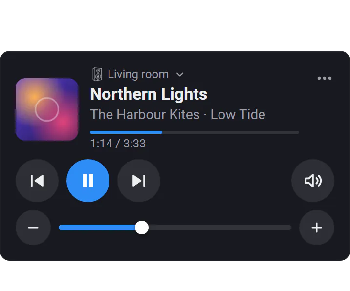

One speaker as a card: album art, the track, play controls, mute, and a volume that moves on every tap but never overshoots or passes your maximum. TV and line-in show as such, not as old album art. Tap the name to switch speaker. Up to eight buttons behind ⋯ run the speaker's own actions (such as *Set source to TV*), its app's, or flows; they need an [API key](#api-key) (**Flows** for actions, **Start Flows** for flows). The large layout puts the album art across the whole widget; tap the art to switch layout (each screen remembers its choice).

**Settings:** layout (compact or large), tap the album art to switch layout, colour, [colour style](#colour-style), speaker, speaker switching, volume as a bar or buttons, volume step and maximum, progress, shuffle and repeat, eight buttons with an icon and a name.

## Notes

A short message on the dashboard: a tile with a line of text or more, or a tilted, handwritten Post-it note. Type it in the settings, show a Logic text variable, or let a Flow write it with *Write [text] on the note [name]* (optionally in a colour, such as red for *Dryer done*) and *Clear the note [name]*; every Notes widget with that name shows it at once. On the tile, long text is cut off, scrolls, or shows on as many lines as it needs, with the line breaks you type (the tile grows with it); the Post-it wraps it to three lines.

**Settings:** style (tile or Post-it), text from (the message typed in the settings, a Flow card or a text variable), message, note name, variable, alignment, text size, long text, icon, colour, [colour style](#colour-style).

## Pollen and UV
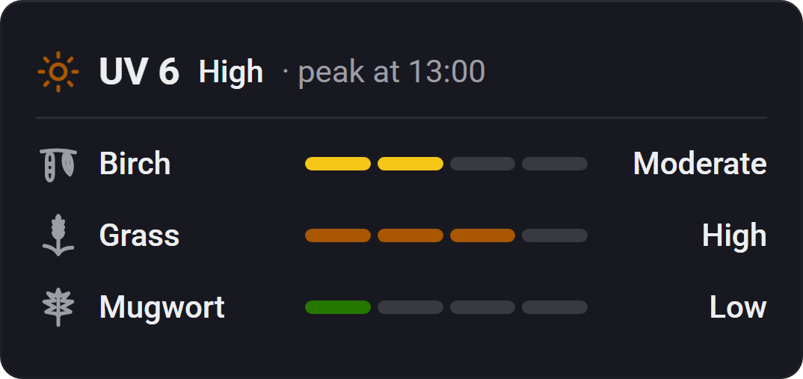

Today's pollen at the Homey's location, a row per type with a bar from low to very high, under the day's UV peak and when it comes. Pollen forecasts cover Europe only; elsewhere the widget says so and shows the UV. Out of season it says there's no pollen in the air.

A level is the day's average in grains per m³, by Astma-Allergi Danmark's bands with a very high band on top. The UV levels are the WHO's.

| From (grains per m³) | Low | Moderate | High | Very high |
|---|---|---|---|---|
| Birch, alder, olive | 1 | 30 | 101 | 1,001 |
| Grass, mugwort, ragweed | 1 | 10 | 51 | 251 |

**Settings:** compact or detailed (with the grains per m³ and the next three days), the UV index, the pollen types (alder, birch, olive, grass, mugwort, ragweed; birch, grass and mugwort by default), [colour style](#colour-style), time format.

Pollen and UV data from [Open-Meteo](https://open-meteo.com), licensed under [CC BY 4.0](https://creativecommons.org/licenses/by/4.0/), generated using Copernicus Atmosphere Monitoring Service information.

## Popups
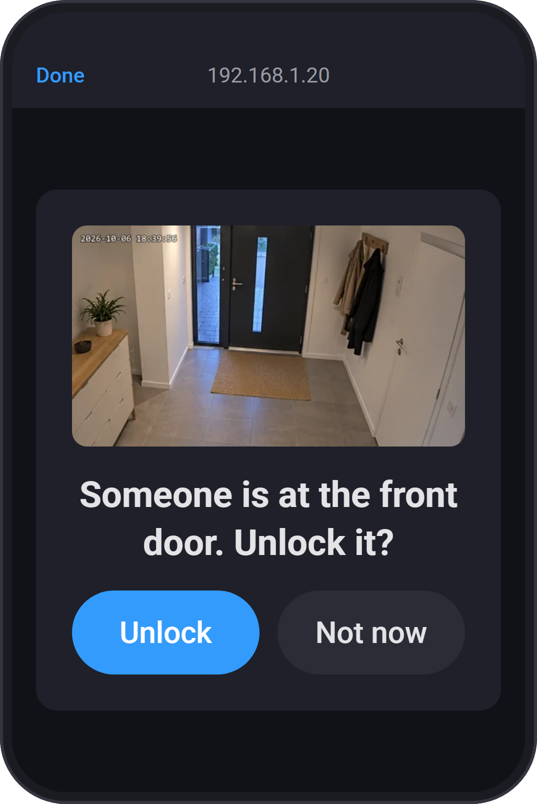

A Flow shows a message, or asks a question with one or two buttons of your own (**Yes** and **No** unless you name them), in front of everything on the screens you choose: a web dashboard, or the phones and tablets showing a Homey dashboard with a Popups widget.

- *Show [text] on [screen] for [duration], picture: [picture], sound: [sound]*: closes after the time, or with a tap on that screen.
- *Ask [question] on [screen], buttons: [button] and [second button], picture: [picture], wait up to [seconds] seconds, sound: [sound]*: the buttons are yours, such as *Open* and *Ignore*, or one *Got it*; left empty, they're *Yes* and *No*. The first one is highlighted. The first answer from any screen closes it everywhere and goes back to the Flow as the tags **Answer** (yes for the first button, no for the second), **Button** (its text) and **Answered** (no when nobody answered in time), which only reach the next cards in an **Advanced Flow**. It waits at most 85 seconds, as Homey stops a Flow card after 90.
- *Close the popups on [screen]* closes them early; an open question then ends unanswered.
- **Picture:** a camera (refreshed while the popup is open) or a picture address. The cards *with an image* take an image tag instead, such as a doorbell's snapshot from its own Flow, taken when the Flow runs, or a text tag holding a picture address.
- **Sound:** a chime, a doorbell or an alert. Browsers only play sound on a page that has been tapped, so a wall tablet plays it once someone has used the web dashboard; on phones it may stay silent.

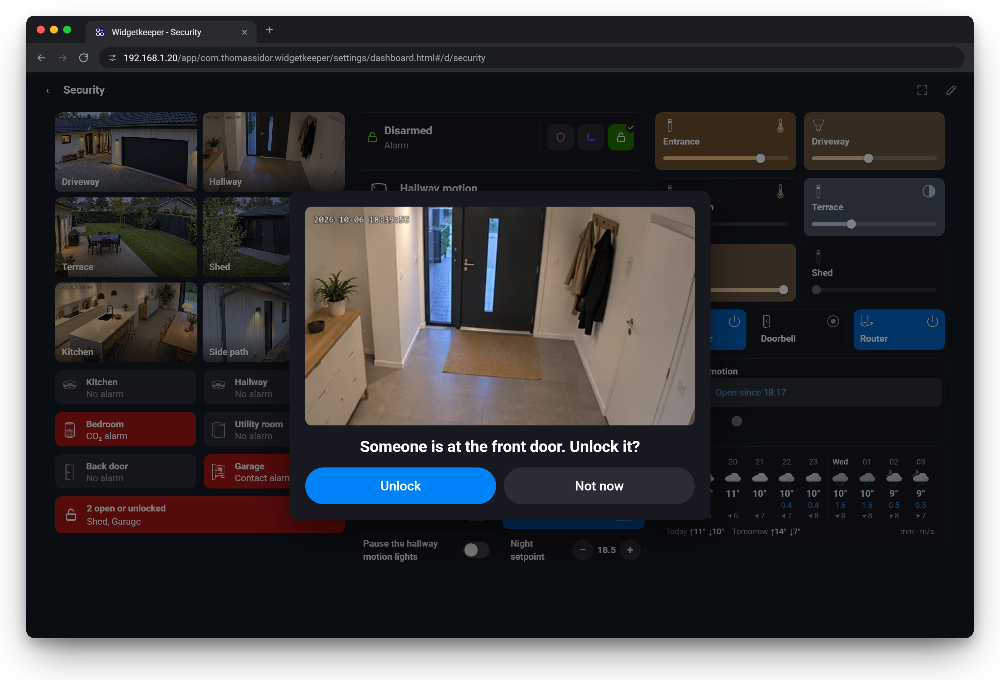

The screen is **Everywhere** or a Popups widget's name. On a [web dashboard](#web-dashboards), the popup covers the page in every browser showing a dashboard with a Popups widget of that name (Everywhere: every web dashboard). Homey's own dashboards don't let a widget draw over them, so there the Popups widget, blank itself, opens the popup in the Homey app's built-in browser; close that window when you're done. Put one at the bottom of each dashboard that should get popups, so it doesn't push other widgets down, with the same name on every screen that should get the same ones: *Hallway* on the phones' dashboard and on the hallway tablet's web dashboard reaches both at once.

**Settings:** screen name, countdown (a bar under a message running down to its end; off by default, as the Homey app's browser window doesn't close by itself).

## Room Health

The indoor climate of the whole house on one card. The sensors you pick are grouped by their Homey room: each room shows its worst value large (else the temperature), its name, and a mark per value (an icon, or a bar), lined up in the same order in every room. A comfortable value is grey, or green with *Green when fine*; outside its range it turns yellow, then red the further out it is. Tap a room to step through its readings.

| Value | Comfortable by default | Red at |
|---|---|---|
| Temperature | 18–24 °C (18 °C is WHO's minimum) | 3 °C outside |
| Humidity | 30–60 % | 10 points outside |
| CO₂ | up to 1000 ppm | 1.5 × the limit |
| Radon | up to 100 Bq/m³ (WHO's reference level) | 1.5 × |
| PM2.5 | up to 15 μg/m³ (WHO's 24-hour guideline) | 1.5 × |
| PM10 | up to 45 μg/m³ (WHO's 24-hour guideline) | 1.5 × |
| VOC | up to 1000 ppb | 1.5 × |

A heat pump's room temperature counts; outdoor and water temperatures don't. Left out on purpose: carbon monoxide (a safety alarm: use [Sensor Alarms](#sensor-alarms)), air quality indexes and VOC in μg/m³ or as an index (their scales differ between devices), and PM1 (no guideline).

**Settings:** sensors, [rename tiles](#tile-names), [colour style](#colour-style), icons or bars, green when fine, the comfortable range of each value (one range for every room).

## Sensor Alarms
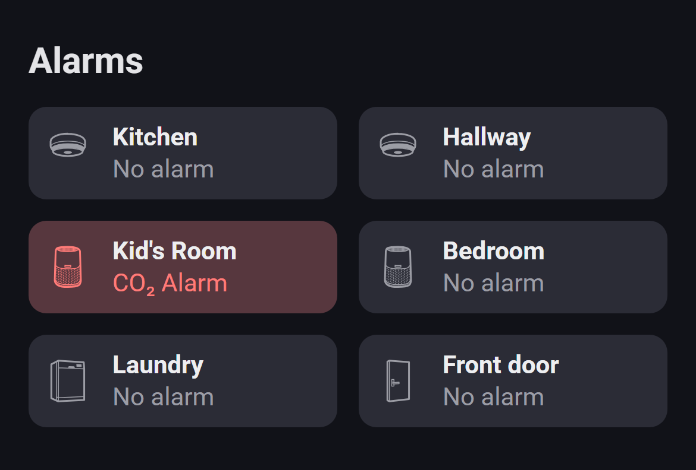

Tiles that show *No alarm*, the alarm that's on or how many, and turn red while one is. Every alarm counts, including apps' own such as radon. Tap a tile for all of its alarms.

**Settings:** sensors, count motion and contact, [colour style](#colour-style), [rename tiles](#tile-names).

## Smart Stack
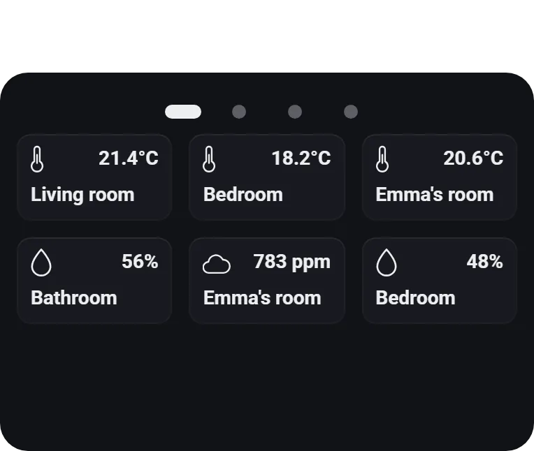

Widgetkeeper widgets from another dashboard, one at a time in the space of one. It turns every 30 seconds, and swipes or the dots move it by hand. Smart rotate brings a widget forward while something happens on it: music plays, a timer runs, a camera sees someone, a door is open. A Flow card can bring one forward too. Needs an [API key](#api-key) with the **Homey** permission to read the dashboard.

**Settings:** dashboard, interval, smart rotate, pause after a swipe, dots.

## Spacer
Transparent empty space of the height you set, in pixels (16 at least), to line up widgets across a dashboard's columns. Homey keeps its usual gap above and below it.

**Settings:** height.

## Sparklines
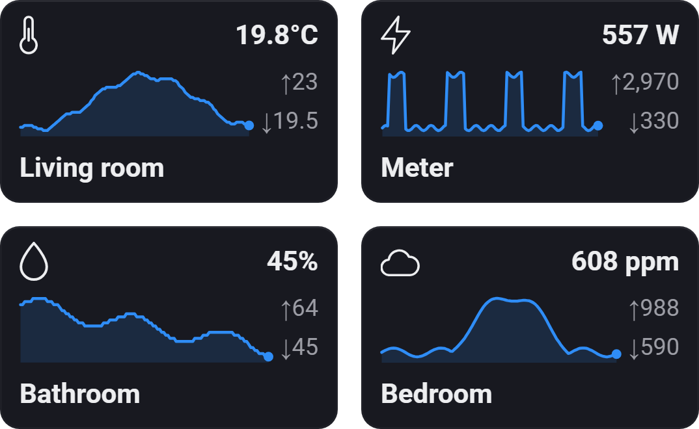

Device Values' tiles with a small live chart of each value and its highest and lowest.

**Settings:** up to six values, time span (1 hour to 7 days, today or yesterday, or this or last week, month or year), 2 or 1 per row, [colour style](#colour-style), [rename tiles](#tile-names).

## Thermostat Presets
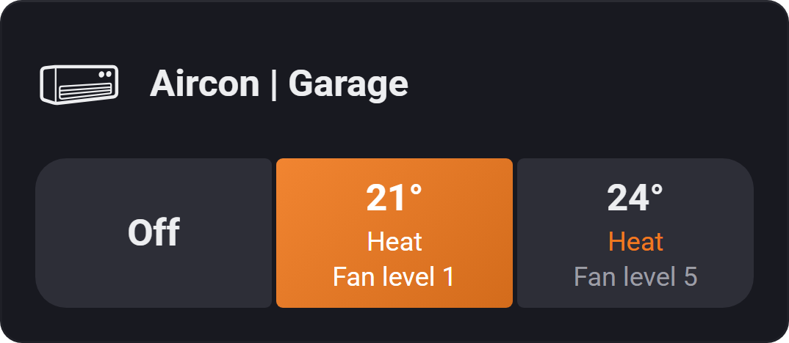

Three one-tap presets for a thermostat, heat pump or air conditioner, such as *Off*, *Heat 21°* and *Heat 24° · Fan level 5*. The matching preset lights up; a preset without a temperature shows the setpoint under the name. Tap the name for the controls: power, the temperature and every mode, fan or swing setting of the device.

Flow cards: *Run [button]*, the condition *[button] is active* and the trigger *[button] was tapped*, with the thermostat and the button's text as tags; the trigger also takes *Any button*. Each picks a button of a widget on one of your dashboards and follows that button's settings. Buttons on Homey's own dashboards are listed with an [API key](#api-key) that has the **Homey** permission; those on web dashboards need none.

**Settings:** the device, a title in place of its name, a value to show beside it (any device value, such as the room temperature), compact layout, [colour style](#colour-style), and per button: power, mode, temperature and one extra option such as the fan speed.

## Timers
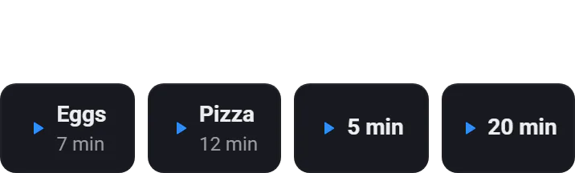

Up to four preset buttons, such as *Eggs · 7 min*. A started timer takes their place: tap to pause, **+1** for a minute more, **✕** to cancel. It beeps and turns red when done. The timer runs on Homey, so every screen sees it and the Flow card **A timer on the Timers widget finished** fires with no dashboard open.

**Settings:** colour, [colour style](#colour-style), four presets with minutes and an optional name, sound.

## Value Matrix

Any devices against any values, in one table. Pick the devices, then up to six values for the columns (temperature, humidity, CO₂, power, battery: any number a device has). The rows are the devices' Homey rooms, each cell the average of the room's devices, or the devices themselves with *Rows: Devices*. A cell is green (OK) inside the column's range, orange (Warning) outside it, and red (Alert) once it's past by half the range; it's striped where a row has no such value.

Type a column's OK range in the value's unit, such as `18–24`, `<1000` or `>10`, or `–` for none. Left empty, the values Room Health knows (temperature in °C, humidity, CO₂, radon, PM2.5, PM10, VOC in ppb) get [its ranges](#room-health), and other values none. The header is the unit (°C, %) or a short name, unless you type your own.

**Settings:** devices, [rename tiles](#tile-names), [colour style](#colour-style), rooms or devices as rows, show legend, and per column the value, its OK range and its header.

## Variable Presets

One Logic variable with two to four buttons, each setting it to a value you pick, such as *Home*, *Away* and *Night* for a house mode, or two setpoints. It looks like Thermostat Presets: the button matching the variable lights up in your colour, and when none does, the name shows its value. A yes/no variable without buttons set gets Yes and No. Needs an [API key](#api-key) with **Variables** to change the variable.

**Settings:** the variable, a title instead of its name, an icon, compact layout, the button colour, [colour style](#colour-style), and per button: the value (Yes or No, a number or a text, as the variable is; pick the variable first) and a label.

## Variables

Logic variables as compact rows with their full name: a switch for yes/no, − and + for a number, and the text for a string. Tap a number or text to type a value. Needs an [API key](#api-key) with **Variables** to change them. Read only shows the values without anything to tap (a dot and Yes/No for yes/no), and needs no key.

**Settings:** up to ten variables, 1 or 2 columns, colour, [colour style](#colour-style), read only, the − and + step, the lowest and highest number, [rename tiles](#tile-names).

## Weather Forecast

The next 36 hours from [MET Norway](https://www.met.no/en) ([yr.no](https://www.yr.no)), hour by hour, with today's and tomorrow's high and low. Swipe sideways to see further ahead.

**Settings:** compact or detailed, one or two rows, 1–3 hours per column, colour style: Standard, Warm and cold (coloured temperatures) or [Vivid](#colour-style) (the card on a gradient for the current weather).

Weather data from MET Norway, licensed under [CC BY 4.0](https://creativecommons.org/licenses/by/4.0/). Icons: [Yr's weather symbols](https://github.com/metno/weathericons) (MIT).

## Web Page
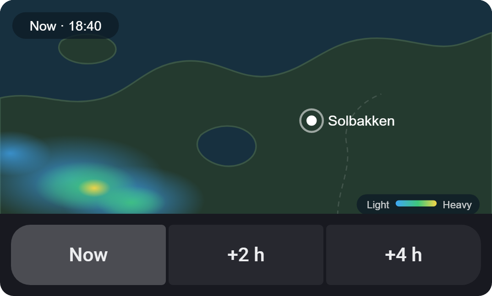

A web page you pick, drawn at the width and height you set and scaled to fill the widget without borders: set them to a fixed-size gadget's size, and it fills the widget on a phone and a tablet alike. Links on the page never open, and unless you let the page be tapped, taps are ignored and a swipe scrolls the dashboard. Two to four buttons in a row under the page switch between their addresses (for a map, the same address with another zoom on each); the widget always opens on the first. `{lat}` and `{lon}` in an address become the Homey's location. Many sites don't allow being shown inside another page (Google, YouTube and most news sites among them): the widget says so, and a site's embed or widget address often works instead. You're responsible for following the terms of the site you show.

**Settings:** address, page width and height, let the page be tapped, reload every (15 minutes keeps live data current on a screen that's always on), up to four buttons (a name and an address).

## Web dashboards
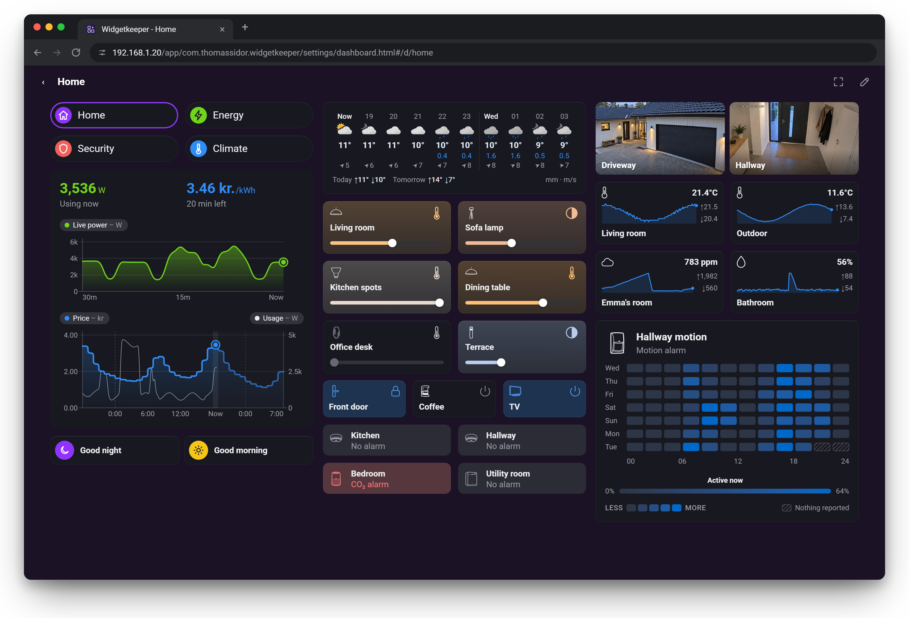

Your Widgetkeeper widgets in any browser at home, or [away from home](#away-from-home): a wall tablet, an old iPad, a computer or a TV. They're the same widgets, with the same settings and live updates as on a Homey dashboard, on dashboards you build on the page itself. The dashboards are kept on your Homey, so every browser shows the same ones.

### Getting started
1. Open **Apps → Widgetkeeper → Configure** in the Homey app and turn on **Web dashboards**.
2. Open the address shown there in a browser on your home network: `http://<your Homey's address>/app/com.thomassidor.widgetkeeper/settings/dashboard.html`.
3. Paste a Homey API key ([which permissions](#web-dashboards-key)), and the web dashboards password if you set one.

### Your dashboards
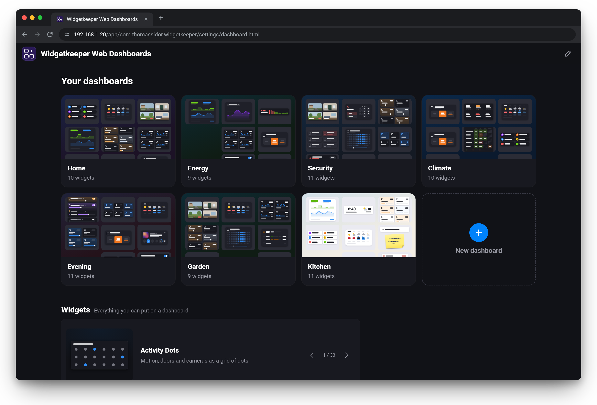

The front page shows every dashboard as a card with a miniature of its widgets, then the widgets you can add. The pen at the top puts it in edit mode: drag the dashboards into order, duplicate one (with its tile names), delete one with a second tap, or hide the widgets. Its **Settings** has the [backup](#backup) and, for this browser only:

- **Keep screen on** while the page is open, for a wall tablet. Browsers only allow this over HTTPS, as on the [away from home](#away-from-home) address; elsewhere the page plays a silent video instead, which works on iPads and iPhones but not in every browser. Where it doesn't, turn off sleep in the device's own settings.
- **Dim**: darkens the whole page, up to 80 %, for a wall tablet at night.
- **Forget the key**.

### Building a dashboard
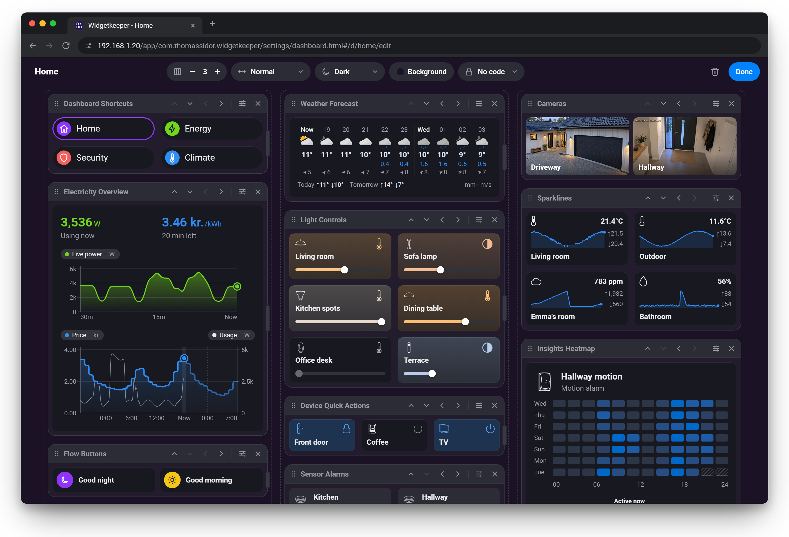

- **Columns and widgets:** one to six columns. Add widgets per column, move them by dragging their bar or with the arrows, and remove them with a second tap.
- **Column width:** Normal, Narrow (a phone's width, as on a Homey dashboard), Wide, or Fit to window, where the columns share the window's width.
- **Wide widgets:** drag the handle on a widget's right edge (or set **Width** in its settings) to make it span two or more columns, such as a large camera or chart. The columns it covers keep their own widgets above and below it: drag one above or under it. On a phone, where there's one column, it's as wide as the rest.
- **Settings:** the same as on a Homey dashboard, in cards: the devices, the general settings, and a folding card per button, tile or column that sums up what's set. Devices are picked from a list grouped by room, with a search.
- **Look:** light, dark or automatic, and a background per dashboard (Default, Black or White, Slate, Ocean, Forest, Plum, Berry, Sand), each with a light and a dark shade. The sun button in the bar switches between light and dark in this browser only.
- **Full screen:** the corner button gives the whole screen to the dashboard.
- **A menu:** put [Dashboard Shortcuts](#dashboard-shortcuts) on every dashboard to jump between them.
- **Popups:** Flows can show a message or ask Yes or No over a dashboard, in every browser showing it, with a camera's picture if you like. See [Popups](#popups).

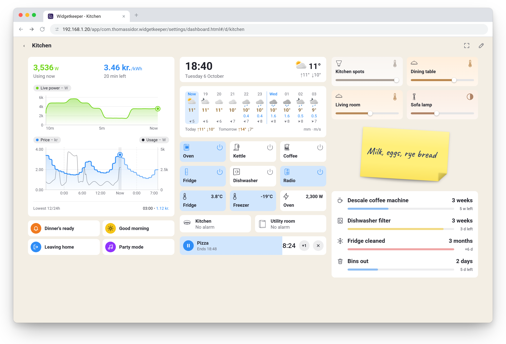

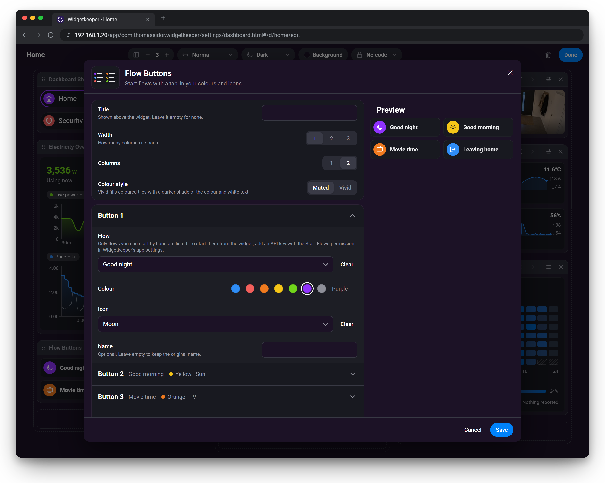

### Widgets from other apps
*Add widget* also lists your other apps' widgets under **Other apps**, with their own settings. They need **Homey** in the browser's key, as Homey only lists them with that. They run sealed off, so their code can't read the page or the browser's key. A widget that doesn't work that way can be trusted in its settings (*Trust this widget*); it then runs as on a Homey dashboard and could read the key.

Some widgets are made for the width they have on a Homey dashboard, and come out taller or shorter in a wider column. *Size as on Homey* in their settings lays them out at a phone's width and scales them to fill the column, so they look as on Homey.

### Away from home
Turn on **Remote access** under **Apps → Widgetkeeper → Configure** for a second address, `https://<your Homey's id>.connect.athom.com/app/com.thomassidor.widgetkeeper/settings/dashboard.html`, through Homey's cloud like the Homey app. A browser asks for the API key again there, as each address is its own site. Anyone with the address still needs a key, but a [password](#password) is worth setting too. Unlike the home address, this one is encrypted (HTTPS), so it's also the one to use at home on a network you don't fully trust (see [the key](#web-dashboards-key)).

### Password
On top of the API key, you can set a password under **Apps → Widgetkeeper → Configure**; every browser then asks for it once. Setting, changing or removing it signs every browser out, and repeated wrong passwords lock the sign-in for a while. Changing or removing it asks for the current one; if you forget it, the Flow card **Remove the web dashboards password** removes it.

### Screens without a keyboard
A screen you can't type a key on, such as a Google Nest Hub you cast a dashboard to, or a wall tablet without a keyboard, can sign in with a short code instead. Under **Apps → Widgetkeeper → Configure → Web dashboards → Screens without a keyboard**, tap **Add screen**, give it a name and a personal API key made just for that screen (and the current password, if you've set one). You get a code like `K7QM-3XPA`, the dashboards' address with the code in it, and that address as a QR code:

- Type the code on the screen's key screen in place of the key, or
- open the address on the screen (cast it, scan the QR code or bookmark it): `…/dashboard.html#code=K7QM-3XPA`, or `…/dashboard.html#/d/<dashboard>?code=K7QM-3XPA` to open one dashboard. The screen swaps the code for the key on every load, so a screen that forgets what it stored, as a cast one does, still gets in.

The code is shown only when you add the screen; if it's lost, remove the screen and add it again. Anyone with the code can use the screen's key, so make a key for that screen alone, with no more permission than it needs. **Remove** stops the code and signs that screen out the next time it opens the address; deleting the key under **Settings → API Keys** stops it everywhere. Repeated wrong codes lock every code for a while. Changing the password asks to sign each screen in again with the new one (**Sign in** beside it). Widgetkeeper keeps the screens' keys on the Homey with its other secrets, never in the app settings.

### Code
A dashboard can take a [Keypad](#keypad) code: in its editor, pick one (or Any code) under the lock. Editing it and going back to the dashboards then take the code, so a wall tablet stays on its dashboard and nobody there can change its widgets, a Keypad's code included. The page asks for it and Widgetkeeper checks it; wrong ones lock as at a Keypad. Removing the code under **Keypad codes** opens the dashboard again. Like the Keypad's, it guards the screen, not your Homey: someone with the browser's API key and its developer tools can still get past it.

### Backup
In the front page's **Settings**, **Download backup** saves the dashboards you tick in one file: the layouts, the widgets, their settings and tile names. **Restore backup** lists a file's dashboards; after a second tap, the ones you tick replace those they were saved from (or come back, if deleted), and the others stay as they are. Notes' texts and Days Since's counters aren't included, as Homey's own dashboards share them.

### Web dashboards' key
Each browser connects with a key of its own, kept in that browser:

- A key with the **Homey** permission works. A narrower one hasn't been tried, as Homey doesn't document which permission an app's own API takes.
- A widget that changes something needs that permission in the browser's key too, as in the [API key](#api-key) table, even though the app's key makes the change.
- Likewise, switching a light, a lock, a curtain, a thermostat or a speaker needs permission to control devices in the browser's key (`homey.device.control`, under **Devices**), though Widgetkeeper makes the change. Reading doesn't: the widgets read devices, cameras, Insights and variables with Widgetkeeper's own permissions, so a browser that may open the page sees everything the widgets show, whatever its key.
- The Smart Stack and [other apps' widgets](#widgets-from-other-apps) need **Homey**.
- The home address is plain HTTP, as the Homey serves it: the key (and the password's sign-in) goes unencrypted over your home network with every request, so anything that can watch that network could read it. On a network you don't fully trust, such as one guests share, use the [away from home](#away-from-home) address, which is encrypted, at home too. Give each browser its own key, so you can revoke a lost tablet's under **Settings → API Keys** without touching the others.

Turning web dashboards off keeps them on your Homey for when you turn them on again.

## Dashboard examples
**Home**

**Energy**
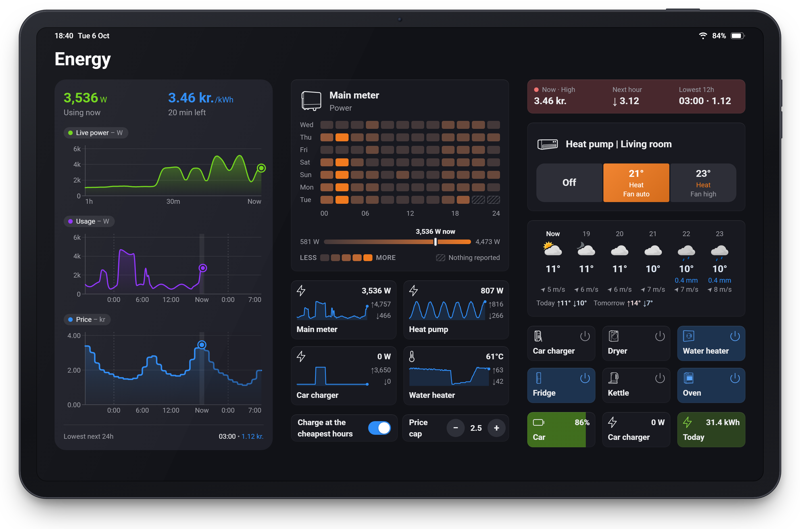

**Security**

**Climate**

**Evening**

**Garden** (light mode)

**Kitchen**

## Colour style
Every widget with a coloured state has a **Colour style** setting: *Muted* is the calmer look, *Vivid* the stronger one, and a colour you pick in the widget follows it.

- Where a colour tints a tile (a Quick Actions tile that's on, a Sensor Alarms alarm, a coloured note, Value Matrix's cells …), Vivid fills the tile with Homey's darker shade, with white text. The charts get a stronger area under their lines.
- Where the colour is already a small solid part (a lit preset button, Insights Heatmap's cells, Media's play button, Activity Dots' dots), Muted uses the darker shade and Vivid the bright colour.
- Days Since and Room Health are toned down in Muted and in full colour in Vivid. Weather Forecast's *Vivid* puts the card on a gradient for the current weather.

## Device names
If your device names say more than the device, such as *Ceiling lamp | Kitchen*, choose under **Apps → Widgetkeeper → Configure → Device names** which part every widget shows:

- *Full name*: as in Homey (the default).
- *Before the separator*: *Ceiling lamp | Kitchen* shows as *Ceiling lamp*. You type the separator, such as `|` or ` - ` (spaces count, so ` - ` leaves *Wi-Fi plug* whole). With the separator more than once, the part before the first one.
- *After the separator*: *Kitchen | Ceiling lamp* shows as *Ceiling lamp*, the part after the last one.
- *Last word*: *Kitchen ceiling lamp* shows as *lamp*.

A name without the separator shows in full. The page shows a few of your own names as they'll look, and open widgets change at once. The device lists in widget settings, Flow tokens and [names typed on tiles](#tile-names) stay as they are.

## Tile names

Give any tile a name of your own, such as *Sofa corner* for a room's lights, instead of the device's or room's name. Light Controls, Lights by Room (its rooms and lights), Curtains, Device Quick Actions, Sensor Alarms, Room Health, Value Matrix, Device Values, Sparklines, Locks and Doors, Cameras, Variables and (on web dashboards) Dashboard Shortcuts have it.

1. Edit the dashboard, edit the widget, turn on **Rename tiles** (the first setting) and save the widget.
2. Leave the dashboard's edit mode. Each tile now shows a text field: type its name, or leave it empty for the device's (or room's) own.
3. Edit the widget again and turn **Rename tiles** off.

The names belong to that widget: they stay with the right tiles when you rename or reorder devices, and every screen and Smart Stack showing the widget gets them.

## API key
Homey doesn't let apps change variables, start flows, read dashboards or start Moods on their own. For those, create a key in the Homey web app under **Settings → API Keys**, tick the permissions below for the widgets you use, and paste it under **Apps → Widgetkeeper → Configure**. The key stays on your Homey, and that page says what it may do once it's saved.

| What | Permission to tick | Scope |
|---|---|---|
| Variables and Variable Presets: changing a value | **Variables** (View Variables isn't enough) | `homey.logic` |
| Flow Buttons | **Start Flows** | `homey.flow.start` |
| Keypad: a button with a Flow | **Start Flows** | `homey.flow.start` |
| Keypad: a button that sets a variable | **Variables** | `homey.logic` |
| Media's buttons: a flow | **Start Flows** | `homey.flow.start` |
| Media's buttons: the speaker's own actions, such as *Set source to TV*, and its app's | **Flows** (Start Flows isn't enough) | `homey.flow` |
| Light Controls' Room's Moods: starting a Mood | **Set Moods** | `homey.mood.set` |
| Lights by Room: starting a Mood | **Set Moods** | `homey.mood.set` |
| Smart Stack: reading the dashboard | **Homey** (it allows everything, but there's no permission for dashboards alone) | `homey` |

Ticking a group's first box (**Flows**, **Moods**, **Homey**) includes the boxes under it. Everything else needs no key: the widgets read devices, Insights, variables, flows and Moods with Widgetkeeper's own permissions.

## Languages
English, Dutch, German, French, Italian, Swedish, Norwegian, Spanish, Danish, Russian, Polish, Korean and Arabic, following Homey's language.

## Installation
Install Widgetkeeper from the [Homey App Store](https://homey.app/a/com.thomassidor.widgetkeeper/). The [test version](https://homey.app/a/com.thomassidor.widgetkeeper/test/) has the next version's widgets before they go live. To install it from source with the Homey CLI, see [CONTRIBUTING.md](CONTRIBUTING.md).

## Troubleshooting
If a widget doesn't work as expected, open **Apps → Widgetkeeper → Configure** in the Homey app: its **Diagnostics** report has a device's full details once you pick it, and no passwords, API keys or camera addresses. Include it when you [open an issue](https://github.com/thomassidor/widgetkeeper/issues).

## Changelog
See [CHANGELOG.md](CHANGELOG.md).

## License
[MIT](LICENSE)
