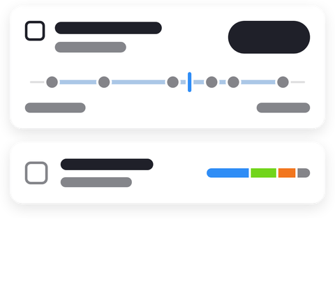
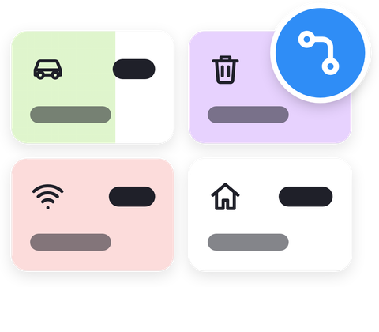
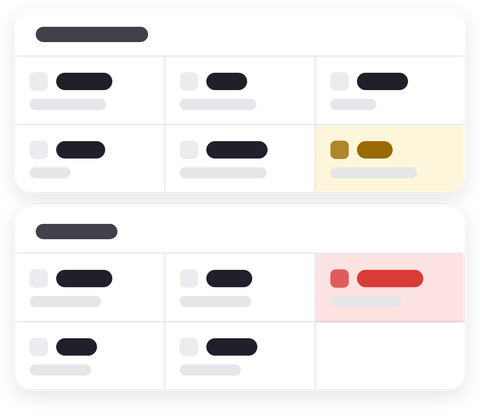
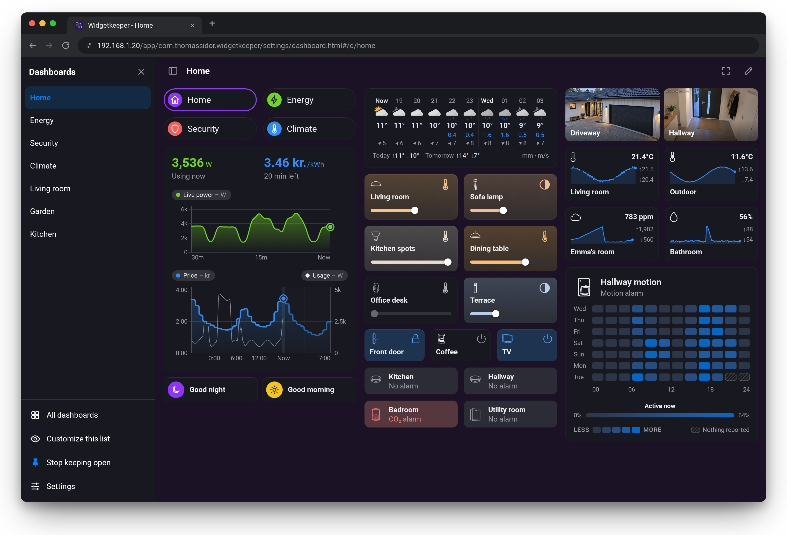
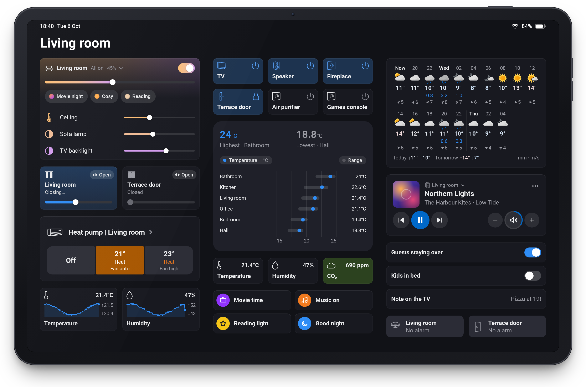

# Widgetkeeper

Extra dashboard widgets for Homey Pro, made to sit naturally next to Homey's own with the same look and feel. Use them on Homey's dashboards, or on [web dashboards](#web-dashboards) you build yourself and open in any browser: a wall tablet, an old iPad, a computer or a TV.

**Contents:** [Widgets](#widgets) · [Web dashboards](#web-dashboards) · [Dashboard examples](#dashboard-examples) · [Colour style](#colour-style) · [Device names](#device-names) · [Time format](#time-format) · [Tile names](#tile-names) · [API key](#api-key) · [Installation](#installation) · [Troubleshooting](#troubleshooting)

## Widgets
Every widget follows Homey's light and dark mode and is translated into all 13 of Homey's languages. Tap one for what it does and its settings.

<a href="docs/widgets/sensordots.md"><picture><source media="(prefers-color-scheme: dark)" srcset="docs/previews/sensordots-dark.png"></picture></a>
<a href="docs/widgets/sensordots.md"><b>Activity Dots</b></a> 
Many motion, contact and vibration sensors at a glance, as dots that change colour when active 

<a href="docs/widgets/cameras.md"><picture><source media="(prefers-color-scheme: dark)" srcset="docs/previews/cameras-dark.png"></picture></a>
<a href="docs/widgets/cameras.md"><b>Cameras</b></a> 
Two to six cameras in one grid of snapshots; tap one to watch it live 

<a href="docs/widgets/charts.md"><picture><source media="(prefers-color-scheme: dark)" srcset="docs/previews/charts-dark.png"></picture></a>
<a href="docs/widgets/charts.md"><b>Chart · Basic</b></a> 
How did it go? One value over any span up to two years, or against the period before or a second value 

<a href="docs/widgets/typicalday.md"><picture><source media="(prefers-color-scheme: dark)" srcset="docs/previews/typicalday-dark.png"></picture></a>
<a href="docs/widgets/typicalday.md"><b>Chart · Daily Profile</b></a> 
Today's line over the usual day and its spread: is today unusual? 

<a href="docs/widgets/gauge.md"><picture><source media="(prefers-color-scheme: dark)" srcset="docs/previews/gauge-dark.png"></picture></a>
<a href="docs/widgets/gauge.md"><b>Chart · Gauge</b></a> 
One value now on a bar or dial, green to red by level if you like: is the air still good? 

<a href="docs/widgets/lines.md"><picture><source media="(prefers-color-scheme: dark)" srcset="docs/previews/lines-dark.png"></picture></a>
<a href="docs/widgets/lines.md"><b>Chart · Lines</b></a> 
Up to six values over time on one chart, a line each: every room's temperature side by side 

<a href="docs/widgets/dailyrange.md"><picture><source media="(prefers-color-scheme: dark)" srcset="docs/previews/dailyrange-dark.png"></picture></a>
<a href="docs/widgets/dailyrange.md"><b>Chart · Min/Max</b></a> 
Each day's lowest to highest as a bar: how much did it swing? 

<a href="docs/widgets/compare.md"><picture><source media="(prefers-color-scheme: dark)" srcset="docs/previews/compare-dark.png"></picture></a>
<a href="docs/widgets/compare.md"><b>Chart · Ranking</b></a> 
One value across devices, now and its range today, sorted: which room is warmest? 

<a href="docs/widgets/scatter.md"><picture><source media="(prefers-color-scheme: dark)" srcset="docs/previews/scatter-dark.png"></picture></a>
<a href="docs/widgets/scatter.md"><b>Chart · Scatter (XY)</b></a> 
One value against another, a dot an hour: does the heat pump work harder when it's colder? 

<a href="docs/widgets/stacked.md"><picture><source media="(prefers-color-scheme: dark)" srcset="docs/previews/stacked-dark.png"></picture></a>
<a href="docs/widgets/stacked.md"><b>Chart · Stacked</b></a> 
Several values stacked on one time axis, the rest of a total as Other: who uses the power? 

<a href="docs/widgets/timeline.md"><picture><source media="(prefers-color-scheme: dark)" srcset="docs/previews/timeline-dark.png"></picture></a>
<a href="docs/widgets/timeline.md"><b>Chart · Timeline</b></a> 
When was it on, open or moving? A row per value over the day 

<a href="docs/widgets/totals.md"><picture><source media="(prefers-color-scheme: dark)" srcset="docs/previews/totals-dark.png"></picture></a>
<a href="docs/widgets/totals.md"><b>Chart · Totals</b></a> 
How much a value went up per hour, day or month (kWh, rain, hours of TV), like the Energy tab 

<a href="docs/widgets/clock.md"><picture><source media="(prefers-color-scheme: dark)" srcset="docs/previews/clock-dark.png"></picture></a>
<a href="docs/widgets/clock.md"><b>Clock</b></a> 
The time and the date, with the weather now and today's high and low 

<a href="docs/widgets/combined.md"><picture><source media="(prefers-color-scheme: dark)" srcset="docs/previews/combined-dark.png"></picture></a>
<a href="docs/widgets/combined.md"><b>Combined Value</b></a> 
One value of several devices as one: the average, the sum, the lowest or the highest 

<a href="docs/widgets/curtains.md"><picture><source media="(prefers-color-scheme: dark)" srcset="docs/previews/curtains-dark.png"></picture></a>
<a href="docs/widgets/curtains.md"><b>Curtains</b></a> 
Curtains and blinds that open or close with one tap, with a slider for anything in between 

<a href="docs/widgets/shortcuts.md"><picture><source media="(prefers-color-scheme: dark)" srcset="docs/previews/shortcuts-dark.png"></picture></a>
<a href="docs/widgets/shortcuts.md"><b>Dashboard Shortcuts</b></a> (web dashboards only) 
Your other web dashboards as buttons in your colours and icons, a menu for every dashboard 

<a href="docs/widgets/dayssince.md"><picture><source media="(prefers-color-scheme: dark)" srcset="docs/previews/dayssince-dark.png"></picture></a>
<a href="docs/widgets/dayssince.md"><b>Days Since</b></a> 
How long since the plants were watered or the filter changed, amber and then red when it's due; tap to reset 

<a href="docs/widgets/quickactions.md"><picture><source media="(prefers-color-scheme: dark)" srcset="docs/previews/quickactions-dark.png"></picture></a>
<a href="docs/widgets/quickactions.md"><b>Device Quick Actions</b></a> 
Compact tiles that run a device's quick action with one tap 

<a href="docs/widgets/values.md"><picture><source media="(prefers-color-scheme: dark)" srcset="docs/previews/values-dark.png"></picture></a>
<a href="docs/widgets/values.md"><b>Device Values</b></a> 
Compact tiles that each show one value, such as a temperature, power or on/off 

<a href="docs/widgets/electricity.md"><picture><source media="(prefers-color-scheme: dark)" srcset="docs/previews/electricity-dark.png"></picture></a>
<a href="docs/widgets/electricity.md"><b>Electricity Overview</b></a> 
Live power use, hourly electricity prices and usage history on one card 

<a href="docs/widgets/price.md"><picture><source media="(prefers-color-scheme: dark)" srcset="docs/previews/price-dark.png"></picture></a>
<a href="docs/widgets/price.md"><b>Energy Price Strip</b></a> 
The electricity price now and the coming hours as small bars, green, yellow or red 

<a href="docs/widgets/flows.md"><picture><source media="(prefers-color-scheme: dark)" srcset="docs/previews/flows-dark.png"></picture></a>
<a href="docs/widgets/flows.md"><b>Flow Buttons</b></a> 
Start flows with one tap: a round button in the colour and icon you pick, with the flow's name 

<a href="docs/widgets/flowtiles.md"><picture><source media="(prefers-color-scheme: dark)" srcset="docs/previews/flowtiles-dark.png"></picture></a>
<a href="docs/widgets/flowtiles.md"><b>Flow Tiles</b></a> 
Tiles your Flows write: a text or number, an icon, a colour and a fill, and a tap that starts a Flow 

<a href="docs/widgets/heatmap.md"><picture><source media="(prefers-color-scheme: dark)" srcset="docs/previews/heatmap-dark.png"></picture></a>
<a href="docs/widgets/heatmap.md"><b>Insights Heatmap</b></a> 
A week of one value (light, temperature, motion …) as a grid of weekdays and hours 

<a href="docs/widgets/keypad.md"><picture><source media="(prefers-color-scheme: dark)" srcset="docs/previews/keypad-dark.png"></picture></a>
<a href="docs/widgets/keypad.md"><b>Keypad</b></a> 
Up to three buttons behind an optional code that start Flows or set a device or variable, with its state beside them 

<a href="docs/widgets/lights.md"><picture><source media="(prefers-color-scheme: dark)" srcset="docs/previews/lights-dark.png"></picture></a>
<a href="docs/widgets/lights.md"><b>Light Controls</b></a> 
Compact light tiles with brightness, colour and colour temperature: six lights in the space of three 

<a href="docs/widgets/lightrooms.md"><picture><source media="(prefers-color-scheme: dark)" srcset="docs/previews/lightrooms-dark.png"></picture></a>
<a href="docs/widgets/lightrooms.md"><b>Lights by Room</b></a> 
Every room's lights on a card: switch and dim a room, or open it for each light and the room's Moods 

<a href="docs/widgets/locks.md"><picture><source media="(prefers-color-scheme: dark)" srcset="docs/previews/locks-dark.png"></picture></a>
<a href="docs/widgets/locks.md"><b>Locks and Doors</b></a> 
One line that says whether every lock and door is locked and closed 

<a href="docs/widgets/media.md"><picture><source media="(prefers-color-scheme: dark)" srcset="docs/previews/media-dark.png"></picture></a>
<a href="docs/widgets/media.md"><b>Media</b></a> 
A speaker with its album art, mute, a volume that never overshoots and buttons for its sources 

<a href="docs/widgets/textline.md"><picture><source media="(prefers-color-scheme: dark)" srcset="docs/previews/textline-dark.png"></picture></a>
<a href="docs/widgets/textline.md"><b>Notes</b></a> 
A note on a tile or a handwritten Post-it, typed in or written by your Flows 

<a href="docs/widgets/pollen.md"><picture><source media="(prefers-color-scheme: dark)" srcset="docs/previews/pollen-dark.png"></picture></a>
<a href="docs/widgets/pollen.md"><b>Pollen and UV</b></a> 
Today's pollen levels and the UV peak, in Europe 

<a href="docs/widgets/popups.md"><picture><source media="(prefers-color-scheme: dark)" srcset="docs/previews/popups-dark.png"></picture></a>
<a href="docs/widgets/popups.md"><b>Popups</b></a> 
A Flow's message or question with buttons of your own, with a picture if you like, in front of everything on a phone, tablet or web dashboard 

<a href="docs/widgets/roomhealth.md"><picture><source media="(prefers-color-scheme: dark)" srcset="docs/previews/roomhealth-dark.png"></picture></a>
<a href="docs/widgets/roomhealth.md"><b>Room Health</b></a> 
Each room's temperature, humidity and air quality at a glance, turning yellow to red when something is off 

<a href="docs/widgets/sensoralarms.md"><picture><source media="(prefers-color-scheme: dark)" srcset="docs/previews/sensoralarms-dark.png"></picture></a>
<a href="docs/widgets/sensoralarms.md"><b>Sensor Alarms</b></a> 
Tiles that show a sensor's alarm and turn red when one is on 

<a href="docs/widgets/stack.md"><picture><source media="(prefers-color-scheme: dark)" srcset="docs/previews/stack-dark.png"></picture></a>
<a href="docs/widgets/stack.md"><b>Smart Stack</b></a> 
Several widgets in one spot, one at a time, with the one that matters brought forward 

<a href="docs/widgets/spacer.md"><picture><source media="(prefers-color-scheme: dark)" srcset="docs/previews/spacer-dark.png"></picture></a>
<a href="docs/widgets/spacer.md"><b>Spacer</b></a> 
Empty space of the height you set, to line up widgets across columns 

<a href="docs/widgets/sparklines.md"><picture><source media="(prefers-color-scheme: dark)" srcset="docs/previews/sparklines-dark.png"></picture></a>
<a href="docs/widgets/sparklines.md"><b>Sparklines</b></a> 
Tiles with a small chart of a value over the last hour, day or week, with its lowest and highest 

<a href="docs/widgets/thermostat.md"><picture><source media="(prefers-color-scheme: dark)" srcset="docs/previews/thermostat-dark.png"></picture></a>
<a href="docs/widgets/thermostat.md"><b>Thermostat Presets</b></a> 
Three one-tap presets for a thermostat, heat pump or air conditioner 

<a href="docs/widgets/timers.md"><picture><source media="(prefers-color-scheme: dark)" srcset="docs/previews/timers-dark.png"></picture></a>
<a href="docs/widgets/timers.md"><b>Timers</b></a> 
Kitchen timers from one-tap presets, with a Flow card when one runs out 

<a href="docs/widgets/valueboard.md"><picture><source media="(prefers-color-scheme: dark)" srcset="docs/previews/valueboard-dark.png"></picture></a>
<a href="docs/widgets/valueboard.md"><b>Value Board</b></a> 
Every value of the devices you pick in one widget, by room or by device 

<a href="docs/widgets/valuematrix.md"><picture><source media="(prefers-color-scheme: dark)" srcset="docs/previews/valuematrix-dark.png"></picture></a>
<a href="docs/widgets/valuematrix.md"><b>Value Matrix</b></a> 
Devices or rooms against the values you choose, in one table, each cell green, orange or red by its range 

<a href="docs/widgets/varpresets.md"><picture><source media="(prefers-color-scheme: dark)" srcset="docs/previews/varpresets-dark.png"></picture></a>
<a href="docs/widgets/varpresets.md"><b>Variable Presets</b></a> 
Two to four one-tap buttons that set a variable to the values you pick, like Thermostat Presets 

<a href="docs/widgets/variables.md"><picture><source media="(prefers-color-scheme: dark)" srcset="docs/previews/variables-dark.png"></picture></a>
<a href="docs/widgets/variables.md"><b>Variables</b></a> 
Compact rows to switch variables on and off or change a number or text, with the full name 

<a href="docs/widgets/weather.md"><picture><source media="(prefers-color-scheme: dark)" srcset="docs/previews/weather-dark.png"></picture></a>
<a href="docs/widgets/weather.md"><b>Weather Forecast</b></a> 
The next 36 hours, hour by hour, from MET Norway (yr.no) 

<a href="docs/widgets/webpage.md"><picture><source media="(prefers-color-scheme: dark)" srcset="docs/previews/webpage-dark.png"></picture></a>
<a href="docs/widgets/webpage.md"><b>Web Page</b></a> 
Any web page, scaled to fill the widget, with buttons to switch between addresses 

## Web dashboards

Your Widgetkeeper widgets in any browser: a wall tablet, an old iPad, a computer or a cast screen. They're the same widgets, with the same settings and live updates as on a Homey dashboard. The dashboards are kept on your Homey, so every browser shows the same ones.

### Getting started
1. In the Homey app, open **Apps → Widgetkeeper → Configure** and turn on **Web dashboards**.
2. Under **Screens and browsers**, add the browser to get its [sign-in code](#screens-and-browsers).
3. On your home network, open `http://<your Homey's address>/app/com.thomassidor.widgetkeeper/settings/dashboard.html` and type the code.

### Building a dashboard

- One to six columns, Normal, Narrow, Wide or Fit to window. Drag widgets to move them, copy one to this or another dashboard, or drag its right edge to span several columns.
- **Add widget** has a search and groups (Lights and control, Charts, Energy …).
- The settings are the same as on a Homey dashboard, in cards, with devices picked by room.
- Light, dark or automatic, with a background per dashboard: a calm tint or a colour of your own.
- Add a [Popups](docs/widgets/popups.md) widget for messages from Flows, and [Dashboard Shortcuts](docs/widgets/shortcuts.md) for big buttons to your other dashboards on a wall tablet, beside the [side pane](#moving-between-dashboards).
- For a kiosk browser such as Fully Kiosk, add `?kiosk=1` to the address to hide the dashboard's bar. Add `&nav=1` too to keep the side pane there.

### Moving between dashboards

The button at the left of the bar opens a side pane with your dashboards, under the front page's sections. It floats over the widgets until you pick one or tap outside it. On a window at least 1000 px wide, the pin keeps it open beside them, and it stays open as you change dashboards.

**Customize** at the bottom of the pane chooses what this browser lists: hide a dashboard or a whole section, and drag them into the order you want. Each browser has its own list, so a hallway tablet can show just three dashboards. Hidden dashboards stay on the front page, and new ones appear in the pane by themselves.

The front page lists the dashboards; the pen reorders, duplicates and deletes them. **Settings** at the bottom of the [side pane](#moving-between-dashboards) has **Keep screen on**, **Dim**, **Dim at set times**, **Rotate dashboards** and **Sign out** for this browser, and the [backup](#backup).

- **Dim at set times:** a second level between two times, by the device's clock. The Flow card *Dim the web dashboards* sets a level too, on every browser or on those showing a dashboard with a [Popups](docs/widgets/popups.md) widget of that screen name. It lasts until another Flow, a moved slider, or the set times next start or end.
- **Rotate dashboards:** tick two or more dashboards and how many seconds each shows (at least 10). A touch pauses it for a minute, and it waits while a dialog, a popup or the editor is open.

### Screens and browsers
Each browser signs in with a code of its own, backed by its own Homey API key:

1. Under **Configure → Web dashboards → Screens and browsers**, tap **Add a screen or browser**.
2. In the Homey web app (**Settings → API Keys**), make a key with **Devices** and what the [API key](#api-key) table lists for your widgets, and paste it.
3. Type the code you get, such as `K7QM-3XPA`, on the page, or open its address or QR code on the screen (handy for one you can't type on, such as a cast Nest Hub).

**Opens on** sends a screen straight to one dashboard. **Remove** stops a code; for a lost device, also delete its key in the Homey web app. You can also paste an API key on the page instead of using a code.

### Sync with a Homey dashboard
**Sync** in a dashboard's editor links it to a dashboard in the Homey app, or makes a new one, and keeps the two the same, both ways: on demand, when it's opened and every night (the time is in the side pane's **Settings**).

- The first sync copies the side you pick. After that, changes on either side reach the other; when the same thing was changed differently on both, the side you picked wins.
- Homey's own widgets, such as light groups and device tiles, stay on Homey and don't show on the web.
- It needs a personal [API key](#api-key) with the **Homey** permission in the app settings.

### Code
Give a dashboard a [Keypad](docs/widgets/keypad.md) code (the lock in its editor), and leaving or editing it asks for the code, so a wall tablet stays on its dashboard. It guards the screen, not your Homey.

### Away from home
**Remote access** under **Configure** adds a second address through Homey's cloud: `https://<your Homey's id>.connect.athom.com/app/com.thomassidor.widgetkeeper/settings/dashboard.html`. It's encrypted, so it's also the one to use at home on a network you don't fully trust.

### Password
You can set a password under **Web dashboards → Away from home**, which every browser is asked for once, on top of its code. If you forget it, the Flow card **Remove the web dashboards password** removes it.

### Backup
In the side pane's **Settings**, **Download backup** and **Restore backup** save and bring back the dashboards you tick, with their widgets, settings and tile names. Notes' texts and Days Since's counters aren't included.

### Widgets from other apps
*Add widget* also lists your other apps' widgets. They need a key with the **Homey** permission and run sealed off from the page; *Trust this widget* runs one as on Homey, and *Size as on Homey* scales one made for a phone's width.

### Web dashboards' key
- A widget that changes something needs that permission in the browser's key too (see [API key](#api-key)), and switching devices needs **Devices**. Reading needs nothing extra.
- The Smart Stack and widgets from other apps need **Homey**.
- The home address is plain HTTP, so the key crosses your network unencrypted. On a network you don't fully trust, use the [away from home](#away-from-home) address. Give each screen its own key, so a lost one can be revoked alone.

Turning web dashboards off keeps them on your Homey.

## Dashboard examples
**Home**

**Energy**

**Security**

**Climate**

**Living room**

**Garden** (light mode)

**Kitchen**

## Colour style
Every widget with a coloured state has a **Colour style** setting: *Muted* is the calmer look, *Vivid* the stronger one, and a colour you pick in the widget follows it. Weather Forecast has a *Vivid* of its own, which puts the card on a gradient for the current weather.

## Device names
If your device names say more than the device, such as *Ceiling lamp | Kitchen*, choose under **Apps → Widgetkeeper → Configure → Device names** which part every widget shows: the full name (the default), the part before or after a separator you type, the last word, or the name without its room (*Kitchen ceiling lamp* in the Kitchen shows as *Ceiling lamp*).

The page shows a few of your own names as they'll look. Device lists in widget settings, Flow tokens and [names typed on tiles](#tile-names) stay as they are.

## Time format
Every widget that shows a time (the Clock, the charts' axes, the price strips, Timers' end times, *since 18:17* …) shows it in 24 or 12 hours as you choose under **Apps → Widgetkeeper → Configure → Time format**. *Automatic* (the default) follows the language of the phone or browser that shows the dashboard. Open widgets change at once.

## Tile names

Give a tile a name of your own, such as *Sofa corner*, instead of the device's or room's name, in any widget with a **Rename tiles** setting:

1. Edit the widget, turn on **Rename tiles** and save.
2. Leave the dashboard's edit mode and type the names on the tiles.
3. Edit the widget again and turn **Rename tiles** off.

The names stay with the right tiles when you rename or reorder devices.

## API key
Homey doesn't let apps change variables, start flows, read dashboards or start Moods on their own. For those, create a key in the Homey web app under **Settings → API Keys**, tick the permissions below for the widgets you use, and paste it under **Apps → Widgetkeeper → Configure**. The key stays on your Homey, and that page says what it may do once it's saved.

| What | Permission to tick | Scope |
|---|---|---|
| Variables and Variable Presets: changing a value | **Variables** (View Variables isn't enough) | `homey.logic` |
| Flow Buttons | **Start Flows** | `homey.flow.start` |
| Keypad: a button with a Flow | **Start Flows** | `homey.flow.start` |
| Keypad: a button that sets a variable | **Variables** | `homey.logic` |
| Media's buttons: a flow | **Start Flows** | `homey.flow.start` |
| Media's buttons: the speaker's own actions, such as *Set source to TV*, and its app's | **Flows** (Start Flows isn't enough) | `homey.flow` |
| Light Controls' Room's Moods: starting a Mood | **Set Moods** | `homey.mood.set` |
| Lights by Room: starting a Mood | **Set Moods** | `homey.mood.set` |
| Smart Stack: reading the dashboard | **Homey** (it allows everything, but there's no permission for dashboards alone) | `homey` |
| Web dashboards: [syncing with a Homey dashboard](#sync-with-a-homey-dashboard) | **Homey** | `homey` |

Ticking a group's first box (**Flows**, **Moods**, **Homey**) includes the boxes under it. Everything else needs no key: the widgets read devices, Insights, variables, flows and Moods with Widgetkeeper's own permissions.

## Languages
English, Dutch, German, French, Italian, Swedish, Norwegian, Spanish, Danish, Russian, Polish, Korean and Arabic, following Homey's language.

## Installation
Install Widgetkeeper from the [Homey App Store](https://homey.app/a/com.thomassidor.widgetkeeper/). The [test version](https://homey.app/a/com.thomassidor.widgetkeeper/test/) has the next version's widgets before they go live. To install it from source with the Homey CLI, see [CONTRIBUTING.md](CONTRIBUTING.md).

## Troubleshooting
If a widget doesn't work as expected, open **Apps → Widgetkeeper → Configure** in the Homey app: its **Diagnostics** report has a device's full details once you pick it, and no passwords, API keys or camera addresses. Include it when you [open an issue](https://github.com/thomassidor/widgetkeeper/issues).

## Changelog
See [CHANGELOG.md](CHANGELOG.md).

## License
[MIT](LICENSE)

Most of the icons in the icon settings are from [Lucide](https://lucide.dev) (ISC, some MIT; [licence](widgets/spacer/public/icons.LICENSE.txt)).
