# Widgetkeeper

Extra dashboard widgets for Homey Pro, made to sit naturally next to Homey's own with the same look and feel.

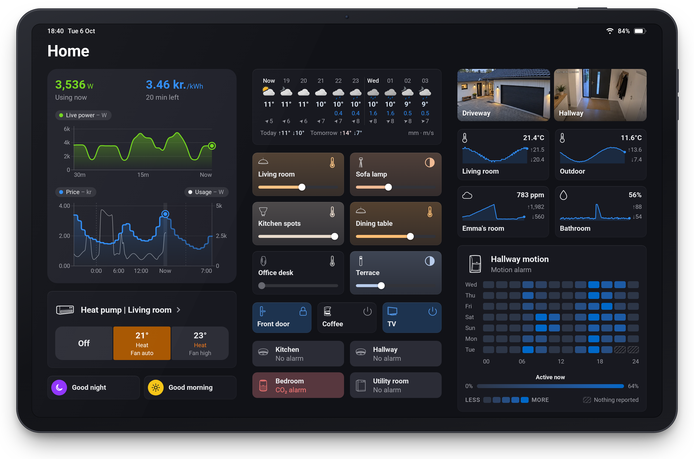

**Contents:** [Widgets](#widgets) · [Web dashboards](#web-dashboards) · [Dashboard examples](#dashboard-examples) · [Colour style](#colour-style) · [Device names](#device-names) · [Tile names](#tile-names) · [API key](#api-key) · [Installation](#installation) · [Troubleshooting](#troubleshooting)

## Widgets
Every widget follows Homey's light and dark mode and is translated into all 13 of Homey's languages. Tap one for what it does and its settings.

<a href="docs/widgets/sensordots.md"><picture><source media="(prefers-color-scheme: dark)" srcset="docs/previews/sensordots-dark.png">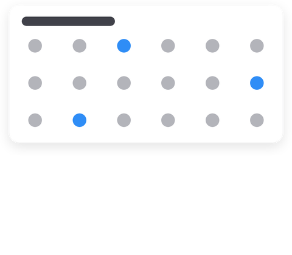</picture></a>
<a href="docs/widgets/sensordots.md"><b>Activity Dots</b></a> 
Many motion, contact and vibration sensors at a glance, as dots that change colour when active 

<a href="docs/widgets/cameras.md"><picture><source media="(prefers-color-scheme: dark)" srcset="docs/previews/cameras-dark.png">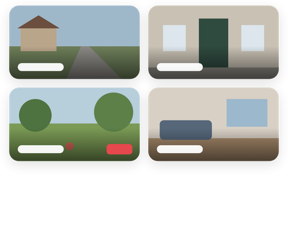</picture></a>
<a href="docs/widgets/cameras.md"><b>Cameras</b></a> 
Two to six cameras in one grid of snapshots; tap one to watch it live 

<a href="docs/widgets/charts.md"><picture><source media="(prefers-color-scheme: dark)" srcset="docs/previews/charts-dark.png">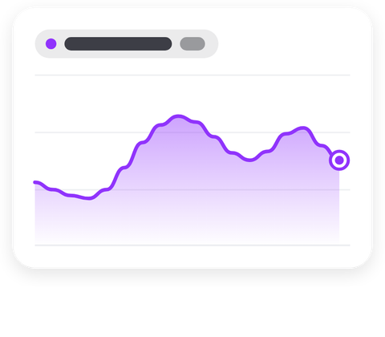</picture></a>
<a href="docs/widgets/charts.md"><b>Chart · Basic</b></a> 
How did it go? One value over any span up to two years, or against the period before or a second value 

<a href="docs/widgets/typicalday.md"><picture><source media="(prefers-color-scheme: dark)" srcset="docs/previews/typicalday-dark.png">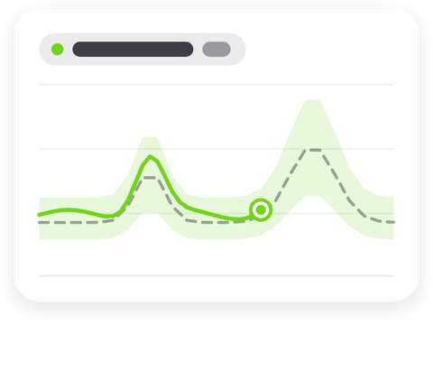</picture></a>
<a href="docs/widgets/typicalday.md"><b>Chart · Daily Profile</b></a> 
Today's line over the usual day and its spread: is today unusual? 

<a href="docs/widgets/gauge.md"><picture><source media="(prefers-color-scheme: dark)" srcset="docs/previews/gauge-dark.png">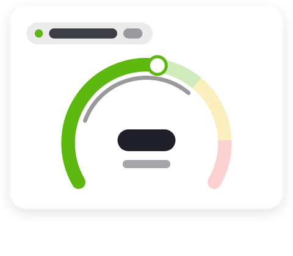</picture></a>
<a href="docs/widgets/gauge.md"><b>Chart · Gauge</b></a> 
One value now on a bar or dial, green to red by level if you like: is the air still good? 

<a href="docs/widgets/lines.md"><picture><source media="(prefers-color-scheme: dark)" srcset="docs/previews/lines-dark.png">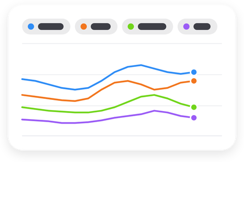</picture></a>
<a href="docs/widgets/lines.md"><b>Chart · Lines</b></a> 
Up to six values over time on one chart, a line each: every room's temperature side by side 

<a href="docs/widgets/dailyrange.md"><picture><source media="(prefers-color-scheme: dark)" srcset="docs/previews/dailyrange-dark.png">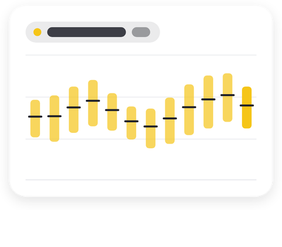</picture></a>
<a href="docs/widgets/dailyrange.md"><b>Chart · Min/Max</b></a> 
Each day's lowest to highest as a bar: how much did it swing? 

<a href="docs/widgets/compare.md"><picture><source media="(prefers-color-scheme: dark)" srcset="docs/previews/compare-dark.png">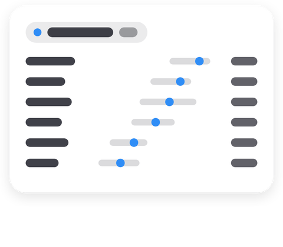</picture></a>
<a href="docs/widgets/compare.md"><b>Chart · Ranking</b></a> 
One value across devices, now and its range today, sorted: which room is warmest? 

<a href="docs/widgets/scatter.md"><picture><source media="(prefers-color-scheme: dark)" srcset="docs/previews/scatter-dark.png">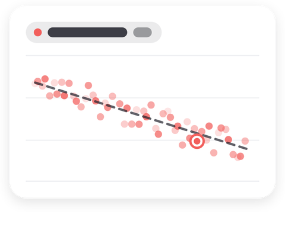</picture></a>
<a href="docs/widgets/scatter.md"><b>Chart · Scatter (XY)</b></a> 
One value against another, a dot an hour: does the heat pump work harder when it's colder? 

<a href="docs/widgets/stacked.md"><picture><source media="(prefers-color-scheme: dark)" srcset="docs/previews/stacked-dark.png">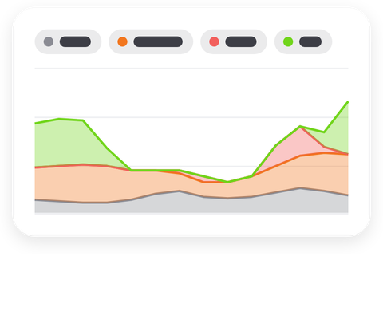</picture></a>
<a href="docs/widgets/stacked.md"><b>Chart · Stacked</b></a> 
Several values stacked on one time axis, the rest of a total as Other: who uses the power? 

<a href="docs/widgets/timeline.md"><picture><source media="(prefers-color-scheme: dark)" srcset="docs/previews/timeline-dark.png">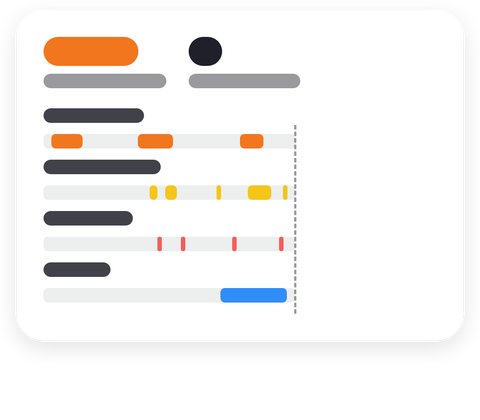</picture></a>
<a href="docs/widgets/timeline.md"><b>Chart · Timeline</b></a> 
When was it on, open or moving? A row per value over the day 

<a href="docs/widgets/totals.md"><picture><source media="(prefers-color-scheme: dark)" srcset="docs/previews/totals-dark.png">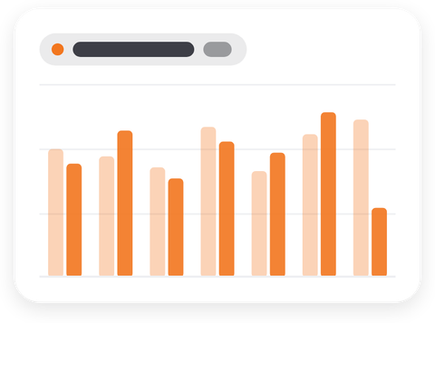</picture></a>
<a href="docs/widgets/totals.md"><b>Chart · Totals</b></a> 
How much a value went up per hour, day or month (kWh, rain, hours of TV), like the Energy tab 

<a href="docs/widgets/clock.md"><picture><source media="(prefers-color-scheme: dark)" srcset="docs/previews/clock-dark.png">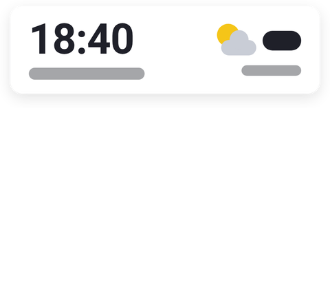</picture></a>
<a href="docs/widgets/clock.md"><b>Clock</b></a> 
The time and the date, with the weather now and today's high and low 

<a href="docs/widgets/curtains.md"><picture><source media="(prefers-color-scheme: dark)" srcset="docs/previews/curtains-dark.png">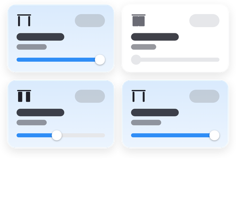</picture></a>
<a href="docs/widgets/curtains.md"><b>Curtains</b></a> 
Curtains and blinds that open or close with one tap, with a slider for anything in between 

<a href="docs/widgets/shortcuts.md"><picture><source media="(prefers-color-scheme: dark)" srcset="docs/previews/shortcuts-dark.png">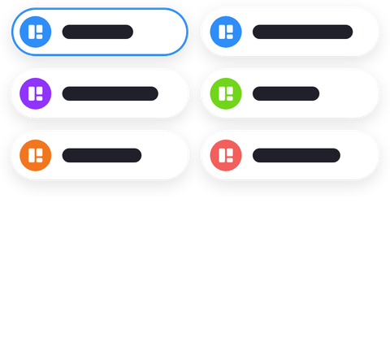</picture></a>
<a href="docs/widgets/shortcuts.md"><b>Dashboard Shortcuts</b></a> (web dashboards only) 
Your other web dashboards as buttons in your colours and icons, a menu for every dashboard 

<a href="docs/widgets/dayssince.md"><picture><source media="(prefers-color-scheme: dark)" srcset="docs/previews/dayssince-dark.png">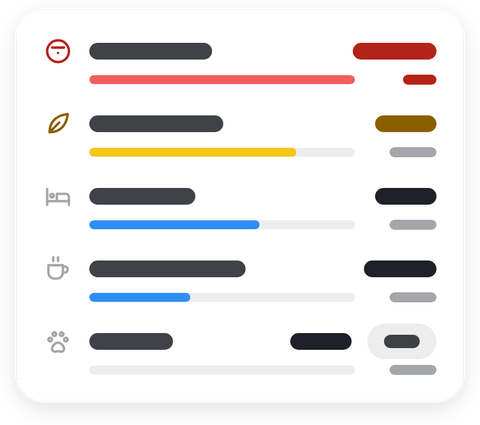</picture></a>
<a href="docs/widgets/dayssince.md"><b>Days Since</b></a> 
How long since the plants were watered or the filter changed, amber and then red when it's due; tap to reset 

<a href="docs/widgets/quickactions.md"><picture><source media="(prefers-color-scheme: dark)" srcset="docs/previews/quickactions-dark.png">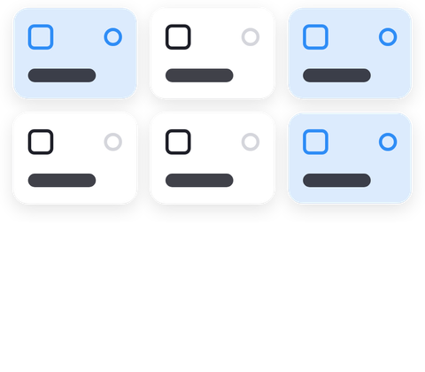</picture></a>
<a href="docs/widgets/quickactions.md"><b>Device Quick Actions</b></a> 
Compact tiles that run a device's quick action with one tap 

<a href="docs/widgets/values.md"><picture><source media="(prefers-color-scheme: dark)" srcset="docs/previews/values-dark.png">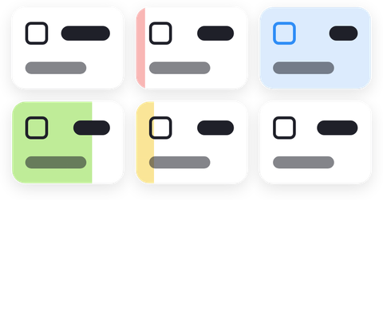</picture></a>
<a href="docs/widgets/values.md"><b>Device Values</b></a> 
Compact tiles that each show one value, such as a temperature, power or on/off 

<a href="docs/widgets/electricity.md"><picture><source media="(prefers-color-scheme: dark)" srcset="docs/previews/electricity-dark.png">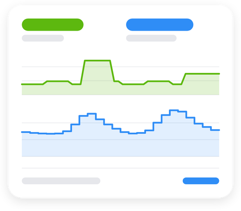</picture></a>
<a href="docs/widgets/electricity.md"><b>Electricity Overview</b></a> 
Live power use, hourly electricity prices and usage history on one card 

<a href="docs/widgets/price.md"><picture><source media="(prefers-color-scheme: dark)" srcset="docs/previews/price-dark.png">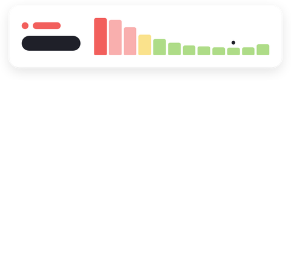</picture></a>
<a href="docs/widgets/price.md"><b>Energy Price Strip</b></a> 
The electricity price now and the coming hours as small bars, green, yellow or red 

<a href="docs/widgets/flows.md"><picture><source media="(prefers-color-scheme: dark)" srcset="docs/previews/flows-dark.png">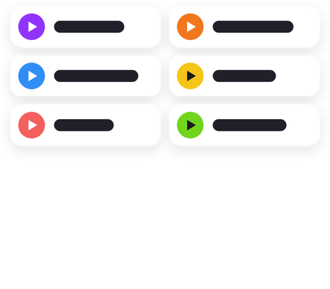</picture></a>
<a href="docs/widgets/flows.md"><b>Flow Buttons</b></a> 
Start flows with one tap: a round button in the colour and icon you pick, with the flow's name 

<a href="docs/widgets/heatmap.md"><picture><source media="(prefers-color-scheme: dark)" srcset="docs/previews/heatmap-dark.png">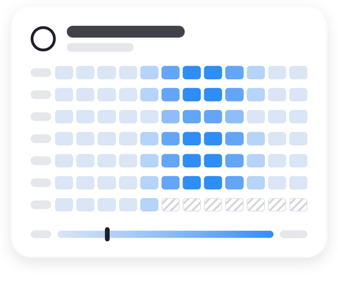</picture></a>
<a href="docs/widgets/heatmap.md"><b>Insights Heatmap</b></a> 
A week of one value (light, temperature, motion …) as a grid of weekdays and hours 

<a href="docs/widgets/keypad.md"><picture><source media="(prefers-color-scheme: dark)" srcset="docs/previews/keypad-dark.png"></picture></a>
<a href="docs/widgets/keypad.md"><b>Keypad</b></a> 
Up to three buttons behind an optional code that start Flows or set a device or variable, with its state beside them 

<a href="docs/widgets/lights.md"><picture><source media="(prefers-color-scheme: dark)" srcset="docs/previews/lights-dark.png">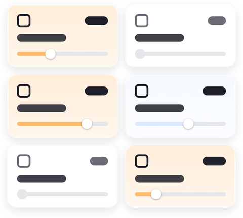</picture></a>
<a href="docs/widgets/lights.md"><b>Light Controls</b></a> 
Compact light tiles with brightness, colour and colour temperature: six lights in the space of three 

<a href="docs/widgets/lightrooms.md"><picture><source media="(prefers-color-scheme: dark)" srcset="docs/previews/lightrooms-dark.png">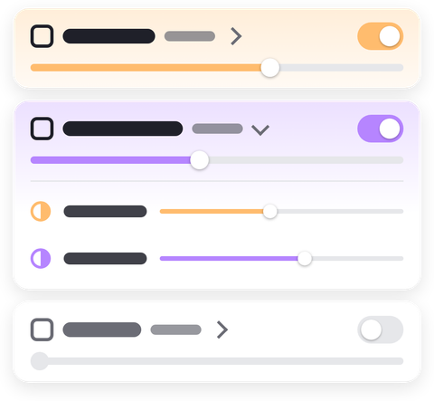</picture></a>
<a href="docs/widgets/lightrooms.md"><b>Lights by Room</b></a> 
Every room's lights on a card: switch and dim a room, or open it for each light and the room's Moods 

<a href="docs/widgets/locks.md"><picture><source media="(prefers-color-scheme: dark)" srcset="docs/previews/locks-dark.png">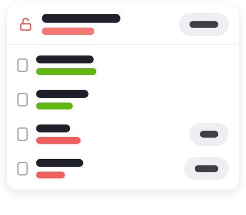</picture></a>
<a href="docs/widgets/locks.md"><b>Locks and Doors</b></a> 
One line that says whether every lock and door is locked and closed 

<a href="docs/widgets/media.md"><picture><source media="(prefers-color-scheme: dark)" srcset="docs/previews/media-dark.png">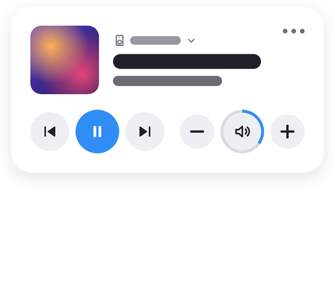</picture></a>
<a href="docs/widgets/media.md"><b>Media</b></a> 
A speaker with its album art, mute, a volume that never overshoots and buttons for its sources 

<a href="docs/widgets/textline.md"><picture><source media="(prefers-color-scheme: dark)" srcset="docs/previews/textline-dark.png">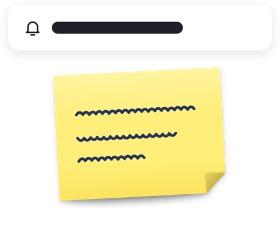</picture></a>
<a href="docs/widgets/textline.md"><b>Notes</b></a> 
A note on a tile or a handwritten Post-it, typed in or written by your Flows 

<a href="docs/widgets/pollen.md"><picture><source media="(prefers-color-scheme: dark)" srcset="docs/previews/pollen-dark.png">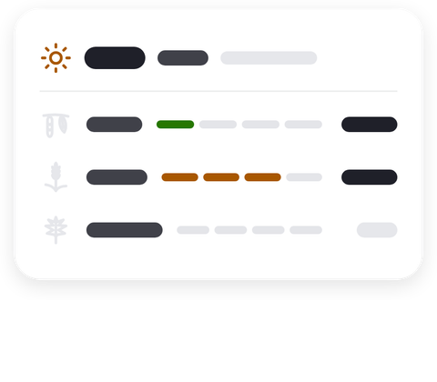</picture></a>
<a href="docs/widgets/pollen.md"><b>Pollen and UV</b></a> 
Today's pollen levels and the UV peak, in Europe 

<a href="docs/widgets/popups.md"><picture><source media="(prefers-color-scheme: dark)" srcset="docs/previews/popups-dark.png">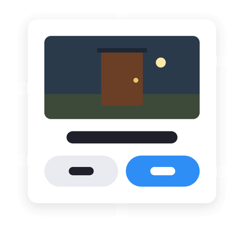</picture></a>
<a href="docs/widgets/popups.md"><b>Popups</b></a> 
A Flow's message or question with buttons of your own, with a picture if you like, in front of everything on a phone, tablet or web dashboard 

<a href="docs/widgets/roomhealth.md"><picture><source media="(prefers-color-scheme: dark)" srcset="docs/previews/roomhealth-dark.png">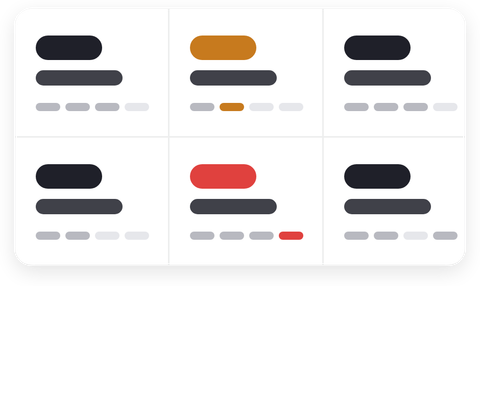</picture></a>
<a href="docs/widgets/roomhealth.md"><b>Room Health</b></a> 
Each room's temperature, humidity and air quality at a glance, turning yellow to red when something is off 

<a href="docs/widgets/sensoralarms.md"><picture><source media="(prefers-color-scheme: dark)" srcset="docs/previews/sensoralarms-dark.png">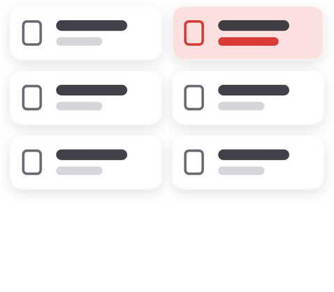</picture></a>
<a href="docs/widgets/sensoralarms.md"><b>Sensor Alarms</b></a> 
Tiles that show a sensor's alarm and turn red when one is on 

<a href="docs/widgets/stack.md"><picture><source media="(prefers-color-scheme: dark)" srcset="docs/previews/stack-dark.png">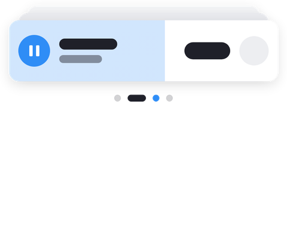</picture></a>
<a href="docs/widgets/stack.md"><b>Smart Stack</b></a> 
Several widgets in one spot, one at a time, with the one that matters brought forward 

<a href="docs/widgets/spacer.md"><picture><source media="(prefers-color-scheme: dark)" srcset="docs/previews/spacer-dark.png">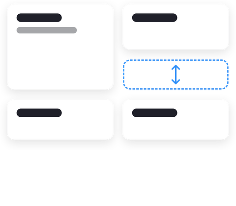</picture></a>
<a href="docs/widgets/spacer.md"><b>Spacer</b></a> 
Empty space of the height you set, to line up widgets across columns 

<a href="docs/widgets/sparklines.md"><picture><source media="(prefers-color-scheme: dark)" srcset="docs/previews/sparklines-dark.png">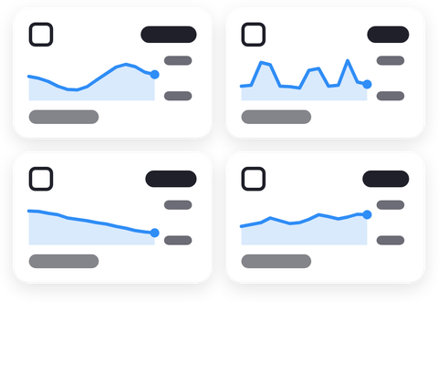</picture></a>
<a href="docs/widgets/sparklines.md"><b>Sparklines</b></a> 
Tiles with a small chart of a value over the last hour, day or week, with its lowest and highest 

<a href="docs/widgets/thermostat.md"><picture><source media="(prefers-color-scheme: dark)" srcset="docs/previews/thermostat-dark.png">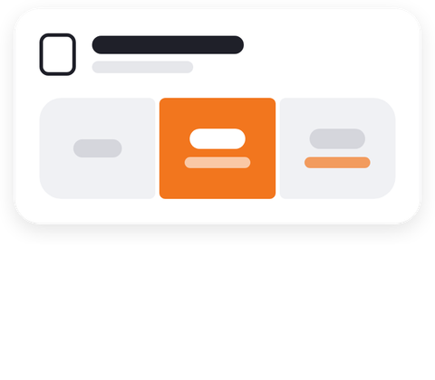</picture></a>
<a href="docs/widgets/thermostat.md"><b>Thermostat Presets</b></a> 
Three one-tap presets for a thermostat, heat pump or air conditioner 

<a href="docs/widgets/timers.md"><picture><source media="(prefers-color-scheme: dark)" srcset="docs/previews/timers-dark.png">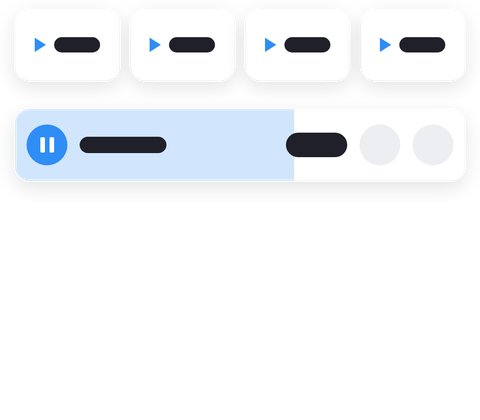</picture></a>
<a href="docs/widgets/timers.md"><b>Timers</b></a> 
Kitchen timers from one-tap presets, with a Flow card when one runs out 

<a href="docs/widgets/valuematrix.md"><picture><source media="(prefers-color-scheme: dark)" srcset="docs/previews/valuematrix-dark.png">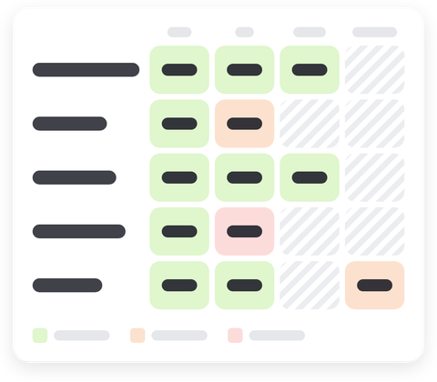</picture></a>
<a href="docs/widgets/valuematrix.md"><b>Value Matrix</b></a> 
Devices or rooms against the values you choose, in one table, each cell green, orange or red by its range 

<a href="docs/widgets/varpresets.md"><picture><source media="(prefers-color-scheme: dark)" srcset="docs/previews/varpresets-dark.png">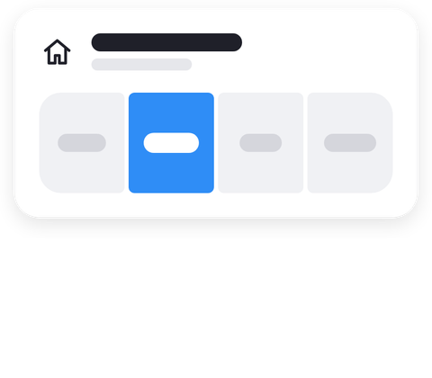</picture></a>
<a href="docs/widgets/varpresets.md"><b>Variable Presets</b></a> 
Two to four one-tap buttons that set a variable to the values you pick, like Thermostat Presets 

<a href="docs/widgets/variables.md"><picture><source media="(prefers-color-scheme: dark)" srcset="docs/previews/variables-dark.png">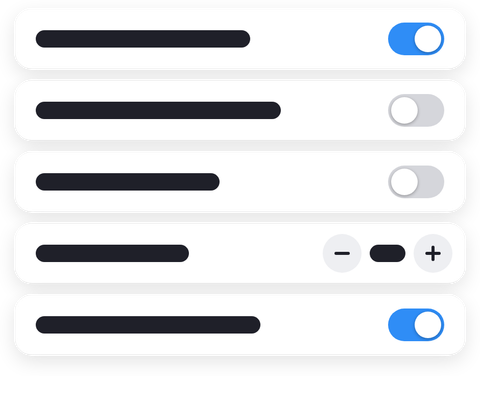</picture></a>
<a href="docs/widgets/variables.md"><b>Variables</b></a> 
Compact rows to switch variables on and off or change a number or text, with the full name 

<a href="docs/widgets/weather.md"><picture><source media="(prefers-color-scheme: dark)" srcset="docs/previews/weather-dark.png">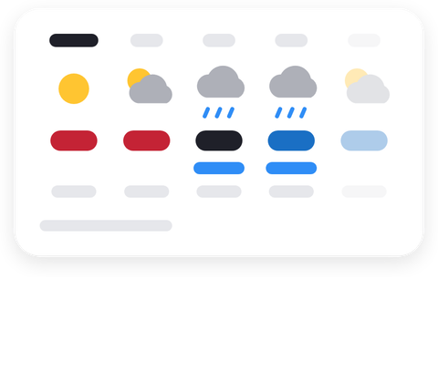</picture></a>
<a href="docs/widgets/weather.md"><b>Weather Forecast</b></a> 
The next 36 hours, hour by hour, from MET Norway (yr.no) 

<a href="docs/widgets/webpage.md"><picture><source media="(prefers-color-scheme: dark)" srcset="docs/previews/webpage-dark.png">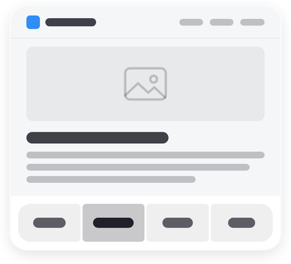</picture></a>
<a href="docs/widgets/webpage.md"><b>Web Page</b></a> 
Any web page, scaled to fill the widget, with buttons to switch between addresses 

## Web dashboards
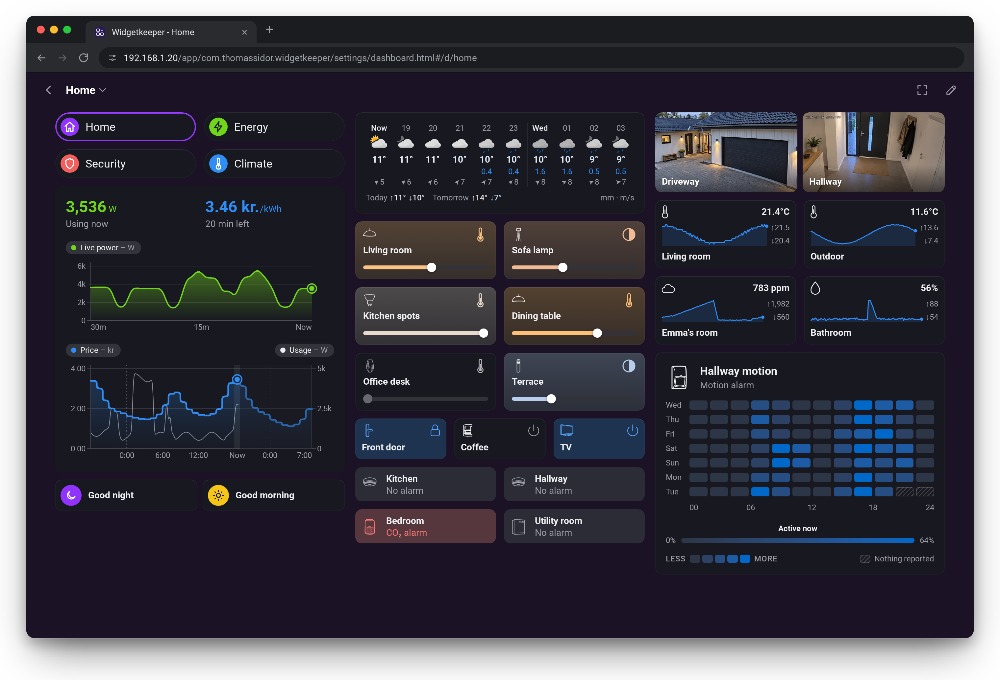

Your Widgetkeeper widgets in any browser at home, or [away from home](#away-from-home): a wall tablet, an old iPad, a computer or a TV. They're the same widgets, with the same settings and live updates as on a Homey dashboard, on dashboards you build on the page itself. The dashboards are kept on your Homey, so every browser shows the same ones.

### Getting started
1. Open **Apps → Widgetkeeper → Configure** in the Homey app and turn on **Web dashboards**.
2. Open the address shown there in a browser on your home network: `http://<your Homey's address>/app/com.thomassidor.widgetkeeper/settings/dashboard.html`.
3. Add the browser under **Screens and browsers** on the same page and type the sign-in code it gets ([how](#screens-and-browsers)). Or, under **Use an API key instead**, paste a Homey API key ([which permissions](#web-dashboards-key)). Then the web dashboards password, if you set one.

### Your dashboards
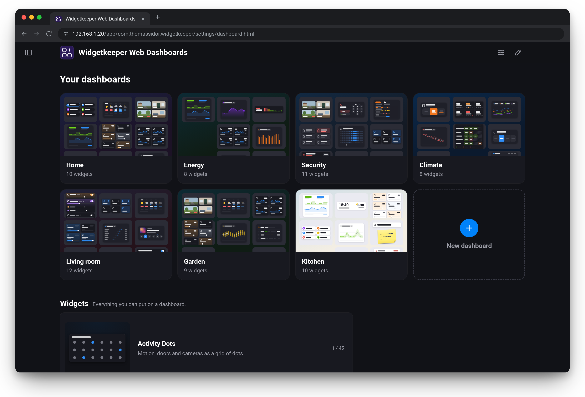

The front page shows every dashboard as a card with a miniature of its widgets, then the widgets you can add. The pen at the top puts it in edit mode: drag the dashboards into order, duplicate one (with its tile names), delete one with a second tap, or hide the widgets. Its **Settings** has the [backup](#backup) and, for this browser only:

- **Keep screen on** while the page is open, for a wall tablet. Browsers only allow this over HTTPS, as on the [away from home](#away-from-home) address; elsewhere the page plays a silent video instead, which works on iPads and iPhones but not in every browser. Where it doesn't, turn off sleep in the device's own settings.
- **Dim**: darkens the whole page, up to 80 %, for a wall tablet at night.
- **Sign out**: the browser asks for a sign-in code again.

### Building a dashboard
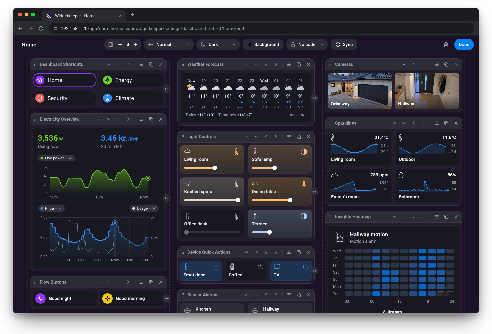

- **Columns and widgets:** one to six columns. Add widgets per column, move them by dragging their bar or with the arrows, and remove them with a second tap. The copy button on a widget's bar copies it, settings, devices and tile names included, to this dashboard (right under it) or another one (at the end of a column you pick).
- **Column width:** Normal, Narrow (a phone's width, as on a Homey dashboard), Wide, or Fit to window, where the columns share the window's width.
- **Wide widgets:** drag the handle on a widget's right edge (or set **Width** in its settings) to make it span two or more columns, such as a large camera or chart. The columns it covers keep their own widgets above and below it: drag one above or under it. On a phone, where there's one column, it's as wide as the rest.
- **Settings:** the same as on a Homey dashboard, in cards: the devices, the general settings, and a folding card per button, tile or column that sums up what's set. Devices are picked from a list grouped by room, with a search.
- **Look:** light, dark or automatic, and a background per dashboard (Default, Black or White, Slate, Ocean, Forest, Plum, Berry, Sand), each with a light and a dark shade. The sun button in the bar switches between light and dark in this browser only.
- **Full screen:** the corner button gives the whole screen to the dashboard.
- **Kiosk browsers:** add `?kiosk=1` to the address (`…/dashboard.html?kiosk=1#/d/<dashboard>`, or `#/d/<dashboard>?kiosk=1`) for a browser such as Fully Kiosk that fills the screen itself: the dashboard's bar, with its back link, name, pen and full screen button, is left out. A browser can't go full screen on its own when the page opens, so use the kiosk browser's own full screen setting for that. Add a [code](#code) to the dashboard too, so nobody can leave it or edit it.
- **A menu:** put [Dashboard Shortcuts](docs/widgets/shortcuts.md) on every dashboard to jump between them.
- **Popups:** Flows can show a message or ask Yes or No over a dashboard, in every browser showing it, with a camera's picture if you like. See [Popups](docs/widgets/popups.md).

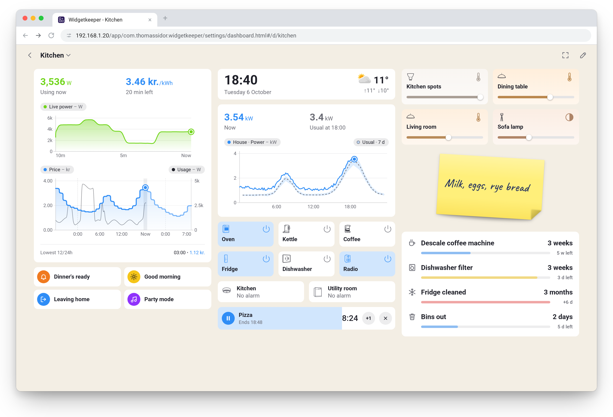

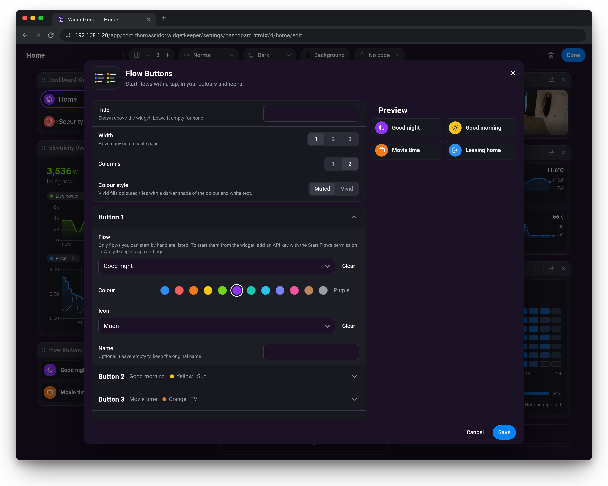

### Widgets from other apps
*Add widget* also lists your other apps' widgets under **Other apps**, with their own settings. They need **Homey** in the browser's key, as Homey only lists them with that. They run sealed off, so their code can't read the page or the browser's key. A widget that doesn't work that way can be trusted in its settings (*Trust this widget*); it then runs as on a Homey dashboard and could read the key.

Some widgets are made for the width they have on a Homey dashboard, and come out taller or shorter in a wider column. *Size as on Homey* in their settings lays them out at a phone's width and scales them to fill the column, so they look as on Homey.

### Away from home
Turn on **Remote access** under **Apps → Widgetkeeper → Configure** for a second address, `https://<your Homey's id>.connect.athom.com/app/com.thomassidor.widgetkeeper/settings/dashboard.html`, through Homey's cloud like the Homey app. A browser signs in again there, as each address is its own site; sign-in codes and their addresses work there too. Anyone with the address still needs a code or a key, but a [password](#password) is worth setting too. Unlike the home address, this one is encrypted (HTTPS), so it's also the one to use at home on a network you don't fully trust (see [the key](#web-dashboards-key)).

### Password
On top of the sign-in code or API key, you can set a password under **Apps → Widgetkeeper → Configure → Web dashboards → Away from home**; every browser then asks for it once. Setting or changing it there signs other browsers out, but your [screens](#screens-and-browsers) stay signed in, and repeated wrong passwords lock the sign-in for a while. Changing or removing it asks for the current one; if you forget it, the Flow card **Remove the web dashboards password** removes it.

### Screens and browsers
Each tablet, phone, computer or screen you can't type on, such as a Google Nest Hub you cast to, signs in with a short code of its own. Under **Apps → Widgetkeeper → Configure → Web dashboards → Screens and browsers**, tap **Add a screen or browser**, then:

1. In the Homey web app, make a key under **Settings → API Keys**, named after the screen.
2. Tick **Devices**, so it can switch lights, locks and the like, and whatever the [API key](#api-key) table lists for the widgets you'll use.
3. Paste it with a name for the screen (and the password, if you've set one).

You get a code like `K7QM-3XPA`, shown only once, and an address with it, also as a QR code:

- type the code on the page, or
- open the address on the screen: `…/dashboard.html#code=K7QM-3XPA`, or `…/dashboard.html#/d/<dashboard>?code=K7QM-3XPA` for one dashboard. It works on every load, so a cast screen that forgets everything still gets in.

Each screen in the list has **Opens on**: pick a dashboard, and its code opens that one instead of the dashboards' front page, so a kitchen tablet or a cast Nest Hub goes straight to its own. An address that names a dashboard still opens that one. Give the dashboard a [code](#code) too, and the screen stays there.

Anyone with a code can use its key, so give each screen only the permissions it needs. **New code** makes another (paste the screen's key again, or a new one). **Remove** stops the code; the device keeps what it has until it next loads the page, so for a lost device also delete its key in the Homey web app (**Settings → API Keys**). Repeated wrong codes lock every code for a while.

### Code
A dashboard can take a [Keypad](docs/widgets/keypad.md) code: in its editor, pick one (or Any code) under the lock. Editing it and going back to the dashboards then take the code, so a wall tablet stays on its dashboard and nobody there can change its widgets, a Keypad's code included. The page asks for it and Widgetkeeper checks it; wrong ones lock as at a Keypad. Removing the code under **Keypad codes** opens the dashboard again. Like the Keypad's, it guards the screen, not your Homey: someone with the browser's API key and its developer tools can still get past it.

### Backup
In the front page's **Settings**, **Download backup** saves the dashboards you tick in one file: the layouts, the widgets, their settings and tile names. **Restore backup** lists a file's dashboards; after a second tap, the ones you tick replace those they were saved from (or come back, if deleted), and the others stay as they are. Notes' texts and Days Since's counters aren't included, as Homey's own dashboards share them.

### Web dashboards' key
Each browser connects with a key of its own, kept in that browser, from its [sign-in code](#screens-and-browsers) or pasted:

- A key with the **Homey** permission works. A narrower one hasn't been tried, as Homey doesn't document which permission an app's own API takes.
- A widget that changes something needs that permission in the browser's key too, as in the [API key](#api-key) table, even though the app's key makes the change.
- Likewise, switching a light, a lock, a curtain, a thermostat or a speaker needs permission to control devices in the browser's key (`homey.device.control`, under **Devices**), though Widgetkeeper makes the change. Reading doesn't: the widgets read devices, cameras, Insights and variables with Widgetkeeper's own permissions, so a browser that may open the page sees everything the widgets show, whatever its key.
- The Smart Stack and [other apps' widgets](#widgets-from-other-apps) need **Homey**.
- The home address is plain HTTP, as the Homey serves it: the key (and the password's sign-in) goes unencrypted over your home network with every request, so anything that can watch that network could read it. On a network you don't fully trust, such as one guests share, use the [away from home](#away-from-home) address, which is encrypted, at home too. Give each browser its own key (a [screen](#screens-and-browsers) each), so you can revoke a lost tablet's under **Settings → API Keys** without touching the others.

Turning web dashboards off keeps them on your Homey for when you turn them on again.

## Dashboard examples
**Home**

**Energy**
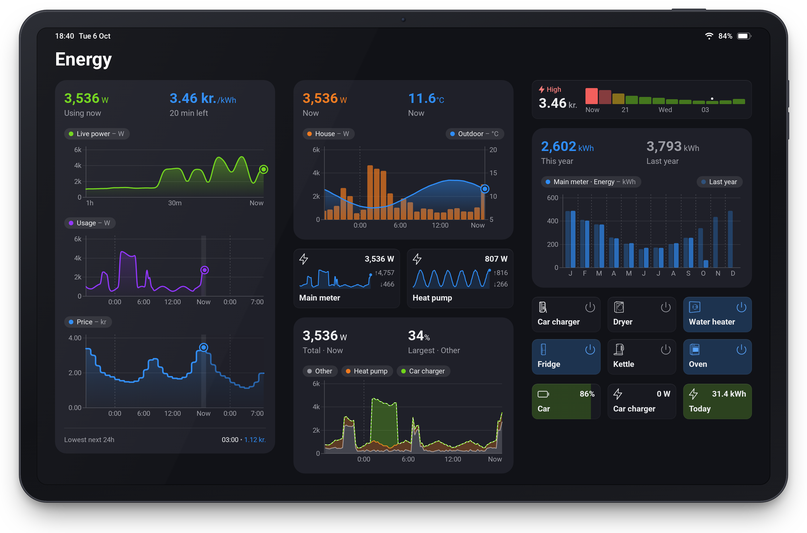

**Security**
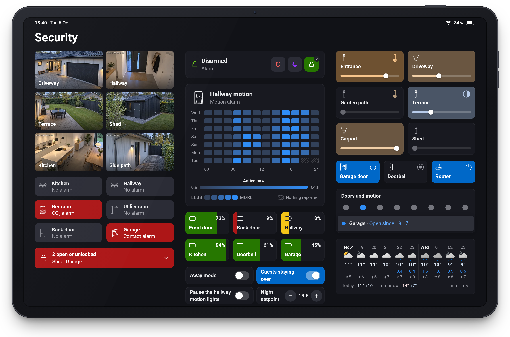

**Climate**
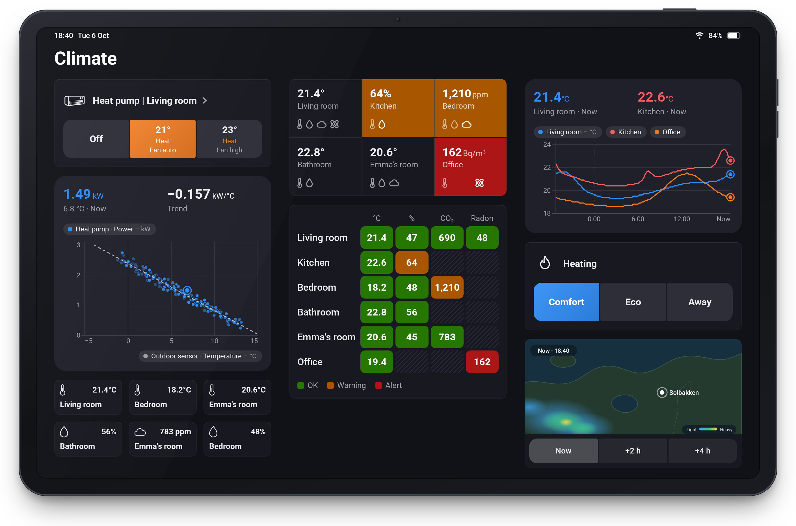

**Evening**

**Garden** (light mode)

**Kitchen**

## Colour style
Every widget with a coloured state has a **Colour style** setting: *Muted* is the calmer look, *Vivid* the stronger one, and a colour you pick in the widget follows it.

- Where a colour tints a tile (a Quick Actions tile that's on, a Sensor Alarms alarm, a coloured note, Value Matrix's cells …), Vivid fills the tile with Homey's darker shade, with white text. The charts get a stronger area under their lines.
- Where the colour is already a small solid part (a lit preset button, Insights Heatmap's cells, Media's play button, Activity Dots' dots), Muted uses the darker shade and Vivid the bright colour.
- Days Since and Room Health are toned down in Muted and in full colour in Vivid. Weather Forecast's *Vivid* puts the card on a gradient for the current weather.

## Device names
If your device names say more than the device, such as *Ceiling lamp | Kitchen*, choose under **Apps → Widgetkeeper → Configure → Device names** which part every widget shows:

- *Full name*: as in Homey (the default).
- *Before the separator*: *Ceiling lamp | Kitchen* shows as *Ceiling lamp*. You type the separator, such as `|` or ` - ` (spaces count, so ` - ` leaves *Wi-Fi plug* whole). With the separator more than once, the part before the first one.
- *After the separator*: *Kitchen | Ceiling lamp* shows as *Ceiling lamp*, the part after the last one.
- *Last word*: *Kitchen ceiling lamp* shows as *lamp*.
- *Without the room name*: a device in the Kitchen called *Kitchen ceiling lamp*, *Kitchen - ceiling lamp* or *Ceiling lamp (Kitchen)* shows as *Ceiling lamp*. Only the room's whole name at the start or end is left out, so *Kitchenette lamp* stays as it is.

A name without the separator (or the room's name) shows in full. The page shows a few of your own names as they'll look, and open widgets change at once. The device lists in widget settings, Flow tokens and [names typed on tiles](#tile-names) stay as they are.

## Tile names

Give any tile a name of your own, such as *Sofa corner* for a room's lights, instead of the device's or room's name. Light Controls, Lights by Room (its rooms and lights), Curtains, Device Quick Actions, Sensor Alarms, Room Health, Value Matrix, Device Values, Sparklines, Locks and Doors, Cameras, Variables and (on web dashboards) Dashboard Shortcuts have it.

1. Edit the dashboard, edit the widget, turn on **Rename tiles** (the first setting) and save the widget.
2. Leave the dashboard's edit mode. Each tile now shows a text field: type its name, or leave it empty for the device's (or room's) own.
3. Edit the widget again and turn **Rename tiles** off.

The names belong to that widget: they stay with the right tiles when you rename or reorder devices, and every screen and Smart Stack showing the widget gets them.

## API key
Homey doesn't let apps change variables, start flows, read dashboards or start Moods on their own. For those, create a key in the Homey web app under **Settings → API Keys**, tick the permissions below for the widgets you use, and paste it under **Apps → Widgetkeeper → Configure**. The key stays on your Homey, and that page says what it may do once it's saved.

| What | Permission to tick | Scope |
|---|---|---|
| Variables and Variable Presets: changing a value | **Variables** (View Variables isn't enough) | `homey.logic` |
| Flow Buttons | **Start Flows** | `homey.flow.start` |
| Keypad: a button with a Flow | **Start Flows** | `homey.flow.start` |
| Keypad: a button that sets a variable | **Variables** | `homey.logic` |
| Media's buttons: a flow | **Start Flows** | `homey.flow.start` |
| Media's buttons: the speaker's own actions, such as *Set source to TV*, and its app's | **Flows** (Start Flows isn't enough) | `homey.flow` |
| Light Controls' Room's Moods: starting a Mood | **Set Moods** | `homey.mood.set` |
| Lights by Room: starting a Mood | **Set Moods** | `homey.mood.set` |
| Smart Stack: reading the dashboard | **Homey** (it allows everything, but there's no permission for dashboards alone) | `homey` |

Ticking a group's first box (**Flows**, **Moods**, **Homey**) includes the boxes under it. Everything else needs no key: the widgets read devices, Insights, variables, flows and Moods with Widgetkeeper's own permissions.

## Languages
English, Dutch, German, French, Italian, Swedish, Norwegian, Spanish, Danish, Russian, Polish, Korean and Arabic, following Homey's language.

## Installation
Install Widgetkeeper from the [Homey App Store](https://homey.app/a/com.thomassidor.widgetkeeper/). The [test version](https://homey.app/a/com.thomassidor.widgetkeeper/test/) has the next version's widgets before they go live. To install it from source with the Homey CLI, see [CONTRIBUTING.md](CONTRIBUTING.md).

## Troubleshooting
If a widget doesn't work as expected, open **Apps → Widgetkeeper → Configure** in the Homey app: its **Diagnostics** report has a device's full details once you pick it, and no passwords, API keys or camera addresses. Include it when you [open an issue](https://github.com/thomassidor/widgetkeeper/issues).

## Changelog
See [CHANGELOG.md](CHANGELOG.md).

## License
[MIT](LICENSE)
