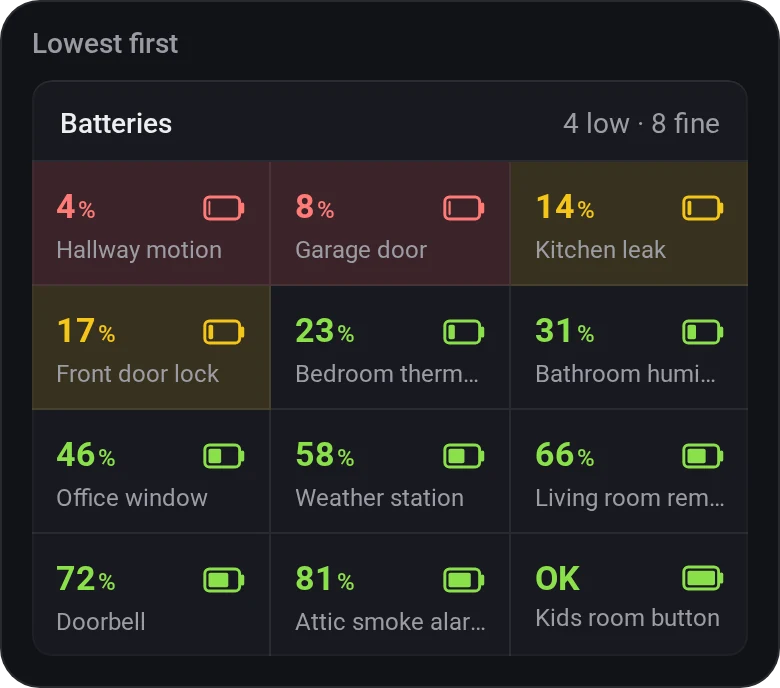
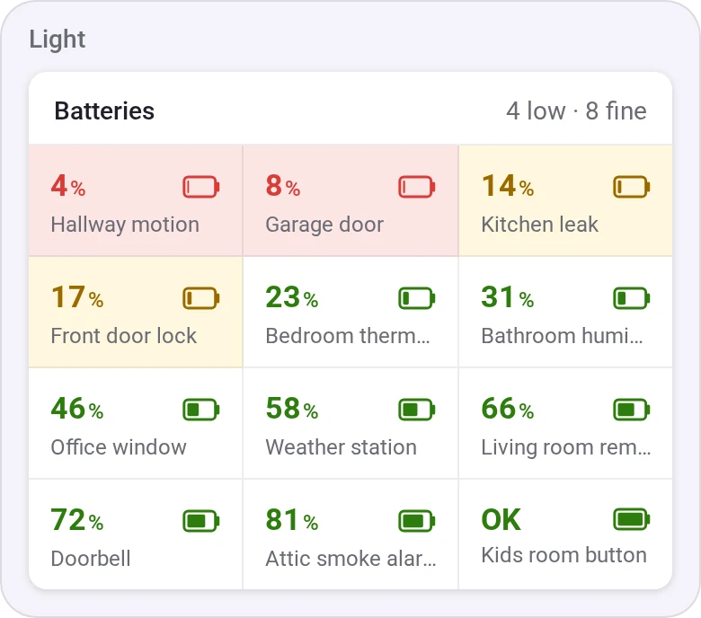
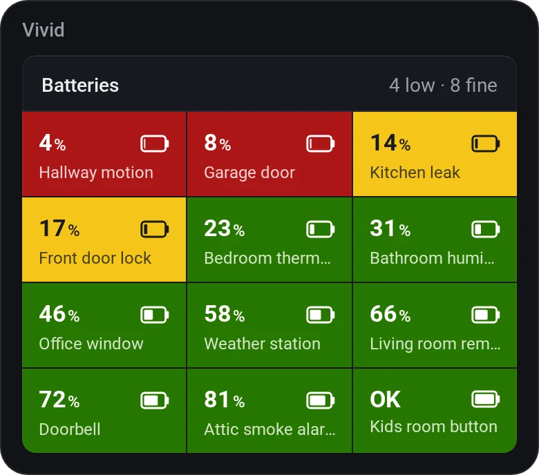
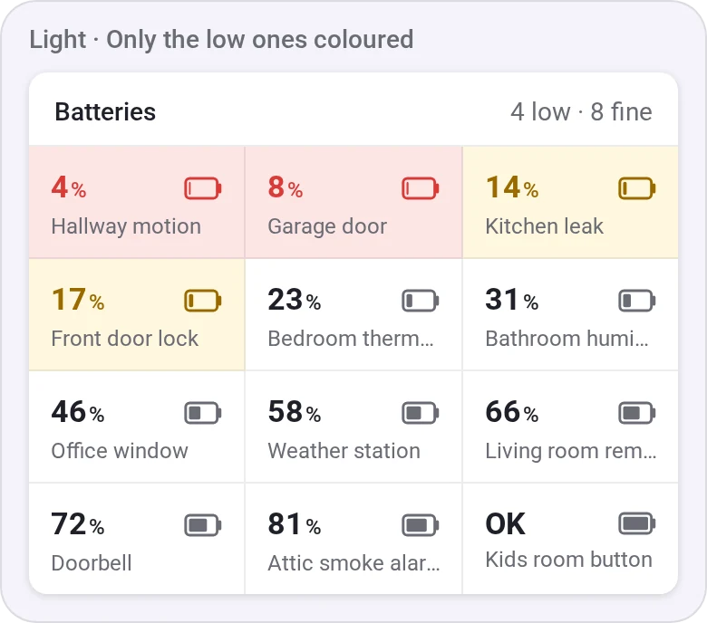
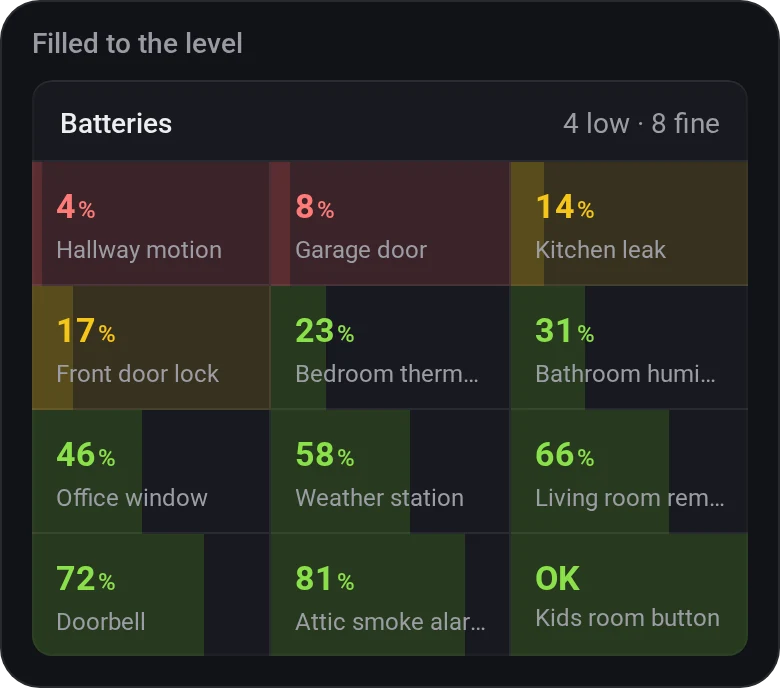
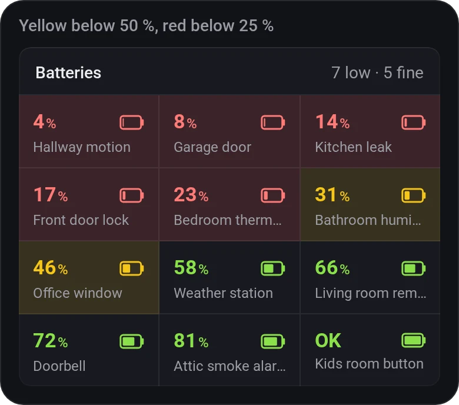
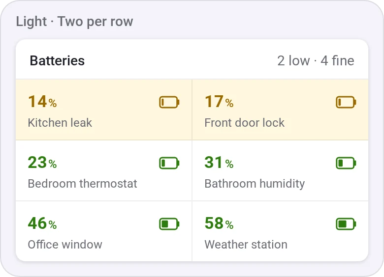
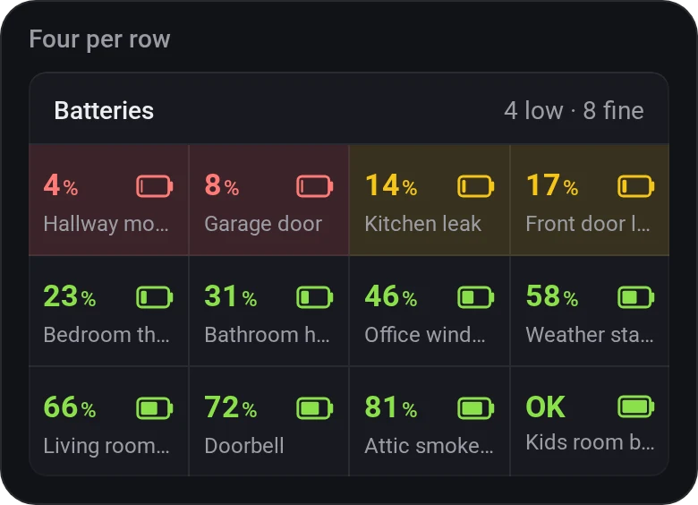
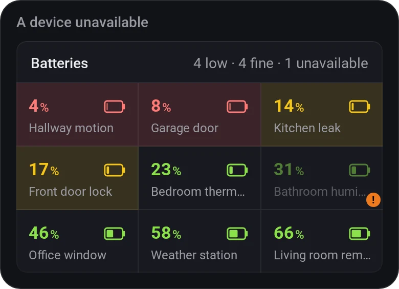

# Batteries

[← All widgets](../../README.md#widgets)

The battery of every device you pick in one tile, lowest first, so the ones that need a new battery are at the top. Each cell shows the level, a battery filled to it and the device's name. A battery below the red level is red, below the yellow level yellow, and the rest green. A device that only says whether its battery is low shows *Low* or *OK*. The heading counts how many are low and how many are fine.

**Settings:** [rename tiles](../../README.md#tile-names), tiles per row (2, 3 or 4), yellow below (20 %), red below (10 %), green when fine, fill to the level (each tile filled from the left as far as its battery, in place of the battery icon; with the Muted colour style), [colour style](../../README.md#colour-style).

## Looks

---
[← All widgets](../../README.md#widgets)
