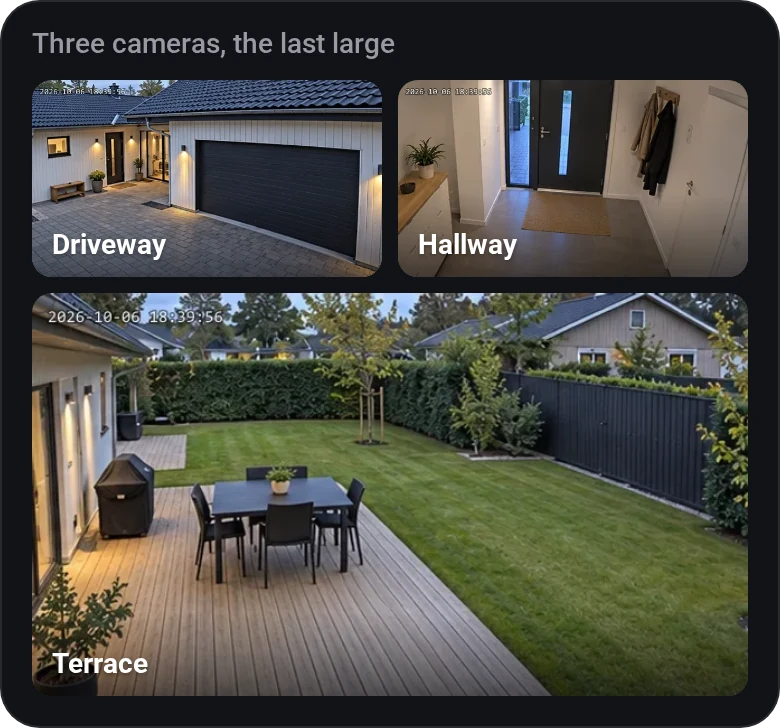

# Cameras

[← All widgets](../../README.md#widgets)

Your cameras as a grid of snapshots that refresh every few seconds (cameras with only a video stream show a still from it). Tap one to watch it live, or pick one to be **Always live**: it plays by itself and fills the widget, a tap shows the other cameras, and it comes back after a minute. Where live video can't play, it stays on snapshots.

**Away from home:** snapshots come through Homey's cloud like everything else, but live video connects straight to the Homey, which Homey's cloud doesn't carry. So live view works on your home network, or away from home through a VPN to it (WireGuard, Tailscale, your router's own VPN). Without one, a tap says *Live view needs your home network or a VPN.*

**Battery cameras:** set **Refresh snapshots every** to anything from 5 minutes to 12 hours. The app then keeps each camera's last picture, so opening a dashboard shows that one and doesn't wake the camera. A new picture is only asked for when one is due and the dashboard is open. A tap still goes live.

To decide yourself when a camera wakes, for example at sunrise and sunset, set it to **Only by Flow** and use the Flow card **Refresh a camera's picture**. It works with no dashboard open, and the tile shows when its picture is from. The card also works on the 5 minute to 12 hour intervals: a Flow's picture counts as the new one, so the interval starts over. A camera with only a video stream can only get a new still from a dashboard, so it's taken on one that's open, or else on the next one opened.

**Flow cards:** *Refresh a camera's picture*.

**Settings:** [rename tiles](../../README.md#tile-names), Camera 1 to 6, which list every device with a snapshot or video (Synology Surveillance Station's too), layout (a large camera at the top or bottom, or one per row), refresh interval, how long live view stays on and always live.

A widget set up before version 1.2.1 keeps the cameras picked under Devices until you fill in any of Camera 1 to 6: from then on it shows only those. So to change or remove one, fill in the cameras you want.

## Looks

---
[← All widgets](../../README.md#widgets)
