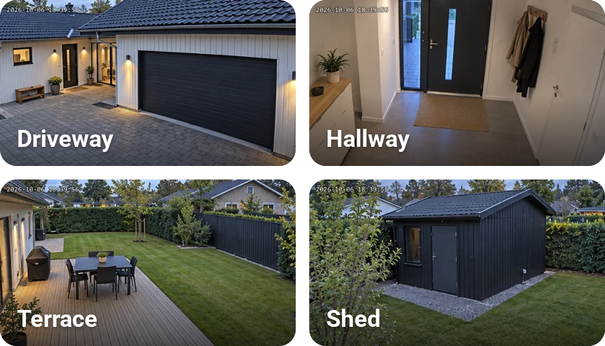
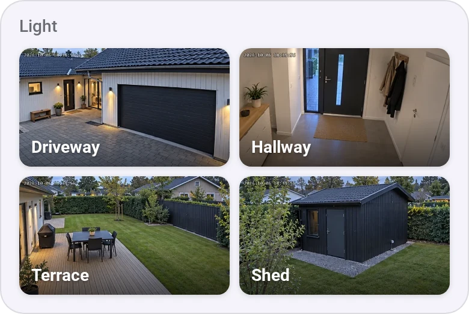
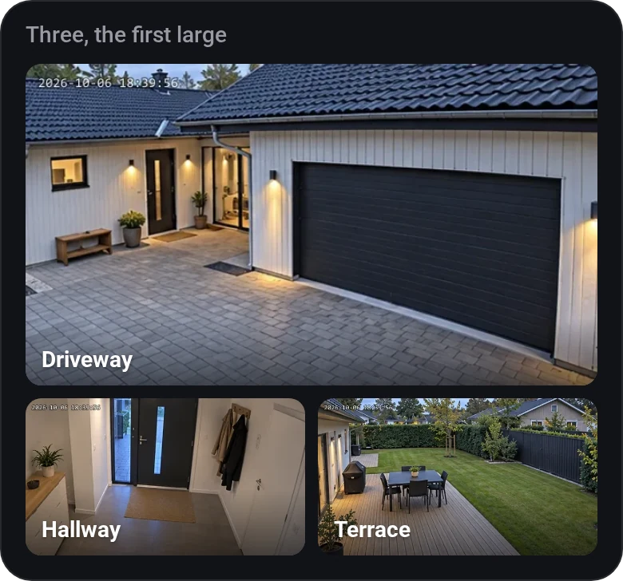
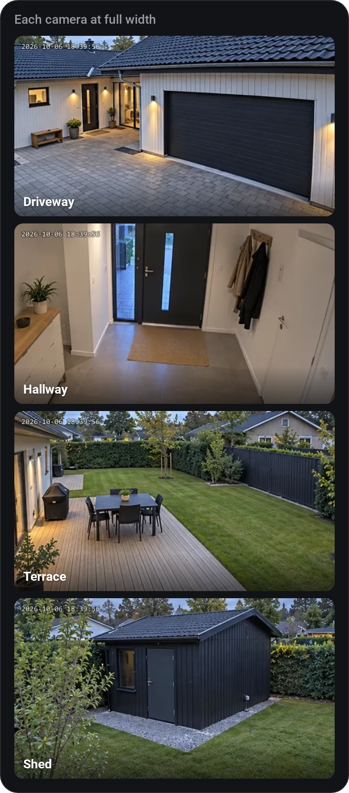

# Cameras

[← All widgets](../../README.md#widgets)

Your cameras as a grid of snapshots that refresh every few seconds (cameras with only a video stream show a still from it). Tap one to watch it live.

**Away from home:** snapshots come through Homey's cloud like everything else, but live video connects straight to the Homey, which Homey's cloud doesn't carry. So live view works on your home network, or away from home through a VPN to it (WireGuard, Tailscale, your router's own VPN). Without one, a tap says *Live view needs your home network or a VPN.*

**Settings:** cameras, layout (a large camera at the top or bottom, or one per row), refresh interval, how long live view stays on, time format, [rename tiles](../../README.md#tile-names), and Camera 1 to 6 for cameras missing from the device list, such as Synology Surveillance Station's: they list every device with a snapshot or video.

## Looks

---
[← All widgets](../../README.md#widgets)
