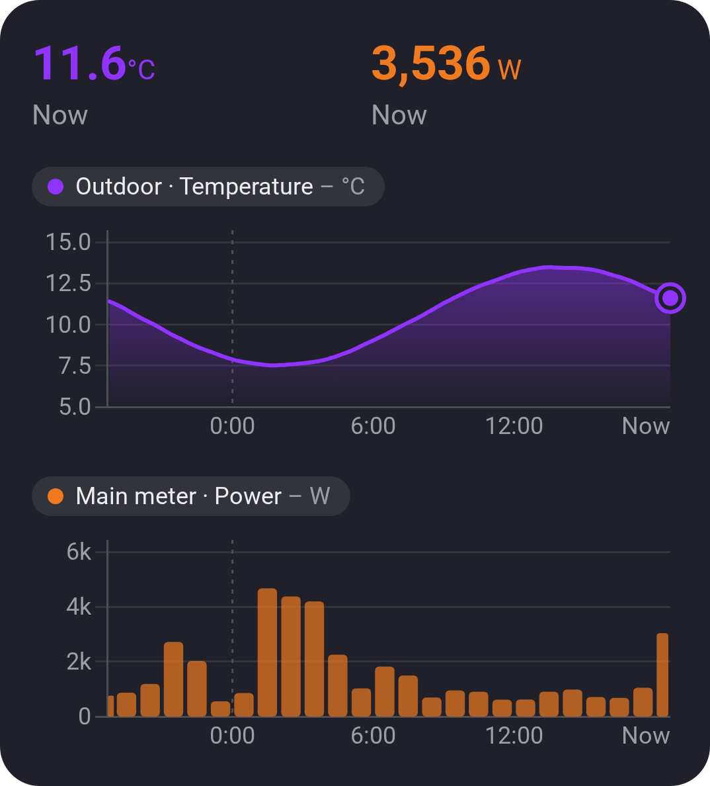
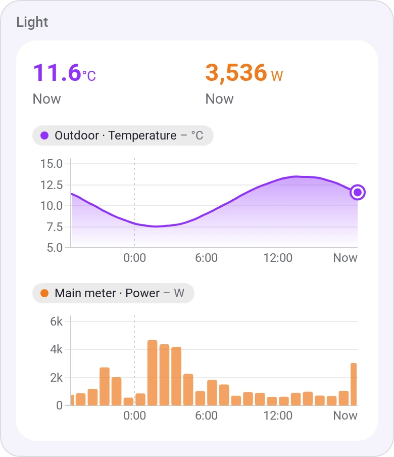
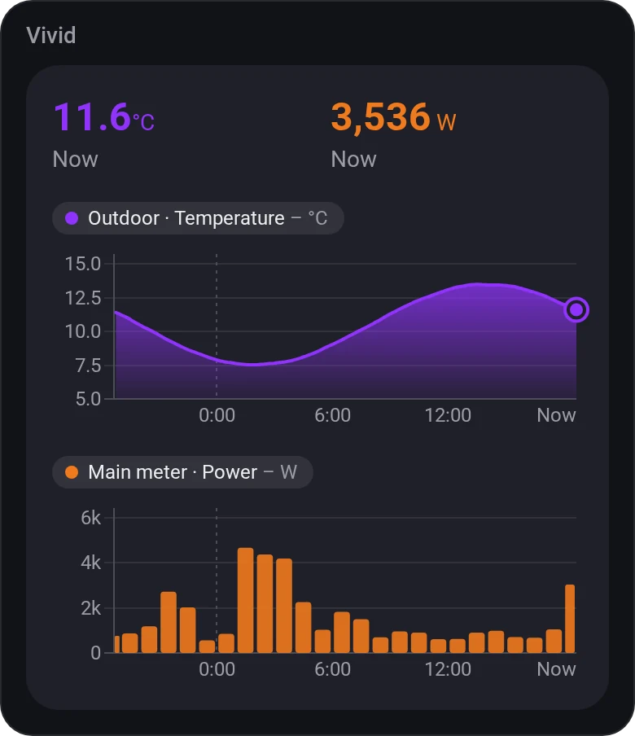
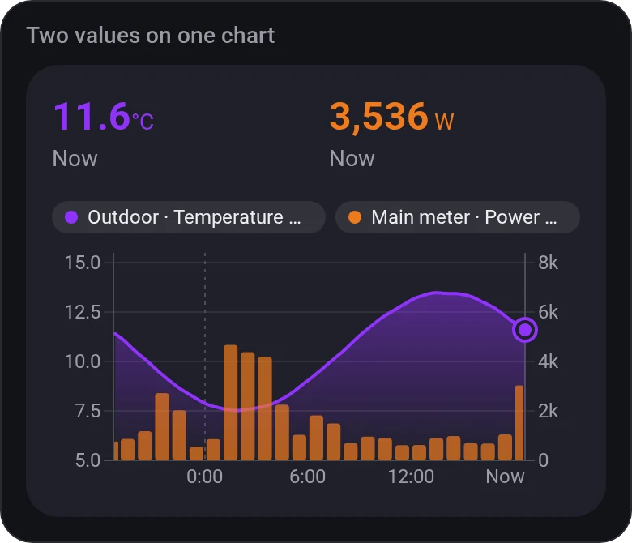
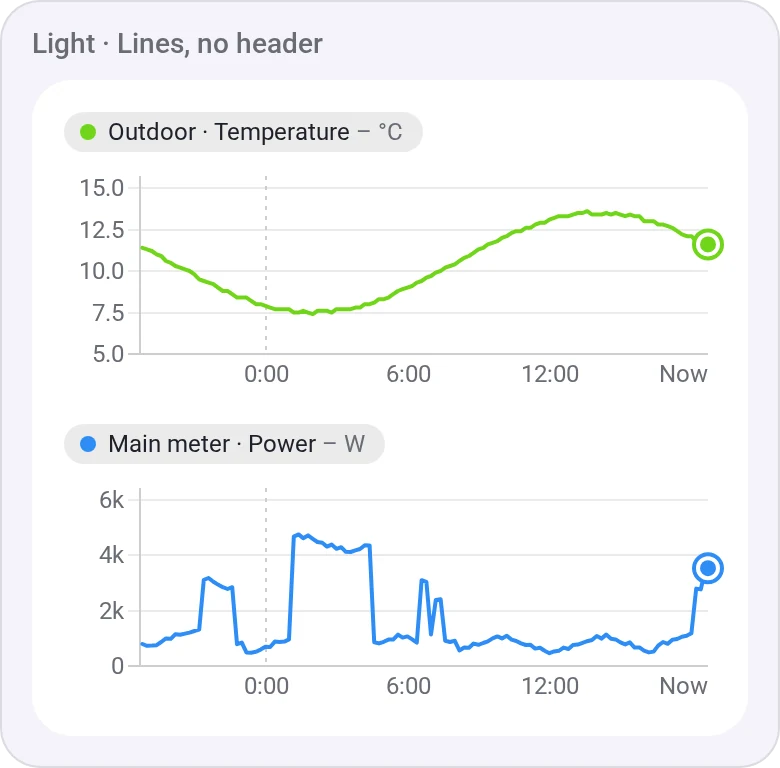

# Chart · Basic

[← All widgets](../../README.md#widgets)

How did it go? A value over any [time span](#time-spans), as a line, an area or bars, drawn like Electricity Overview's charts. Two values can share one chart, to compare a value with the period before it (today over yesterday) or with a second value on its own scale (the power use against the outdoor temperature), or stack as two charts in one widget.

**Settings:** one value, two stacked or two on one chart (sharing chart 1's span, unless both are whole periods of one unit, such as today and yesterday), one scale for both; per chart the value, [time span](#time-spans), style (line with area, line or bars), colour, scale (fitted or from zero), below zero in yellow, smooth line and title; the values at the top (a finished period's average); the legend; [colour style](../../README.md#colour-style).

For totals per hour, day or month, see [Chart · Totals](totals.md); for more than two values, [Chart · Lines](lines.md).

**All chart widgets** show their key numbers at the top; tap the chart for any point's. They take any value Homey logs in Insights, which keeps 5-minute steps for a day, hourly ones for about a week and 6-hour averages beyond that, so over longer spans short peaks are smoothed.

**Time spans:** a number and a unit. Minutes to years count back from now (40 minutes, 24 hours, 18 months). Days from midnight, weeks from Monday, months from the 1st and years from 1 January are whole periods, the current one included (3 months from the 1st is this month and the two before); with *Leave out the current period*, the ones before it (yesterday, last week). Up to two years: Insights keeps no more. Charts set up before 1.2.0 keep their span.

## Looks

---
[← All widgets](../../README.md#widgets)
