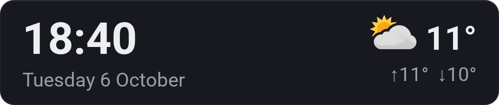
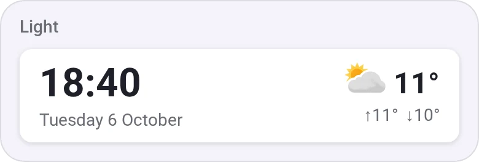
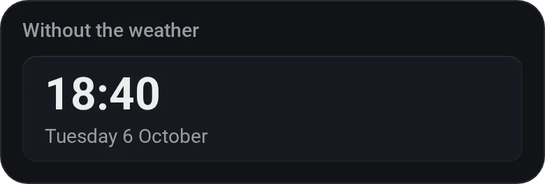
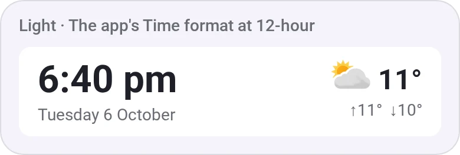

# Clock

[← All widgets](../../README.md#widgets)

The time and the date in one tile, with the weather now and today's high and low from [MET Norway](https://www.met.no/en), the Weather Forecast's data. The time follows your phone, tablet or browser (24 or 12 hours) unless you pick one in the app's [time format](#time-format), the date Homey's language.

**Settings:** show the weather.

## Looks

---
[← All widgets](../../README.md#widgets)
