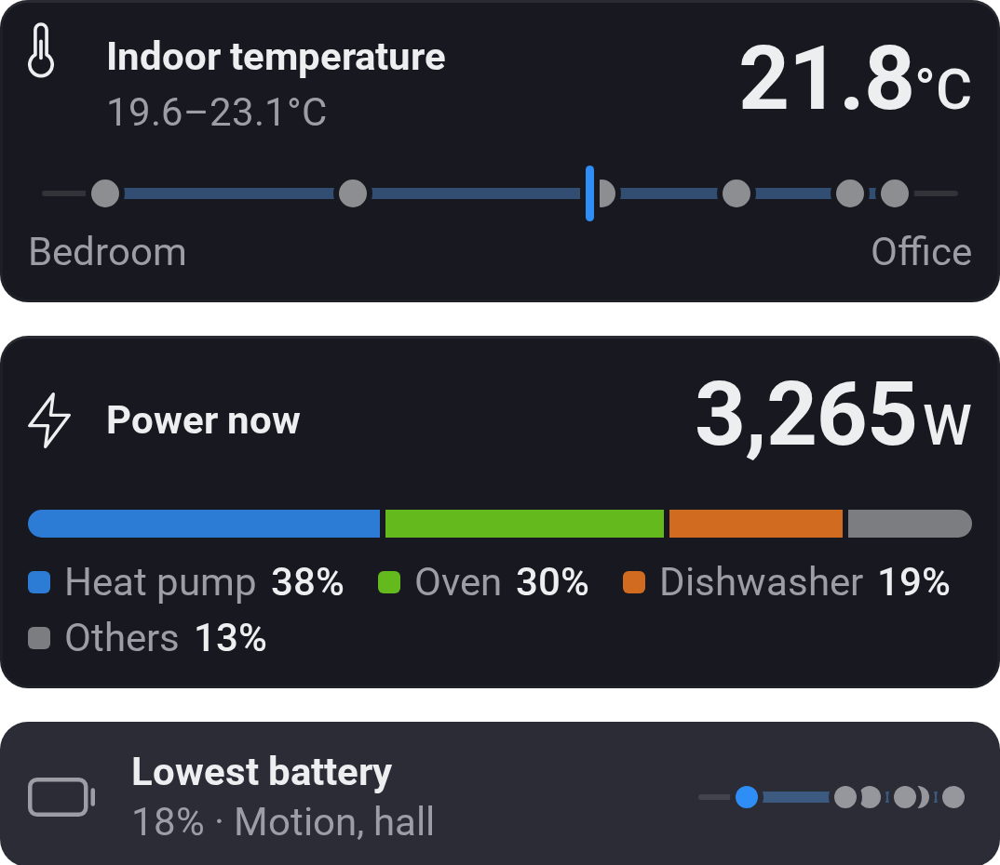
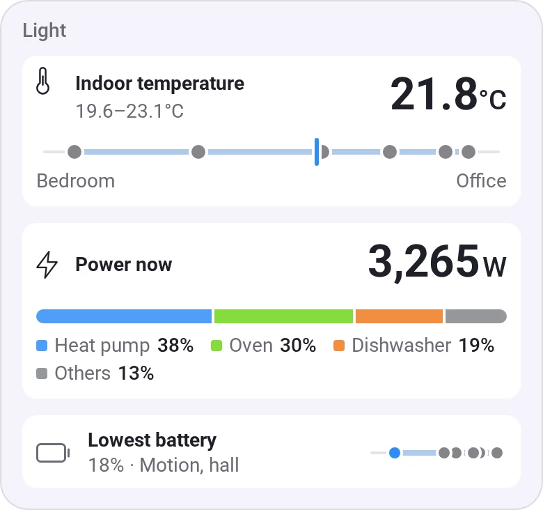
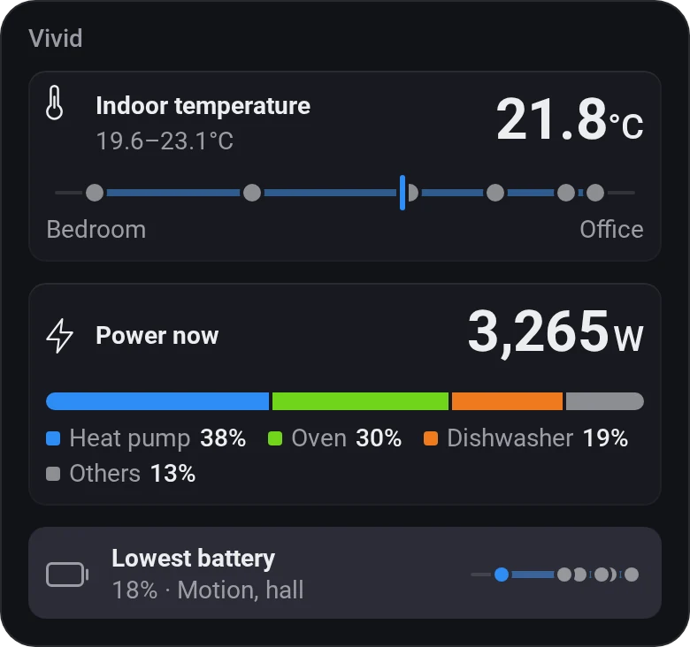
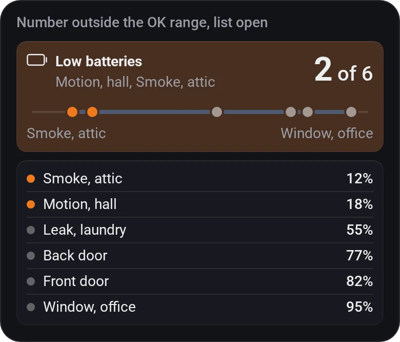
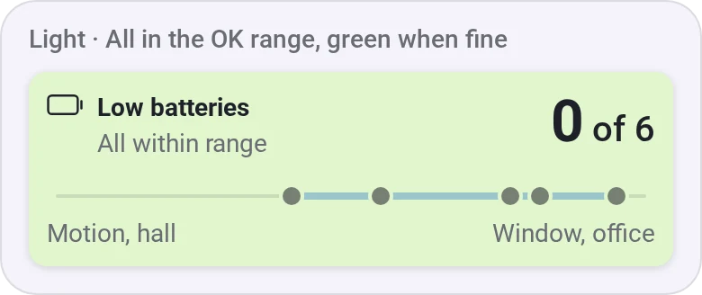
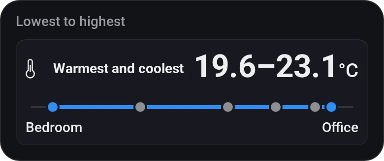
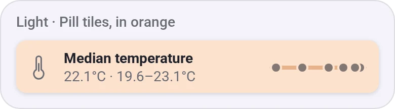
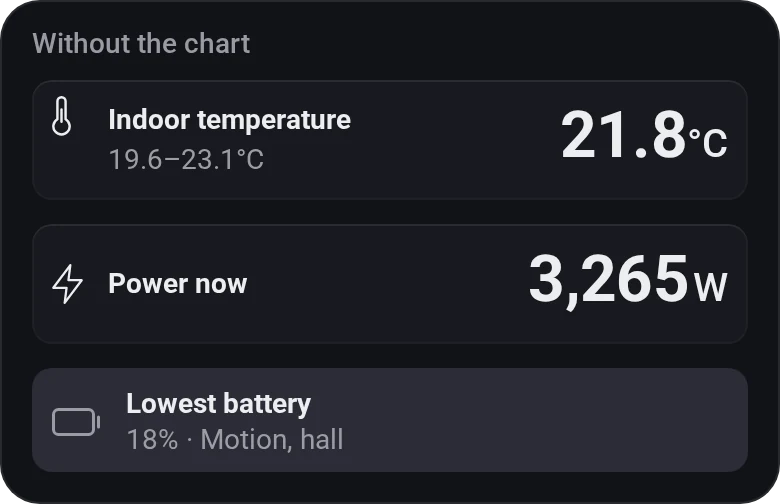

# Combined Value

[← All widgets](../../README.md#widgets)

One value read from several devices, folded into one: the average (or median) temperature of every room, the house's total power, the lowest battery, the highest CO₂, the lowest to the highest, or how many are outside an OK range ("2 of 12" batteries under 20 %, named worst first). The value is large on the right, with the range under its name. A chart shows the devices against each other: a dot each on a shared scale (a percentage from 0 to 100), with the average as a tick and the lowest and highest named; or, for a sum, each device's share of it, the biggest three named. A pill style (like Sensor Alarms') puts the chart on the right. Pick no devices to count every device that has the value, so a new sensor counts as soon as it's added. A device that can't be read is left out, and the tile says so; so is one that reports the value in other units than the rest (a Wh meter among kWh ones). An OK range (`18–24`, `<1000`, `>20`) turns the tile orange when the value is outside it and red when it's far outside, and gives the devices outside it an orange or red dot. Tap the tile for every device's value, sorted, the ones outside the range marked; tap again to close it.

**Settings:** the value, the devices, show (average, median, sum, lowest, highest, lowest – highest, number outside the OK range), name, OK range, green when fine (inside the OK range), show the range, show the chart, compact or pill tile, colour, [colour style](../../README.md#colour-style).

## Looks

---
[← All widgets](../../README.md#widgets)
