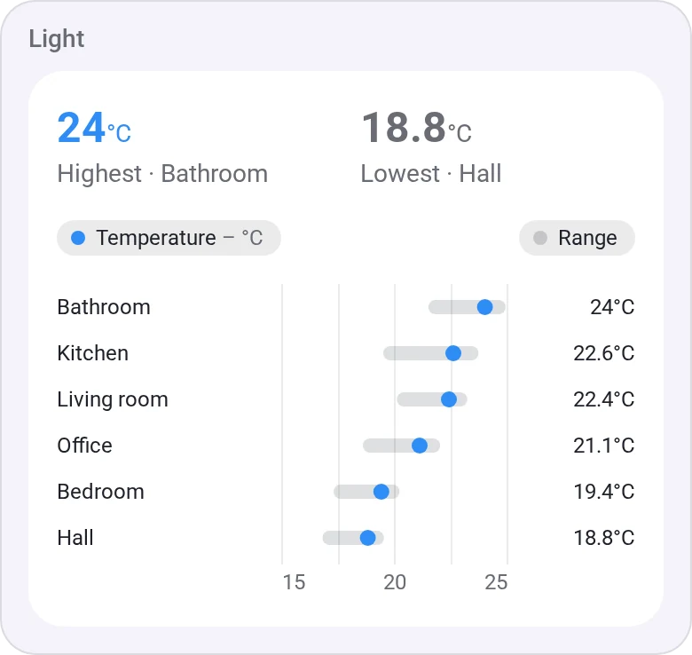
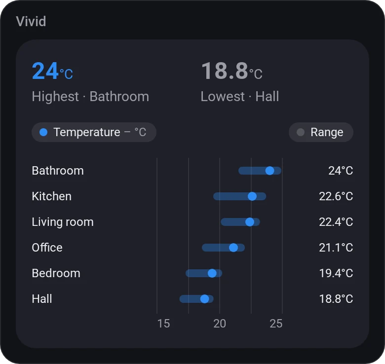
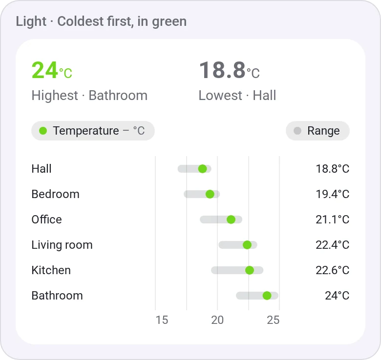
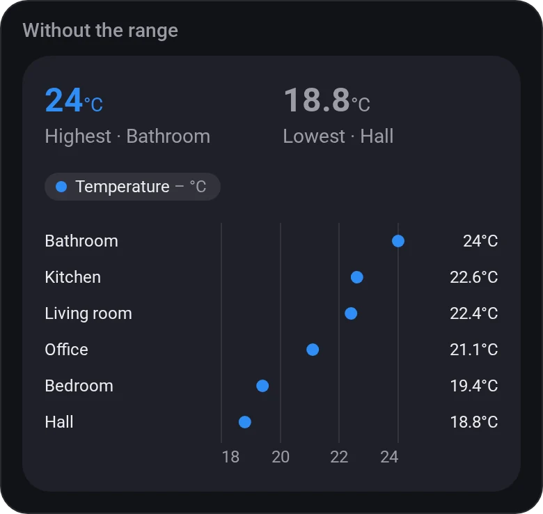
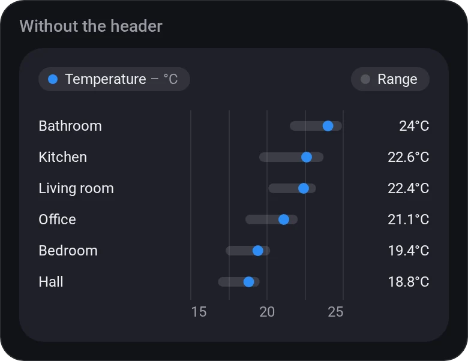
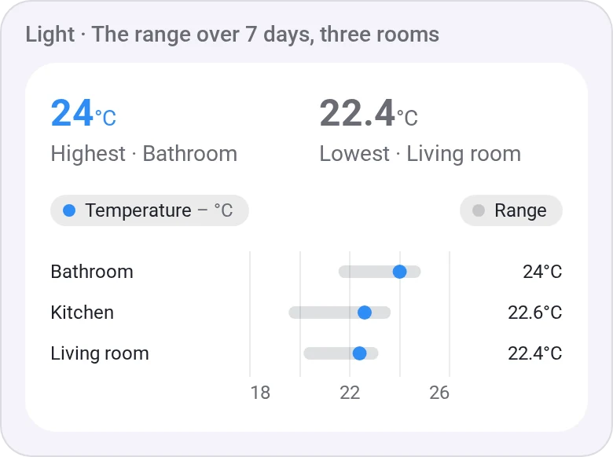
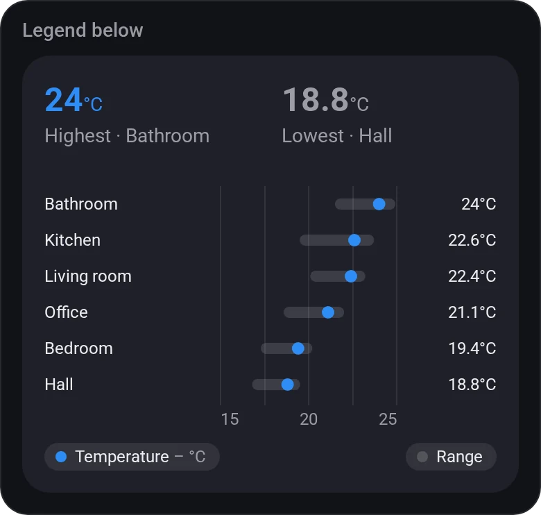

# Chart · Ranking

[← All widgets](../../README.md#widgets)

One value from up to eight devices on one scale, sorted: each room's temperature now as a dot and its range today (or over another [time span](charts.md#time-spans)) as a bar.

**Settings:** values 1 to 8 each with an optional name, [time span](charts.md#time-spans) for the ranges, order (highest first, lowest first or as picked), show the range, the legend (above, below or hidden), title, the values at the top, colour, [colour style](../../README.md#colour-style).

## Looks

---
[← All widgets](../../README.md#widgets)
