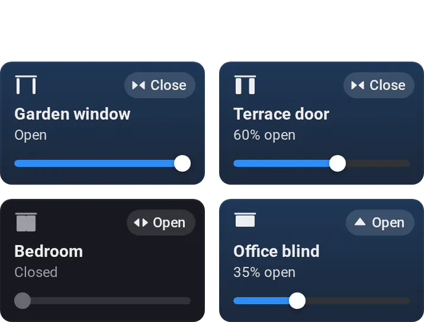

# Curtains

[← All widgets](../../README.md#widgets)

Curtains and blinds as tiles: tap to open or close (the corner label says which), or use the slider for anything between. A tap while it moves sends it back.

**Settings:** devices, what a tap does halfway, inverted position (leave it off when the device's own invert setting already flips it), how close to the end counts as open or closed, state line, group by room, colour, [colour style](../../README.md#colour-style), [rename tiles](../../README.md#tile-names).

---
[← All widgets](../../README.md#widgets)
