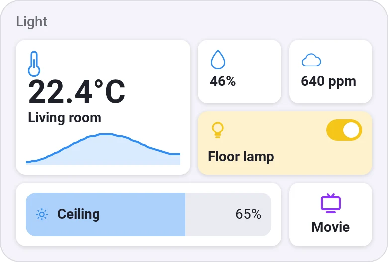
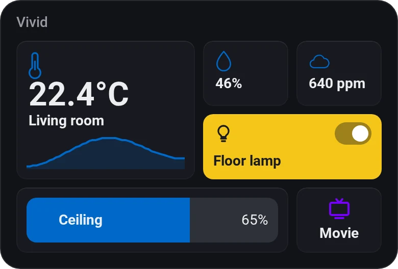

# Widget Builder

[← All widgets](../../README.md#widgets)

For [web dashboards](../../README.md#web-dashboards) only, for now: a widget you design yourself. On the web dashboards' front page, under **Widget Builder**, tap **New design**. The builder shows your design at its real size, with its live values:

- Tap a part on the left to add it. It goes at the bottom, or into the container you've selected.
- Drag a part to move it and its corner to resize it; the parts below make room.
- On the right, the selected part's settings: **Part** (what it shows or changes, its size and place), **Look** (colour, icon), **Rules** and **Flow**.

Changes are saved as you go, and Undo takes them back. **Add to dashboard** puts the design on a web dashboard, or add it there yourself with Add widget → Widget Builder and pick it in the widget's settings. A change to a design shows on every dashboard that has it.

**Parts:**
- **Show:** Value (big on two rows, with its line over a span if you like), Mini chart, Gauge, Level bar, Status (a dot that lights up), Flow value (only Flows fill it).
- **Control:** Switch, Button (starts a Flow, or fires *A Widget Builder button was tapped*), Slider, Stepper (− and +, for a setpoint or a number variable), Choice (one of a few: a mode, a scene, a variable's value), Variable.
- **Layout:** Container, Text, Icon.

A **container** is a background (a colour or a gradient) that holds parts of its own, on a finer grid (12 columns, 8 px rows) or placed freely.

**Rules:** a part can change with its value: above, below, is or is not a value turns it a colour, or hides it. The first rule that holds wins.

**Flow cards:** nothing is open to Flows until you say so. In a part's Flow tab you choose what a Flow may change: its text, value, colour, icon, or whether it's shown. Only those parts appear in the cards, named *Design · Part*. You also choose when a Flow's change goes back: never, after an hour, or at midnight.
- *Set the text of …*, *Set the value of …*, *Colour …*, *Give … a custom colour*, *Give … the icon …*, *Show or hide …*, *Put … back as designed*
- *… is shown* (a condition)
- *A Widget Builder button was tapped* and *A Widget Builder choice was made* (triggers)

Starting a Flow or setting a variable needs the [API key](../../README.md#api-key).

**Settings:** the design; [colour style](../../README.md#colour-style).

## Looks

---
[← All widgets](../../README.md#widgets)
