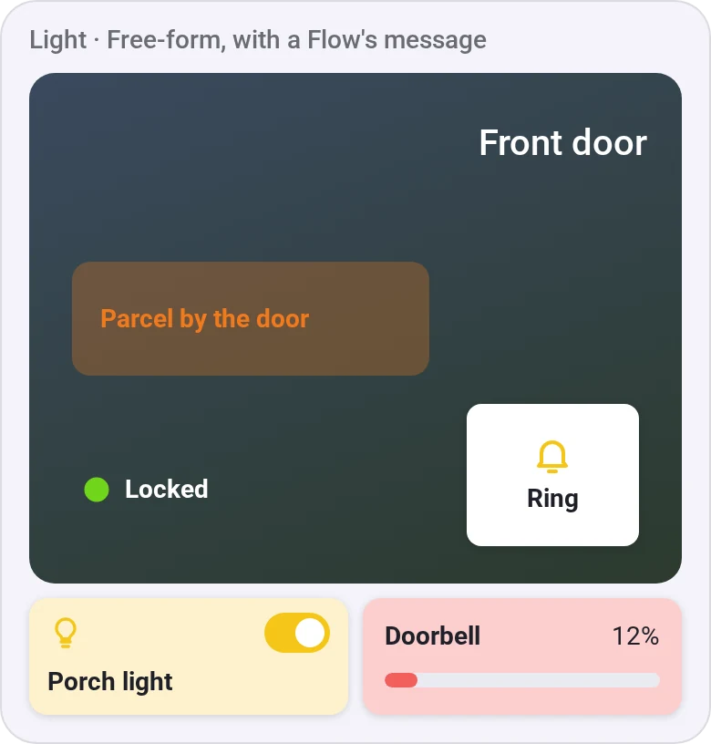
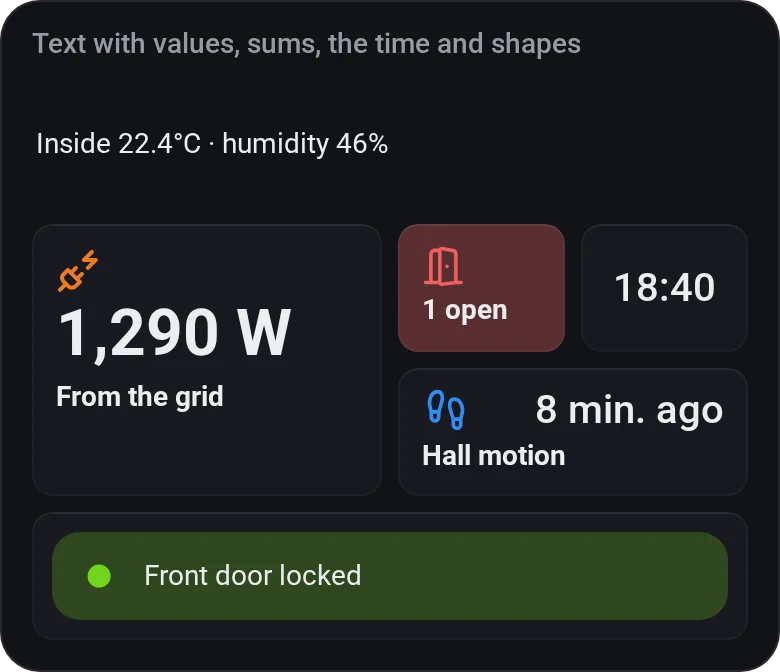

# Widget Builder

[← All widgets](../../README.md#widgets)

For [web dashboards](../../README.md#web-dashboards) only, for now: a widget you design yourself. On the web dashboards' front page, under **Widget Builder**, tap **New design**. The builder shows your design at its real size, with its live values:

- Tap a component on the left to add it at the bottom (or into the selected container), or drag it to where you want it.
- Drag a component to move it, or drag its corner to resize it. The components below move down to make room.
- On the right, the selected component's **Settings** (what it shows or changes, its position and size), **Style** (colour, icon, and a tile, pill or no background), **Rules** and **Flows**.
- The moon or sun in the bar switches the editor and the preview between dark and light.

Changes are saved as you go, and Undo takes them back. **Add to dashboard** puts the design on a web dashboard, or add it there yourself with Add widget → Widget Builder and pick it in the widget's settings. A change to a design shows on every dashboard that has it.

**Components:**
- **Layout:** Container, Text (with values in it: *Inside {1} · humidity {2}*, each a device value, a variable, a calculated value, the time, the date or the weekday), Icon, Shape (a rectangle, circle or line, in a colour or a gradient).
- **Display:** Value (large over two rows, with a graph if you like), Mini chart, Gauge, Level bar, Status (a dot that lights up), Flow value (only Flows fill it), Calculated value (up to 12 values summed, averaged, the lowest or highest and which one it is, a difference, a count such as *3 open*, or a formula like `(a + b) / 2`; it can stay hidden and only feed texts and rules), Time (a clock, the date, how long since a value changed, or the time left until a time of day).
- **Controls:** Switch, Button (starts a Flow, or triggers *A Widget Builder button was tapped*), Slider, Stepper (− and +, for a setpoint or a number variable), Choice (one of a few options: a mode, a scene, a variable's value), Variable.

A **container** is a background (a colour or a gradient) that holds components of its own, snapped to a finer grid (12 columns) or placed freely.

**Rules:** a component can change with its value, or with another one. When the value is above, below, is or is not something you type, it takes a colour or is hidden. The first rule that matches is used. Shapes, texts, icons, buttons and containers have no value of their own, so their rules check another: a dot that turns red while the front door is unlocked, a container that turns orange when the calculated power goes over 2,000 W. A Time's rules compare minutes (*no motion for 30 minutes*).

**Flow cards:** Flows can't change anything until you allow it. In a component's Flows tab you choose what Flows may change: its text, value, colour, icon, or whether it's shown. Only those components appear in the cards, named *Design · Component*. You also choose when those changes are reset: never, after 1 hour, or at midnight.
- *Set the text of …*, *Set the value of …*, *Colour …*, *Give … a custom colour*, *Give … the icon …*, *Show or hide …*, *Put … back as designed*
- *… is shown* (a condition)
- *A Widget Builder button was tapped* and *A Widget Builder choice was made* (triggers)

Starting a Flow or setting a variable needs the [API key](../../README.md#api-key).

**Settings:** the design; [colour style](../../README.md#colour-style).

## Looks

---
[← All widgets](../../README.md#widgets)
