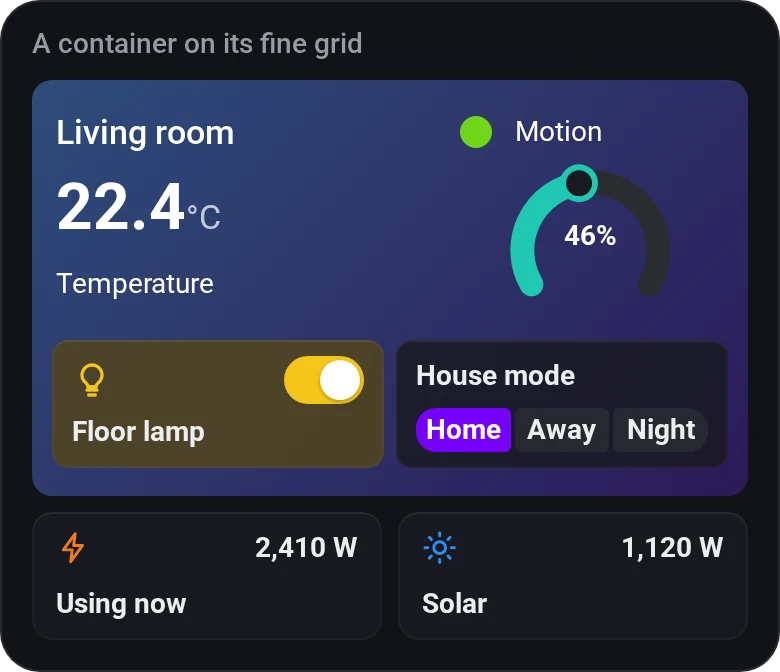
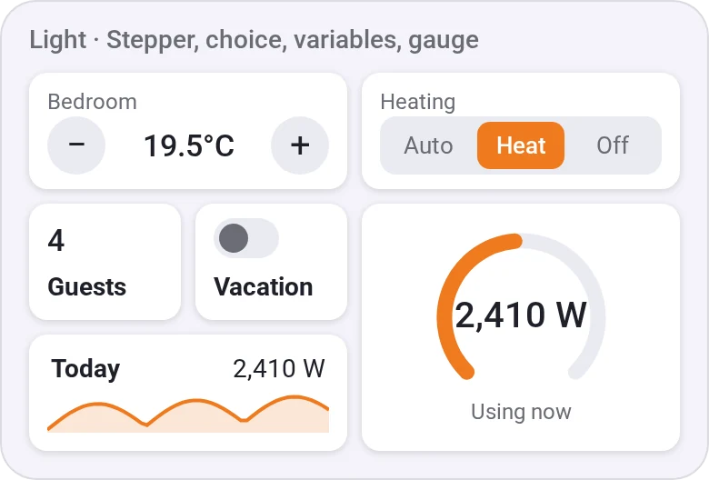
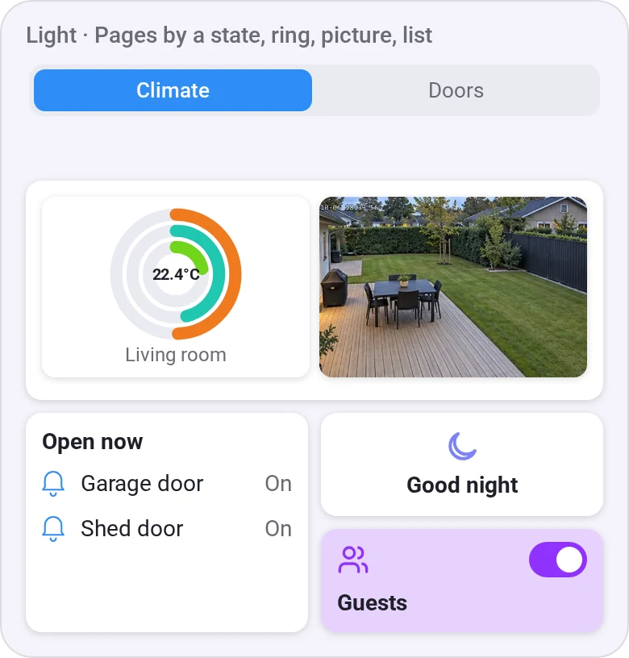
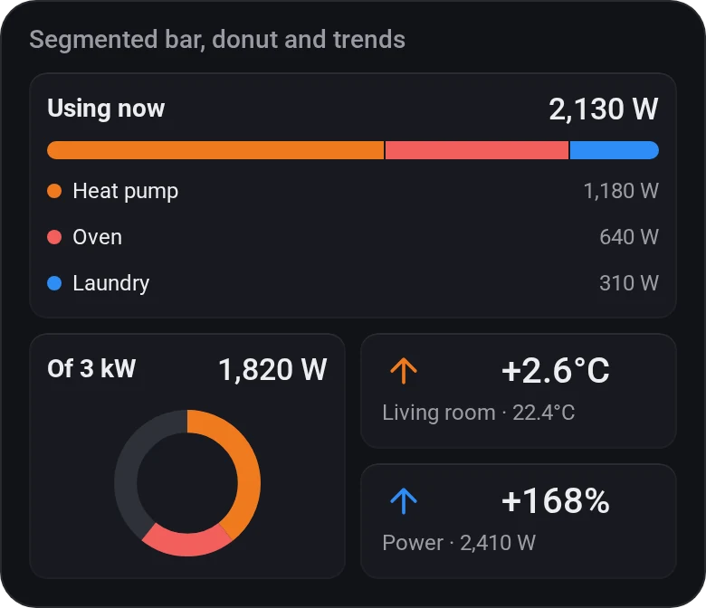
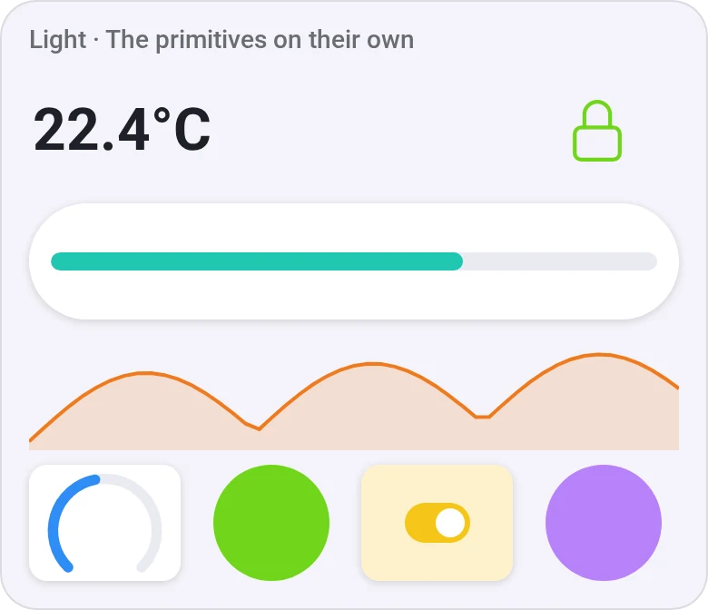
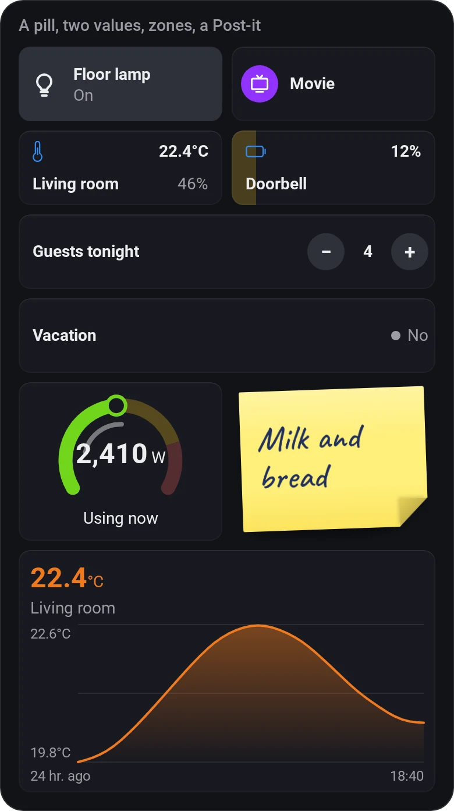

# Widget Builder

[← All widgets](../../README.md#widgets)

A widget you design yourself, for a Homey dashboard or a [web dashboard](../../README.md#web-dashboards). You build it on the web dashboards: open **Widget Builder** from the side pane (or the banner on the front page): it lists your designs; open one, or tap **New design**. The builder shows your design at its real size, with its live values:

- Tap a component on the left to add it at the bottom (or into the selected container), or drag it to where you want it: the cells it will cover light up.
- A tap on the design selects the whole thing under it: a container (a ready-made tile) with everything in it. Tap again for the component inside under your finger, and again for one hidden underneath; a tap on a pages container's tab shows that page.
- Drag a component to move it, into a container or out of one, or drag an edge or corner to resize it. The components below move down to make room.
- Select several: Shift and a tap adds a component beside the selection (or takes it away), a drag from an empty spot selects every top-level component it touches, and Ctrl or ⌘ with **A** selects them all. Drag one of them to move them together.
- **The ribbon** at the top, as in Office: the design's name, the tabs, then Undo, Redo and **Done**; under them **Home** (paste, cut, copy, copy and paste a look (colours, box, text style and rules) onto other components, duplicate, delete, select all), **Arrange** (align, space evenly, same width or height, group components into a container and ungroup one, forward and back, lock and hide), **View** (zoom, fit, outlines with each component's name, the guides, dark or light) and **Design** (duplicate the design, add it to a dashboard or delete it, replace a device everywhere in the design, export and import). Fold the tools away with the arrow beside the tabs. A right click on the design gives the same commands.
- **Lock and hide:** a locked component stays where it is: a tap goes to what's under it (select it in Layers to change it). Hidden is only while you build, to get at what's behind: it still shows on dashboards. Both are in Layers too.
- Dragging: Alt (⌥) leaves a copy where it was, Shift keeps it straight across or down, Ctrl or ⌘ turns off snapping in a free-form container. Its size shows under it. Hold Alt over another component to see the distances to it.
- **Try a value** at the bottom of the Rules tab shows the design as if a value were different (say, the door open), in the builder only: nothing is sent or saved.
- **Export** gives a design as a code or a file, with the ready-mades its Repeaters use; **Import** (in the ribbon, or at the top of the Widget Builder's page) adds one as a new design. Its devices are the other Homey's: use **Replace device** to pick yours.
- Keys: the arrows move the selection a cell (Shift resizes it), **Delete** removes it, **Escape** goes up to its container and then lets go; Ctrl or ⌘ with **Z** undoes, **Shift+Z** redoes, **D** duplicates, **C**, **X** and **V** copy, cut and paste, **G** groups. **?** lists them all.
- On the right, the selected component's **Settings** (what it shows or does, its position and size), **Style** (how it looks: a tile, a pill (Quick Actions' and Device Values' pill) or no background, its colour and text colour, a text's size, an icon) and **Rules**. A ⚡ beside a setting lets a Flow set it (below). Every colour is one of the twelve, drawn as Muted or Vivid draws them, or one of your own.
- At the top: a design is made for one dashboard column; **1 col.**, **2 col.** and **3 col.** show it stretched over more, as a web dashboard stretches a widget you drag wider. Then a column's width, Muted or Vivid. **Dark mode** or **Light mode** under the ribbon's View switches the editor and the preview.

Changes are saved as you go; Undo and Redo are at the top of the ribbon, and Duplicate beside a component's name. **Add to dashboard** puts the design on a web dashboard, as wide as the preview, or add it there yourself: Add widget lists every design under **Widget Builder**. On a Homey dashboard, add the **Widget Builder** widget and pick the design under **Design** in its settings. A change to a design shows on every dashboard that has it.

**Any device:** a device value can be *the widget's device* instead of one device: the design then works with any device, picked in the widget's settings where it's placed. The builder shows it with a preview device of your choosing.

**Your own ready-mades:** **Save as ready-made** (a component's Settings) keeps a copy of it, a whole tile with everything in it, to drag into this design or another, and for a **Repeater**, which shows it once for each of its devices (up to 24: those you pick, or every device with a value, in a room or everywhere, by name or lowest or highest value first), its values of the widget's device filled in with each. They're under the library's **Ready-made** tab. One dragged into a design is a **Linked ready-made**: a change to the ready-made shows wherever it's used, and you can move and resize it but not change it there; **Detach** (its Settings) turns it into a copy of its own to change. The bin beside one in the library deletes it, and its linked copies become copies of their own.

**Components** are primitives, each one thing, to put together as you like:
- **Ready-made:** Value tile, Two values (a value with a second one at the end of its name's line, as Device Values' second value), Chart tile, Gauge tile, Level tile, Status tile, Slider tile, Trend tile, Clock and Flow value tile. Each asks for its device value and adds a container of the primitives below (an icon, the value, the device's name, a graph), to change or take apart. They look like the normal widgets: the Value tile as [Device Values](values.md)', the Chart tile as [Sparklines](sparklines.md)', the Gauge tile as [Chart · Gauge](gauge.md)'s dial, the Slider tile as [Light Controls](lights.md)'.
- **Layout:** Container, Text, Icon, Rectangle, Circle and Line (shapes in a colour or a gradient), Image (a picture from the web, or a device's own: a camera's snapshot, album art, read again every few minutes), Repeater (a ready-made of your own, once per device).
- **Display:** Sparkline (a value's history as a line, as [Sparklines](sparklines.md)' line, smoothed if you like), Chart ([Chart · Basic](charts.md)'s chart of up to three values over any [time span](charts.md#time-spans), as areas, lines or bars, smoothed, the scale fitted or from zero, below zero in yellow, the values at the top, the legend above, below or not at all, and the scale and times), Arc ([Chart · Gauge](gauge.md)'s dial, with its colour by level and the range over a time span), Bar (a level bar, the same options as the Arc), Ring (up to three rings, each a value between its minimum and maximum), Segmented bar (several values as shares of their sum or of a maximum, as a bar or a donut), List (every device with a value, in a room or everywhere, by name or by value; only those that are on or open if you like; each item coloured by its own value, a battery red below 15 %; each device's own icon if you like; a tap can switch one, and other components can use how many it shows: *{1} open*), Calculated value (not drawn: up to 12 values summed, averaged, their median, the lowest or highest, a difference, a count, a formula like `(a + b) / 2`, a value's change over the last hour, day or week, or the minutes since it changed, for texts and rules to use).
- **Controls:** Switch ([Quick Actions](quickactions.md)' tile with [Variables](variables.md)' switch; on as a tint or a lighter tile), Button ([Flow Buttons](flows.md)' round button: starts a Flow, or triggers *A Widget Builder button was tapped*), Slider ([Light Controls](lights.md)' bar), Stepper (Variables' − and +, for a setpoint or a number variable), Choice ([Variable Presets](varpresets.md)' buttons: a mode, a scene, a variable's value), Variable (as a row of Variables: a yes/no switches with a tap, a number has − and +, a number or text is typed right in the tile; or read only), Widget state (an on/off or a choice that only the widget keeps, on that screen: for rules, texts, buttons, or to switch a container's pages).
- **Buttons** can do several things in order: set a device value or a variable (on, off, toggle or a value), start a Flow, open a web dashboard (on a Homey dashboard, in the Homey app's browser), open a web address (on a web dashboard in the same window, so a home-screen web app stays one, or a new tab; in the Homey app, its browser), set a widget state. They can ask for a second tap, or to be held.

**A Text** holds values where you put `{1}`, `{2}` …: a device value or its device's name or room, a variable, a calculated value, the time (with or without seconds), the date, the weekday, how long since a value changed (*8 min. ago*) or a Flow input was set (*3 days ago*), or the time until a time of day. Its sizes are [Notes](textline.md)' (Small, Normal, Large) and Extra large (32 px, its values' units smaller as Chart · Gauge's), its long text cut short, scrolling or on more lines, as Notes'; it can be a Notes Post-it, or dimmed text, and a Flow can set its text, or a number with its units. **An Icon** can follow a device value (a lock open or closed) or show the device's own icon, as a Switch can, and a rule can swap any component's icon as well as its colour. Any component that isn't a control can do things when tapped, like a button: a shape, a text, a picture or a whole container. Switch, Stepper, Choice, Variable and Button can turn off their own icon or label in the Style tab.

A **container** is a tile, a pill or just a background (a colour or a gradient), filled by a value's level if you like (Device Values' *Fill percentages by level*), that holds components of its own, snapped to a grid of its own (12 columns), placed freely, or on **pages** (up to six) switched with tabs, dots or a widget state.

**Colour by value:** a shape, a text, an icon, a bar or an arc can take its colour from a value instead, blended along its range: blue at 15 °C to red at 30 °C, with a colour for the middle if you like. A rule's colour still wins.

**Rules:** a component can change with its value, or with another one. When the value is above, below, is or is not something you type, it takes a colour or is hidden. The first rule that matches is used. Shapes, texts, icons, buttons and containers have no value of their own, so their rules check another: a dot that turns red while the front door is unlocked, a container that turns orange when the calculated power goes over 2,000 W. A calculated *minutes since a change* lets a rule say *no motion for 30 minutes*.

**Flow inputs:** values your Flows set, by name: *Parcel*, *Bins day*, *Alert colour*. Each is a text, a number (with units), a yes/no, a colour or an icon. Tap the ⚡ beside a setting to have it follow one: a text or a component's name, its colour, text colour or fill, its icon, whether it's shown (a yes/no: No hides it), or a container's page (a number from 1, or a page's name). While the input has a value it replaces the setting; without one, the setting's own shows. An input can also be read like any value (in a text's `{1}`, a rule's *Another value*, a calculated value, a ring, arc or bar), and a button can set one, or with the value `now` mark it set just now: a *Watered the plants* button and a text with *how long since*, as [Days Since](dayssince.md). One input can drive any number of components, in any design. The builder's page lists them under *Flow inputs*: rename one, change its type, or delete it.
- **Per device:** an input can keep a value for each device. A design made for any device, or a Repeater's copies, then show each device's own value, and the value for every device where a device has none. The cards' *Device* is left empty for every device.
- **Clear the value:** never, after 1 hour, or at midnight. Back to the setting's own.
- *Set a Widget Builder text input*, *… number input*, *… yes/no input*, *… colour input* (and to a custom colour), *… icon input*, *Clear a Widget Builder Flow input*
- *A Widget Builder Flow input is a value* (a condition)
- *A Widget Builder button was tapped* and *A Widget Builder choice was made* (triggers)

Starting a Flow or setting a variable needs the [API key](../../README.md#api-key).

**Settings:** the design; the device, for a design that works with any device; [colour style](../../README.md#colour-style).

## Looks

---
[← All widgets](../../README.md#widgets)
