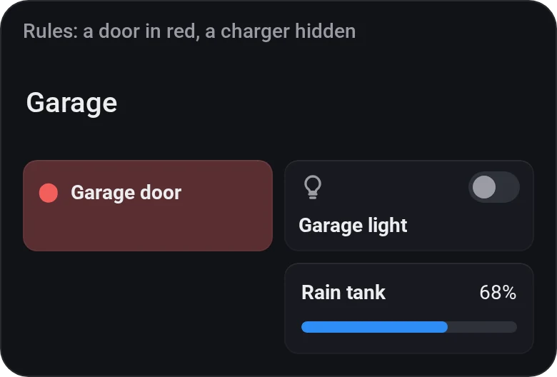

# Widget Builder

[← All widgets](../../README.md#widgets)

For [web dashboards](../../README.md#web-dashboards) only, for now: a widget you design yourself. On the web dashboards' front page, under **Widget Builder**, tap **New design**. The builder shows your design at its real size, with its live values:

- Tap a component on the left to add it at the bottom (or into the selected container), or drag it to where you want it.
- Drag a component to move it, or drag its corner to resize it. The components below move down to make room.
- On the right, the selected component's **Settings** (what it shows or changes, its position and size), **Style** (colour, icon, and a tile, pill or no background), **Rules** and **Flows**.
- The moon or sun in the bar switches the editor and the preview between dark and light.

Changes are saved as you go, and Undo takes them back. **Add to dashboard** puts the design on a web dashboard, or add it there yourself with Add widget → Widget Builder and pick it in the widget's settings. A change to a design shows on every dashboard that has it.

**Components** are primitives, each one thing, to put together as you like:
- **Ready-made:** Value tile, Chart tile, Gauge tile, Level tile, Status tile, Slider tile, Trend tile, Clock and Flow value tile. Each asks for its device value and adds a container of the primitives below (an icon, the value, the device's name, a graph), to change or take apart.
- **Layout:** Container, Text, Icon, Shape (a rectangle, circle or line, in a colour or a gradient), Image (a picture from the web, or a device's own: a camera's snapshot, album art, read again every few minutes).
- **Display:** Sparkline (a value's history as a line), Arc (a gauge's arc), Bar (a level bar), Ring (up to three rings, each a value between its minimum and maximum), Segmented bar (several values as shares of their sum or of a maximum, as a bar or a donut), Repeater (every device with a value, in a room or everywhere, listed by name; only those that are on or open if you like; a tap can switch one, and other components can use how many it shows: *{1} open*), Calculated value (not drawn: up to 12 values summed, averaged, the lowest or highest, a difference, a count, a formula like `(a + b) / 2`, a value's change over the last hour, day or week, or the minutes since it changed, for texts and rules to use).
- **Controls:** Switch, Button (starts a Flow, or triggers *A Widget Builder button was tapped*), Slider (just the bar), Stepper (− and +, for a setpoint or a number variable), Choice (one of a few options: a mode, a scene, a variable's value), Variable (a yes/no switches with a tap; a number or text is typed right in the tile), Widget state (an on/off or a choice that only the widget keeps, on that screen: for rules, texts, buttons, or to switch a container's pages).
- **Buttons** can do several things in order: set a device value or a variable (on, off, toggle or a value), start a Flow, open another web dashboard, set a widget state. They can ask for a second tap, or to be held.

**A Text** holds values where you put `{1}`, `{2}` …: a device value or its device's name, a variable, a calculated value, the time (with or without seconds), the date, the weekday, how long since a value changed (*8 min. ago*), or the time until a time of day. It can be Big (32 px) and bold, and a Flow can set its text or a value with units. **An Icon** can follow a device value (a lock open or closed), and a rule can swap any component's icon as well as its colour. Any component that isn't a control can do things when tapped, like a button: a shape, a text, a picture or a whole container. Switch, Stepper, Choice, Variable and Button can turn off their own icon or label in the Style tab.

A **container** is a background (a colour or a gradient) that holds components of its own, snapped to a finer grid (12 columns), placed freely, or on **pages** (up to six) switched with tabs, dots or a widget state.

**Rules:** a component can change with its value, or with another one. When the value is above, below, is or is not something you type, it takes a colour or is hidden. The first rule that matches is used. Shapes, texts, icons, buttons and containers have no value of their own, so their rules check another: a dot that turns red while the front door is unlocked, a container that turns orange when the calculated power goes over 2,000 W. A calculated *minutes since a change* lets a rule say *no motion for 30 minutes*.

**Flow cards:** Flows can't change anything until you allow it. In a component's Flows tab you choose what Flows may change: its text, value, colour, icon, or whether it's shown. Only those components appear in the cards, named *Design · Component*. You also choose when those changes are reset: never, after 1 hour, or at midnight.
- *Set the text of …*, *Set the value of …*, *Colour …*, *Give … a custom colour*, *Give … the icon …*, *Show or hide …*, *Put … back as designed*
- *… is shown* (a condition)
- *A Widget Builder button was tapped* and *A Widget Builder choice was made* (triggers)

Starting a Flow or setting a variable needs the [API key](../../README.md#api-key).

**Settings:** the design; [colour style](../../README.md#colour-style).

## Looks

---
[← All widgets](../../README.md#widgets)
