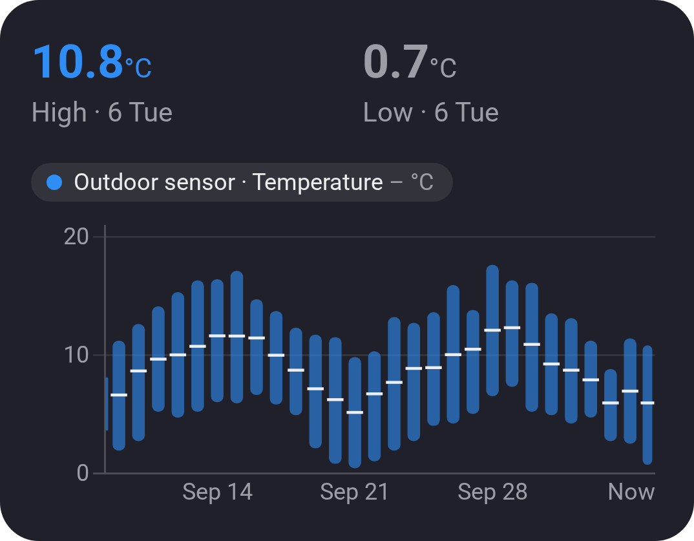
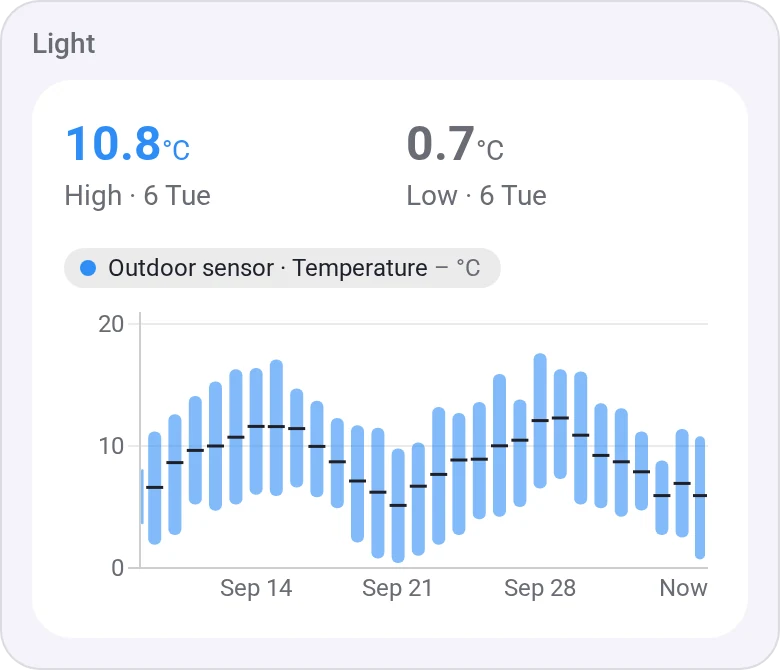
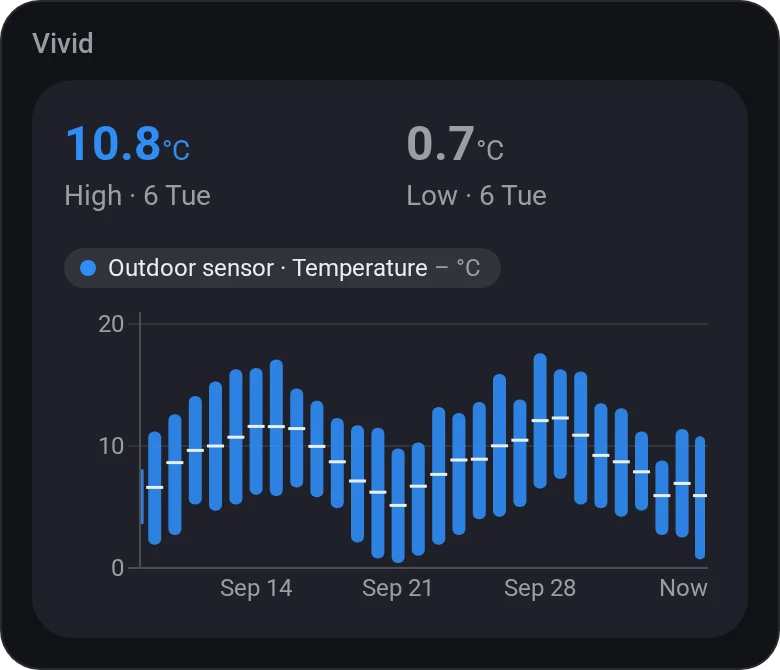
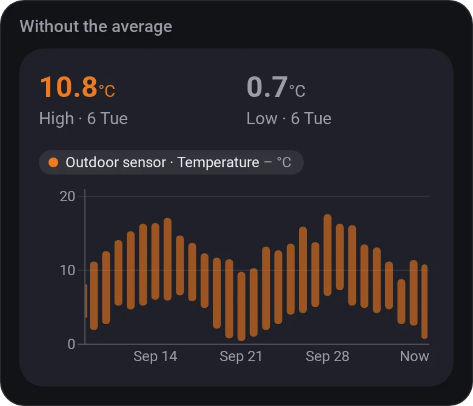
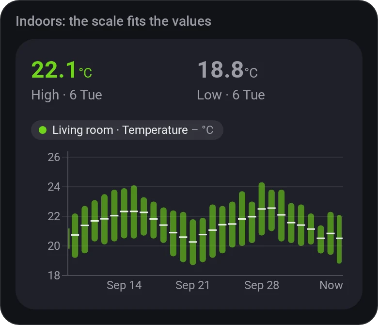
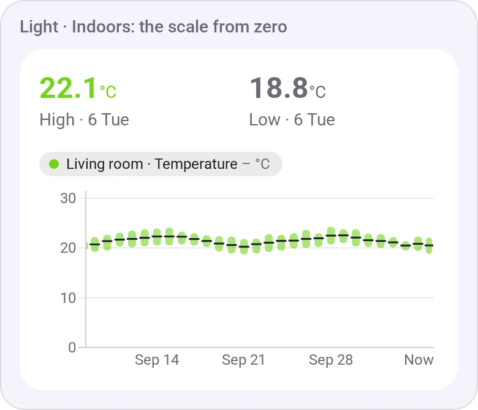
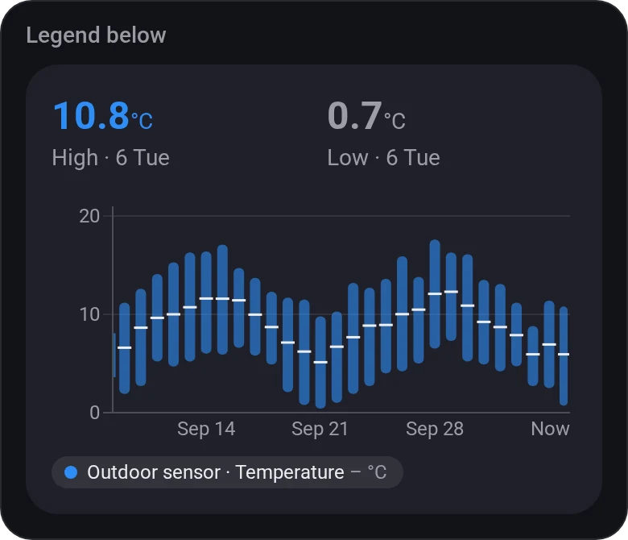
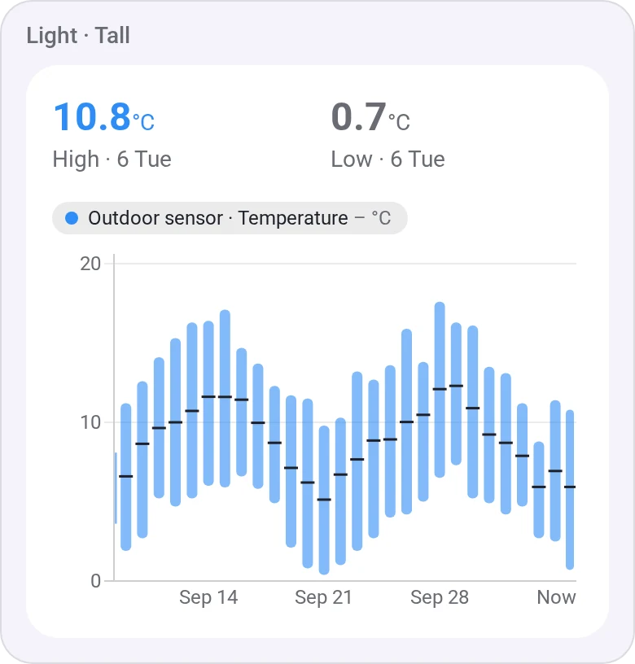

# Chart · Min/Max

[← All widgets](../../README.md#widgets)

Each day's lowest to highest as a bar, its average as a tick: how cold the nights and how warm the afternoons were. The last four weeks by default; other spans get their own bars (an hour each over a day, a month each over a year). Past eight days, Insights' 6-hour averages make the lows and highs a little milder than the real ones.

**Settings:** the value, [time span](charts.md#time-spans), average tick, scale (fitted or from zero), chart height (small, normal or tall), the legend (above, below or hidden), title, the values at the top, colour, [colour style](../../README.md#colour-style).

## Looks

---
[← All widgets](../../README.md#widgets)
