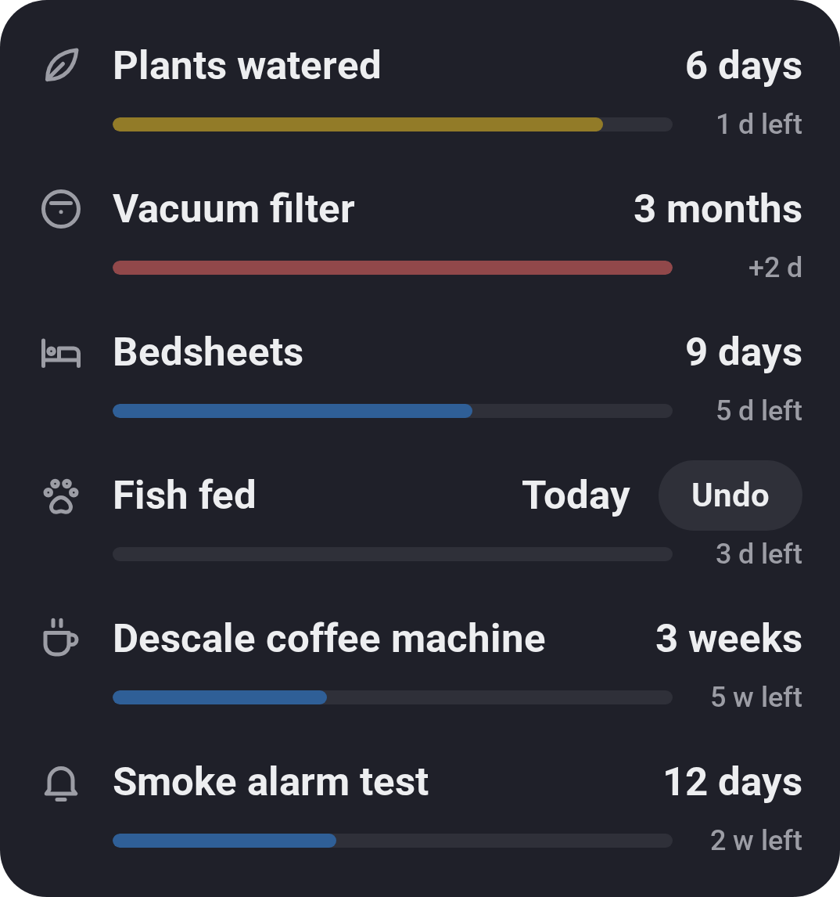
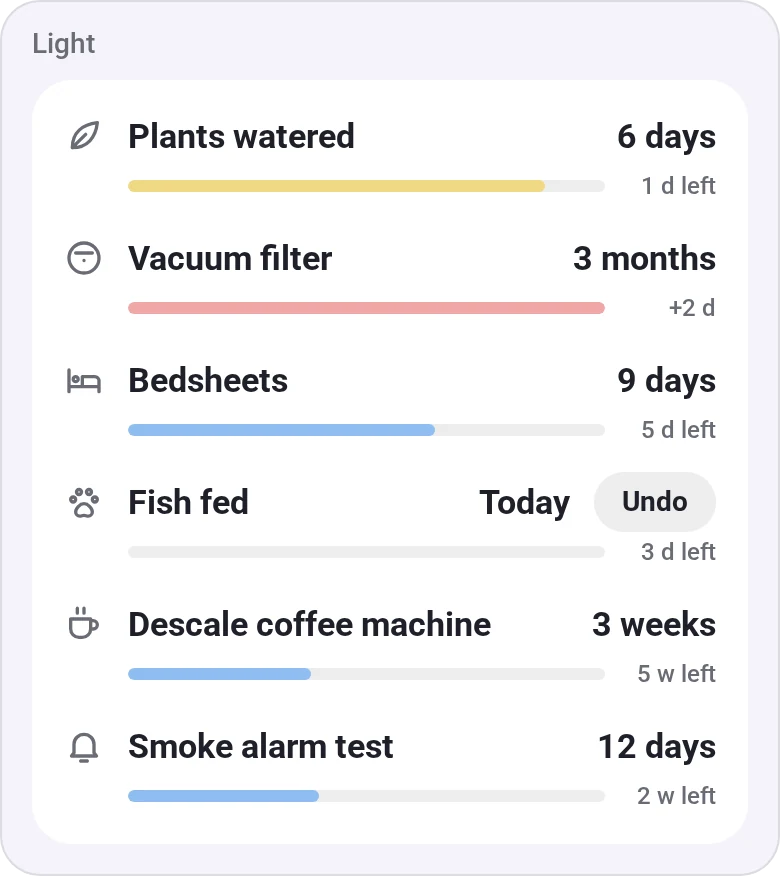
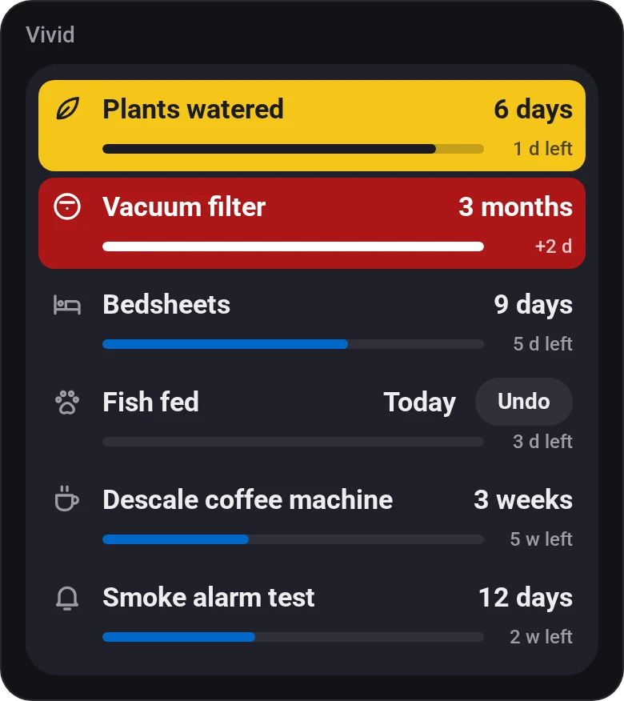
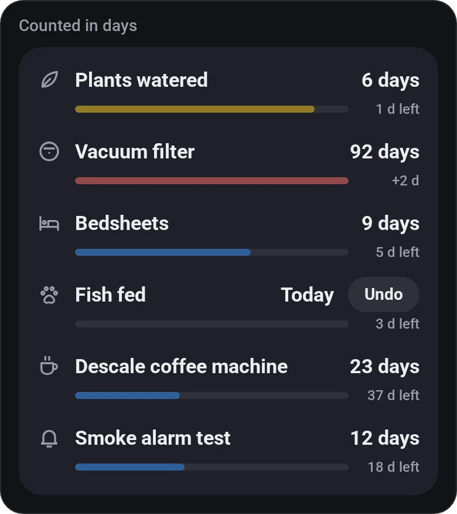
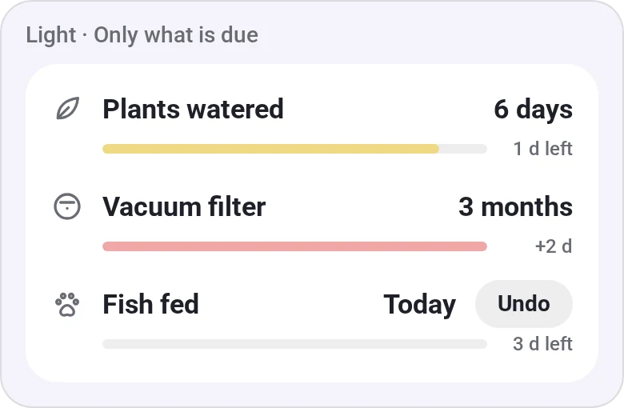

# Days Since

[← All widgets](../../README.md#widgets)

Counters for things you do every so often, such as watering the plants or changing the vacuum filter, in a list on one card. Each bar fills up towards the day the counter is due, with the time left under it; it turns amber, then red, after the days you set, and then shows how long it's overdue (*+2 d*). Tap a row when it's done to start again from *Today* (with **Undo** for a few seconds). Counters are kept on Homey by name, so every widget and screen with the same counter shows the same one.

Flow cards: *Reset [counter]*, *Set [counter] to [days] days ago*, the trigger *[counter] became overdue* (even with no dashboard open) and the condition *[counter] is overdue*; the last two also take *Any counter*.

**Settings:** days only or days, weeks and months; all counters, or only those that are amber and red (or only red), so the ones far from due don't take up room; [colour style](../../README.md#colour-style); up to eight counters, each with a name, an icon and the days until amber and red.

## Looks

---
[← All widgets](../../README.md#widgets)
