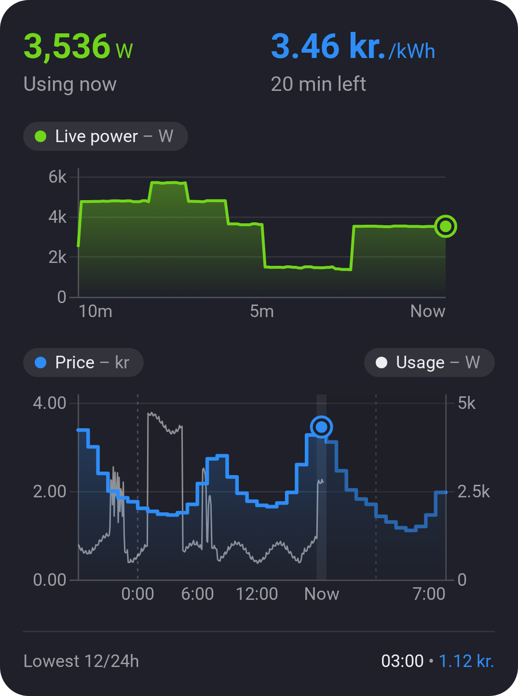
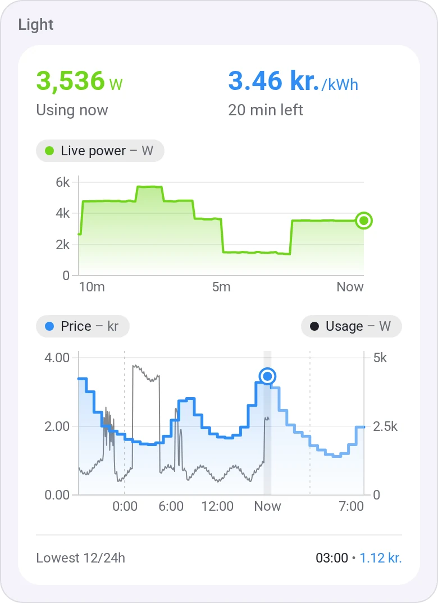
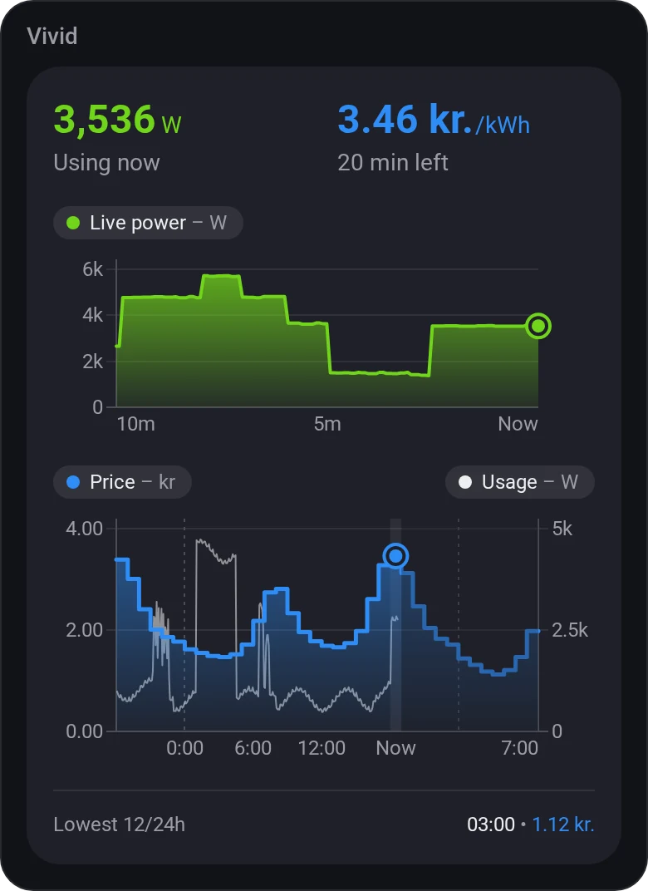
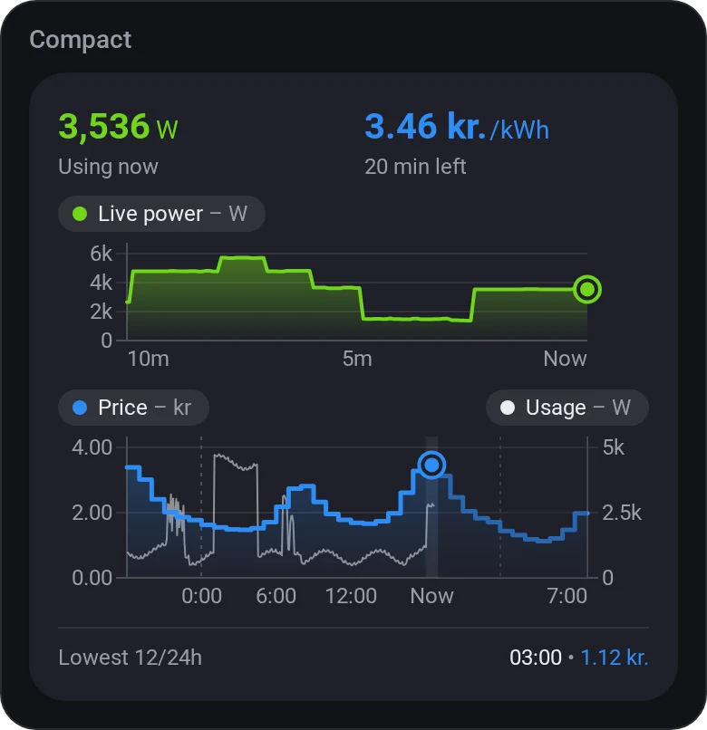
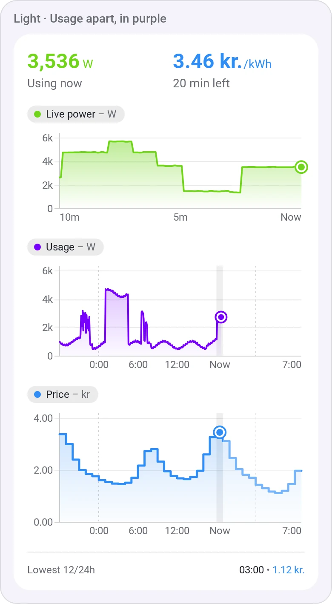
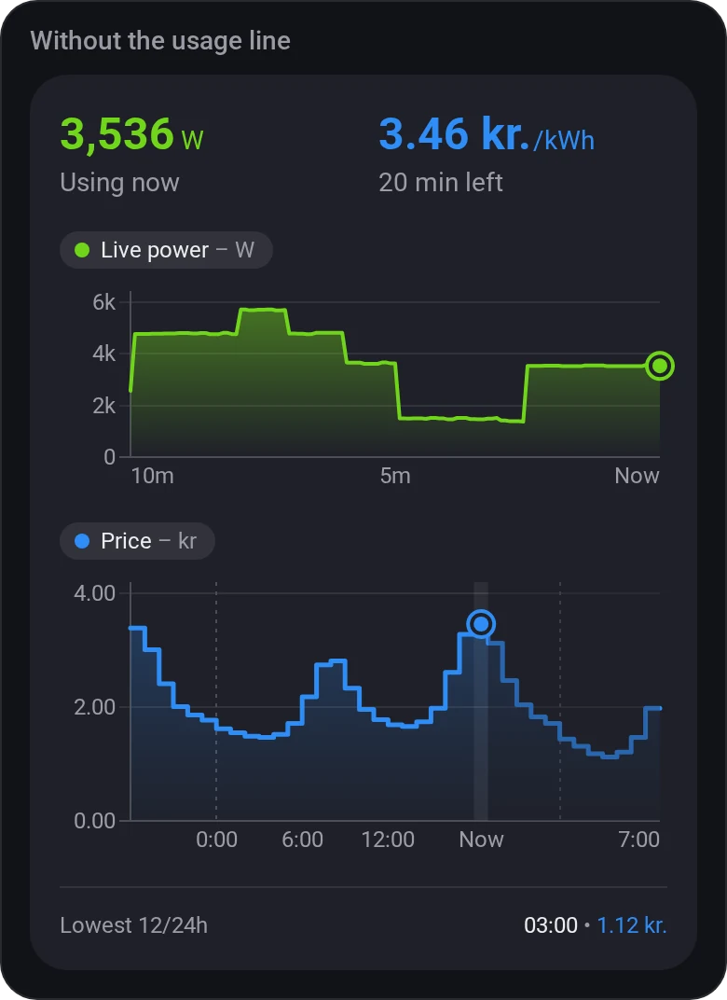
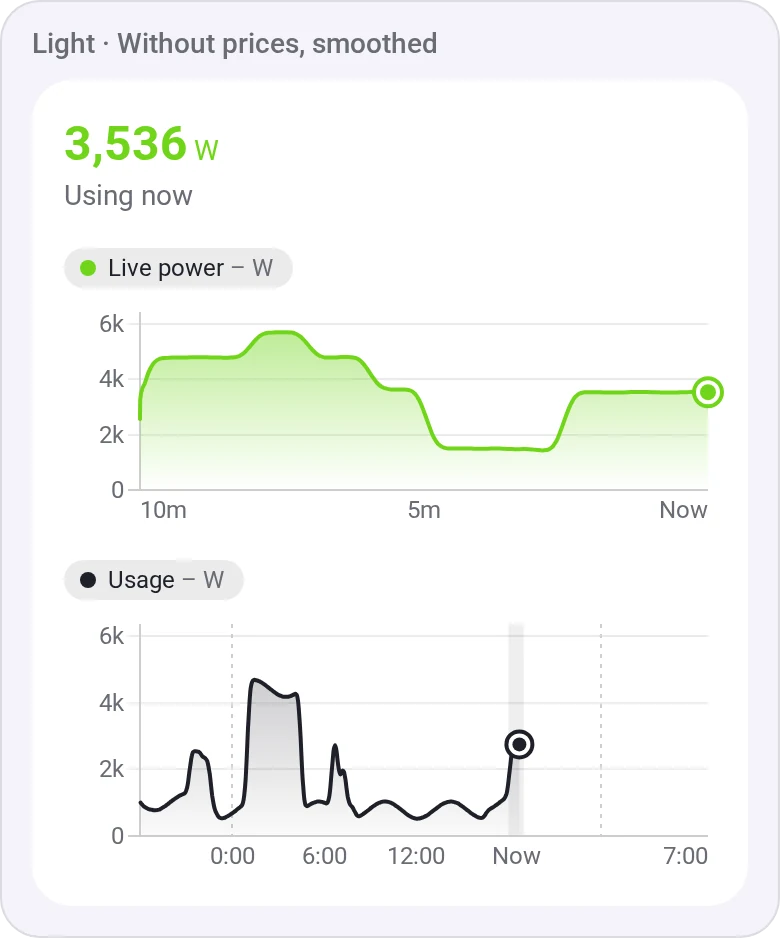
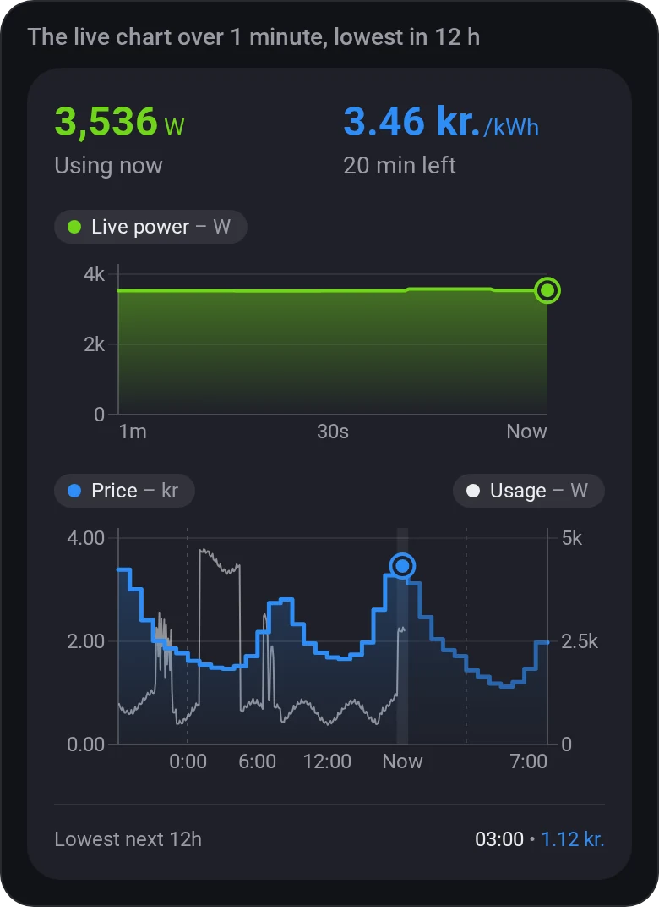

# Electricity Overview

[← All widgets](../../README.md#widgets)

Live power use, the hourly price from yesterday to 12 hours ahead (with your tariffs and taxes from Homey Energy), the last 24 hours of usage and the cheapest hour ahead. Tap a chart to see its values. Works with a fixed price too, and shows solar export below zero.

**Settings:** power meter, live time span, prices, tariffs and taxes, usage history and its colour, smooth lines, lowest price in 12 h / 24 h, compact layout, [colour style](../../README.md#colour-style).

## Looks

---
[← All widgets](../../README.md#widgets)
