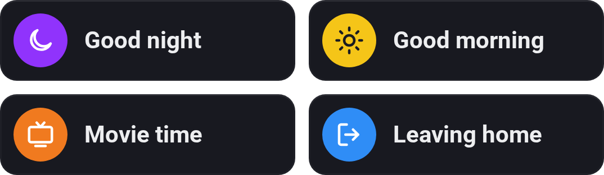

# Flow Buttons

[← All widgets](../../README.md#widgets)

Flows and Advanced Flows as rows with a round button in your colour and icon. Tap a row to start the flow. Needs an [API key](../../README.md#api-key) with **Start Flows**. The Flow card **Set the button colour of … to …** colours the buttons that start a flow, such as green while an e-bike charges; **Default** gives them their own colour again.

**Settings:** up to eight flows, each with a colour, an icon and an optional name; 1 or 2 columns; [colour style](../../README.md#colour-style).

---
[← All widgets](../../README.md#widgets)
