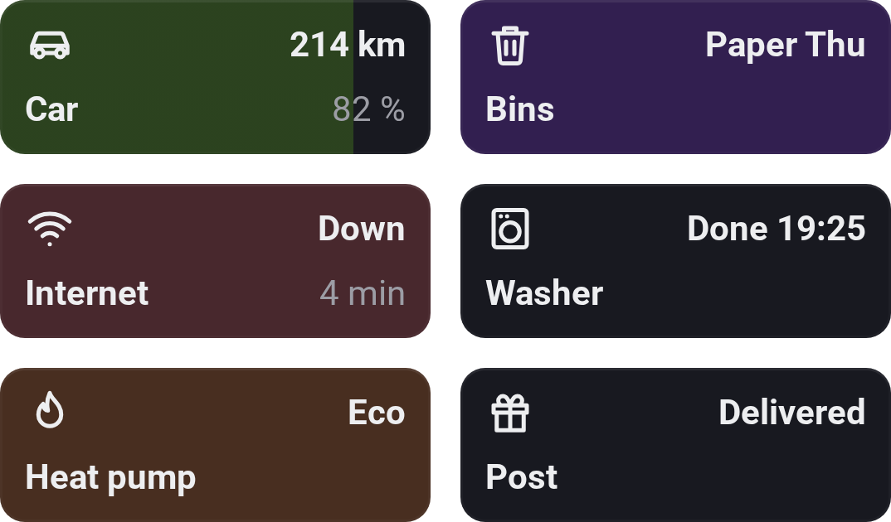

# Flow Tiles

[← All widgets](../../README.md#widgets)

Device Values' tiles, written by your Flows instead of read from a device: the bins (*Paper on Thursday*), the car's range with its battery as a fill, the internet check in red, when the washer is done. The tiles are on a **board** (*Tiles* unless you name another), and every Flow Tiles widget showing that board shows them, on every screen. A Flow card makes a tile the first time it names it:

- **Set Flow Tile … on … to …**: a text, or a number in your screen's number format with optional units (`°C`, `%`, `kWh`, `kr` …) and up to 2 or exactly 0–2 decimals.
- **Set the second line of …**: small and muted after the name; empty removes it.
- **Give Flow Tile … the icon … in …**: one of Flow Buttons' icons and a colour (*Default* for the widget's own).
- **Fill Flow Tile … to … %** and **Remove the fill**: from the left, like a battery level, in the tile's colour (blue without one).
- **Remove Flow Tile …** and **Remove every Flow Tile from …**.

Each card changes only its part, so one Flow can set the value every minute while another sets the colour when it crosses a limit. The trigger **Flow Tile … on … was tapped** (any board or tile too, with the tile's name and value as tags) makes those tiles tappable; tiles no Flow listens to aren't.

**Settings:** board, show only (tile names separated by commas, in that order), order (as added or by name), 1, 2 or 3 columns, compact or pill tile, [colour style](../../README.md#colour-style), on tap (highlight or none), show when it changed.

---
[← All widgets](../../README.md#widgets)
