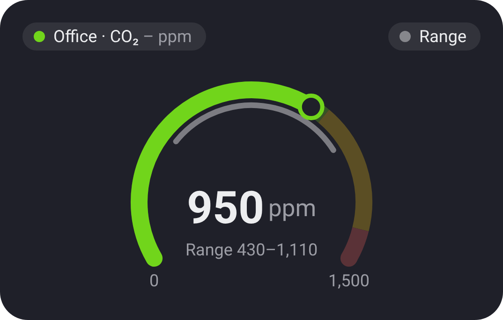

# Chart · Gauge

[← All widgets](../../README.md#widgets)

One value now on a bar: a room's CO₂ or humidity, a battery, the house's power. A percentage goes from 0 to 100; anything else gets a scale fitted around today's values (or another [time span](charts.md#time-spans)), or one you set. A thin band under the bar shows the lowest to the highest over the time span.

**Colour by level** paints the bar green, yellow and red and the value in its level's colour: *Higher is worse* for CO₂ or power (yellow from 1,000 and red from 1,400 by default, CO₂'s usual limits in ppm), *Lower is worse* for a battery.

**Layout:** a bar, or a dial with the value in its middle and the range inside the arc.

**Settings:** the value, layout (bar or dial), scale (automatic, or from and to), colour by level with where yellow and red start, [time span](charts.md#time-spans) for the range, show the range, title, colour, [colour style](../../README.md#colour-style).

---
[← All widgets](../../README.md#widgets)
