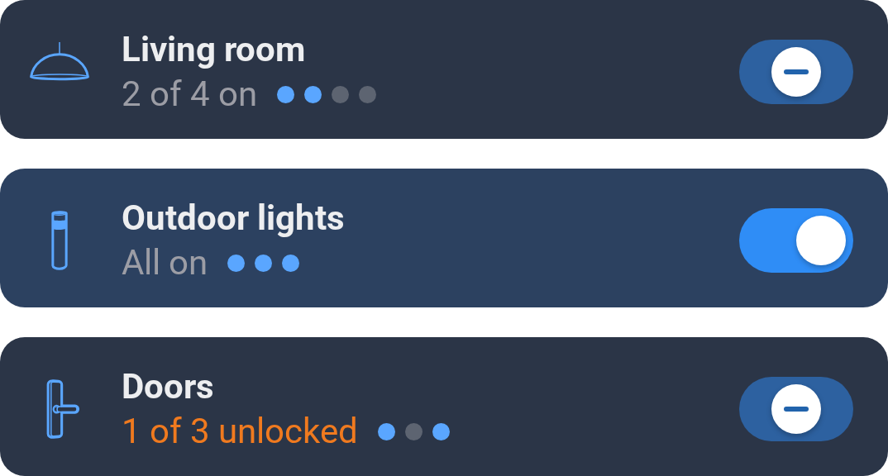
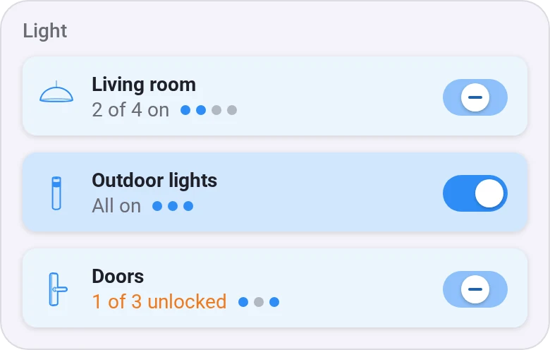
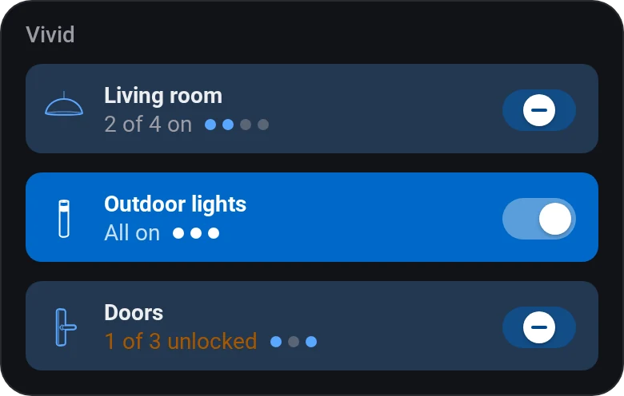
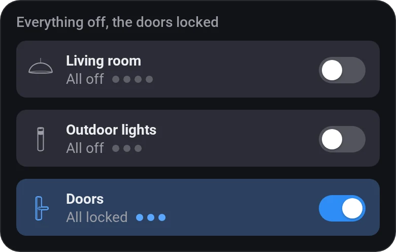
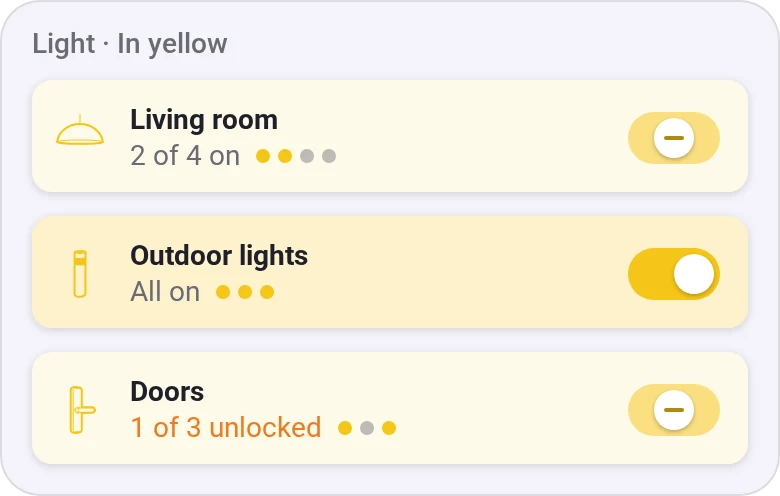
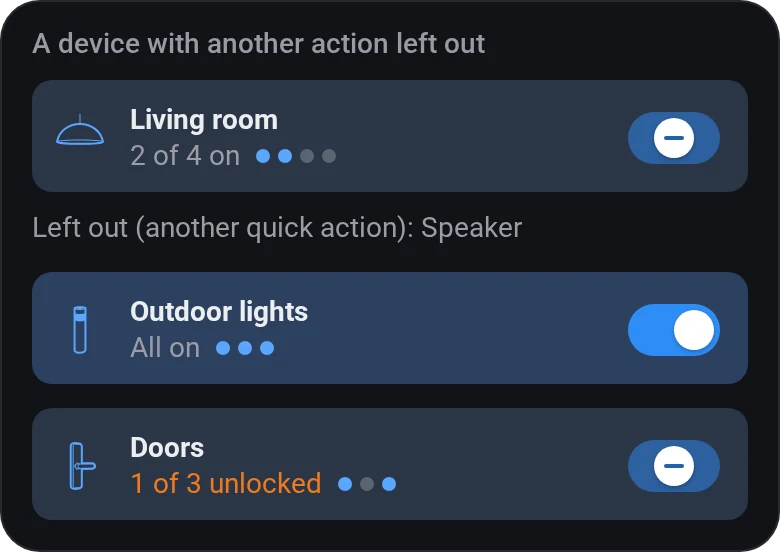
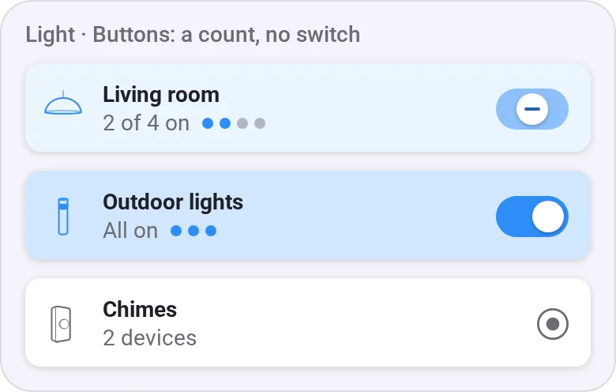
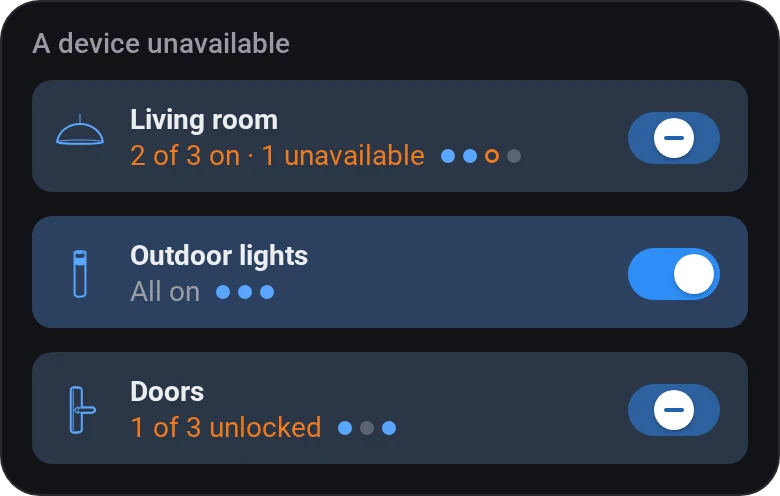

# Group Quick Action

[← All widgets](../../README.md#widgets)

One full-width tile that runs the same quick action on several devices: every light in the living room, every plug of the Christmas lights, every door lock. It's named after the room the devices share (or the name you type), says how many are on (*2 of 5 on*, *1 of 3 unlocked*) with a dot per device, and has a switch that sits in the middle while they disagree.

A tap turns them all off when any is on, and all on when none is. Locks and garage doors work the safe way round: a tap locks or closes the ones that are open, and only unlocks them all when every one is locked. A device that's unavailable is left out of the count and still gets the command. Devices whose quick action is of another kind (a speaker among lights) are left out and named under the tile. Each device's quick action is the one the Homey app's tile uses, as in [Device Quick Actions](quickactions.md).

**Settings:** devices, name (empty: the devices' room, else the first device's name), single, double or long press (so a stray tap can't unlock every door), colour, [colour style](../../README.md#colour-style).

## Looks

---
[← All widgets](../../README.md#widgets)
