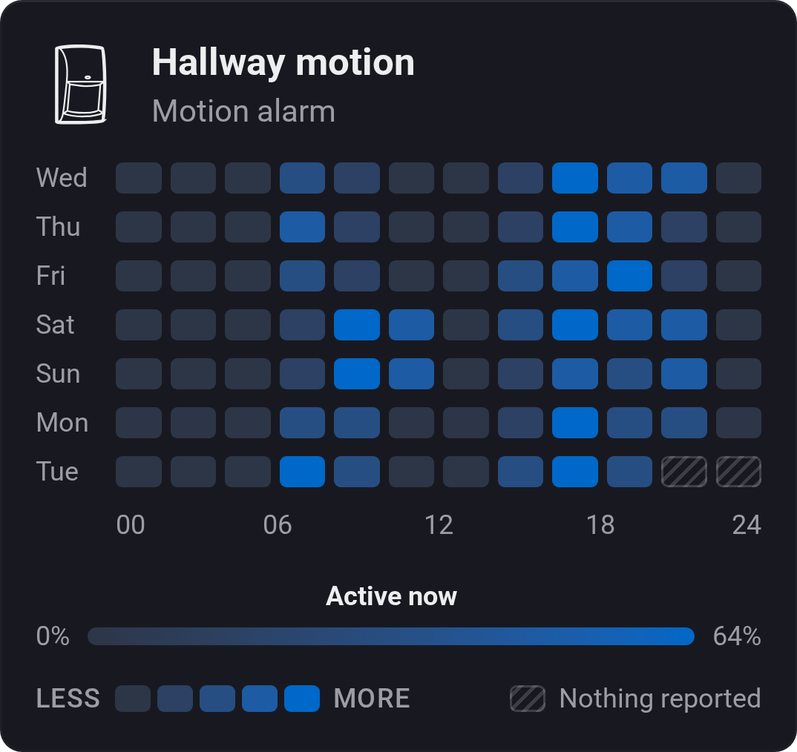
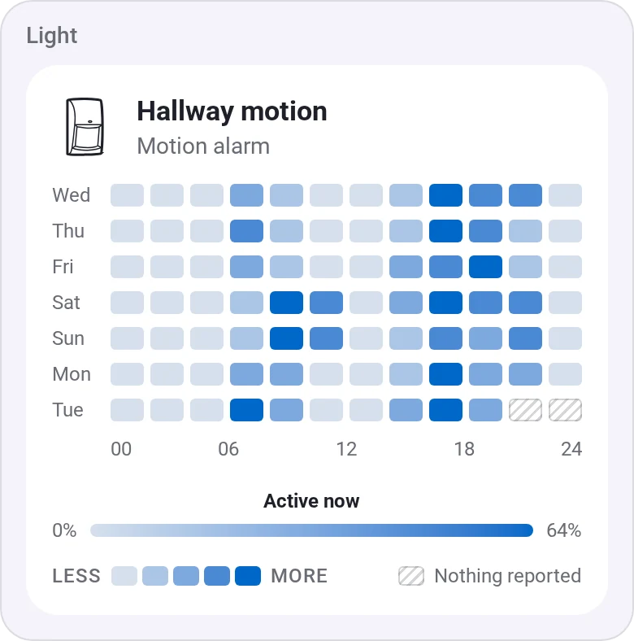
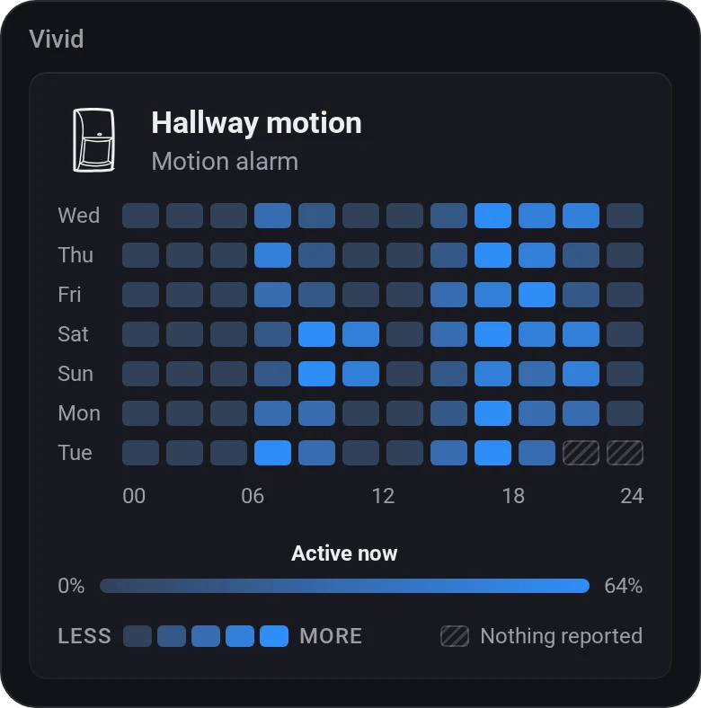
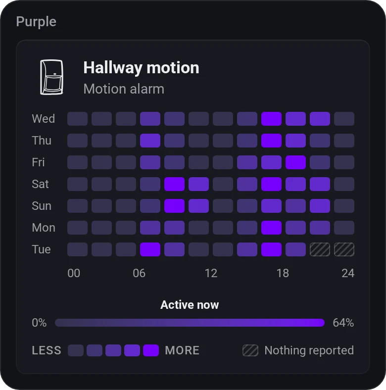
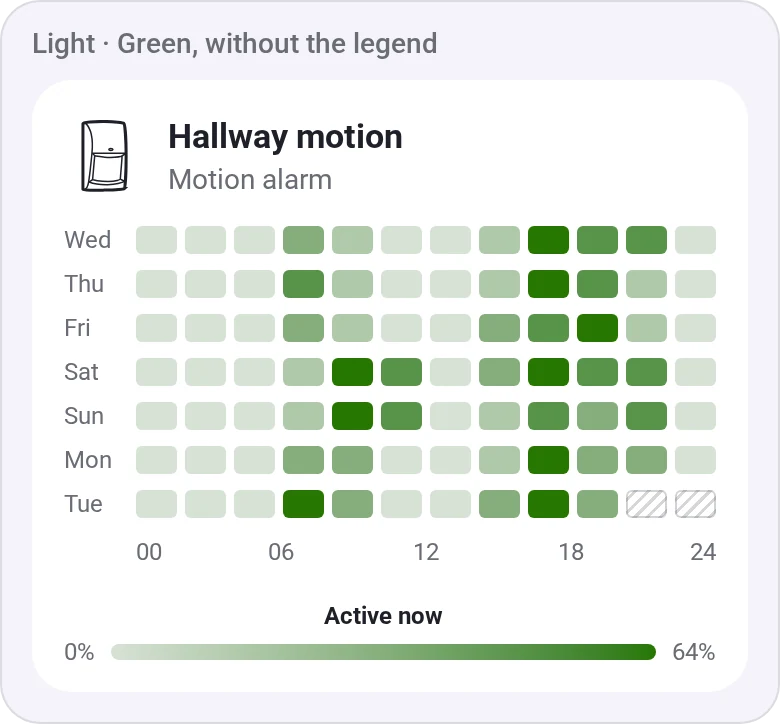

# Insights Heatmap

[← All widgets](../../README.md#widgets)

A week of one Insights value as a grid of days and hours: numbers such as light or temperature, or how much of each hour a sensor was on.

**Settings:** device and value, a title in place of the device's name, this week or the last 3–14 days, hours per column, colour, [colour style](../../README.md#colour-style), scale, legend.

## Looks

---
[← All widgets](../../README.md#widgets)
