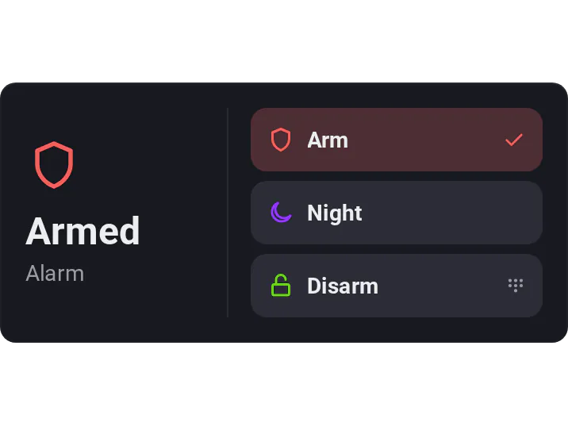
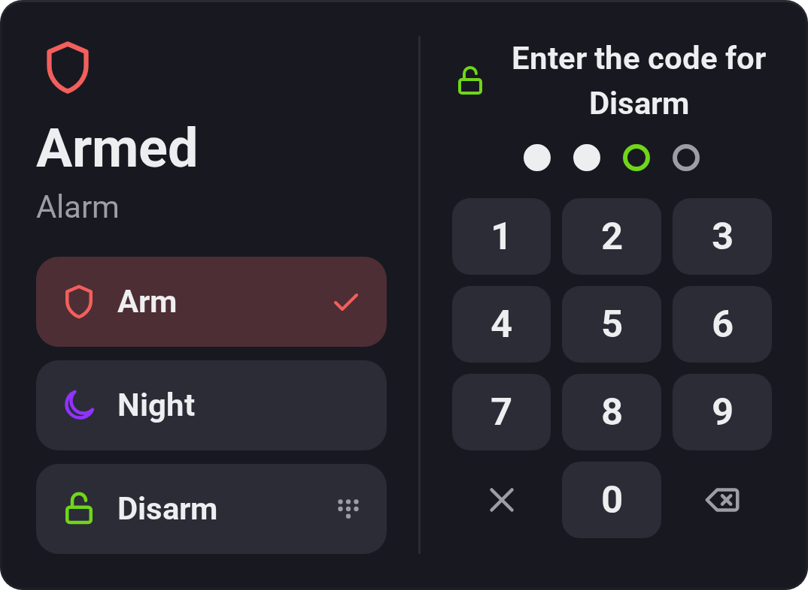

# Keypad

[← All widgets](../../README.md#widgets)

Up to three buttons, each behind an optional 3–6 digit code: arm an alarm, unlock a door, allow an hour of TV. A button starts a Flow, or, without one, sets the widget's state to its value; a button with only a label just starts the Keypad's Flow card (below). The state is a device value or a Logic variable, shown on the left; the button with its value is ticked. A list value, such as an alarm's *Armed*, *Partially armed* and *Disarmed*, or a yes/no one, gets a button per value when none is set up, all behind the code.

A tap on a button that wants the code opens a phone's keypad beside the state (in compact, in place of the widget); it sends the code with the last digit. With **Show the keypad: Always**, the keypad stays beside the state with the buttons under it: type the code, then tap the button, or tap the button first. With just one button behind the code, the code alone runs it.

The codes are made under **Apps → Widgetkeeper → Configure → Keypad codes**: a name, such as *Alarm* or *Kids*, and the digits, typed twice. A widget's **Code** setting picks one by name, so several widgets can share a code and you change it in one place (changing it takes the current code, and adding another takes one of the codes already made; removing it doesn't, and its widgets then refuse their buttons until another is picked). Or it picks **Any code**: then everyone's code works, and the Flow card tells whose it was, so give each person their own (no two codes can share digits). While the codes have different lengths, the keypad has an OK key. Widgetkeeper checks the code on your Homey and keeps only a fingerprint of it, made with a secret only the app has, so the digits are never stored or shown. Five wrong codes in a row lock that code for 30 s, doubling each time up to 15 min, and ten in a row, whichever codes they were, lock them all. The code guards the dashboard (a wall tablet, the children, guests), not your Homey: anyone who can open the Homey app can still start the Flow or change the device there.

**Flow cards:** *A Keypad button was tapped by [code]* (Anyone, Anyone with a code, or one code by name), once a button ran, with the tags **Code** (the code's name, such as *Anna*; empty without one), **Button** and **Keypad** (the widget's title). A Flow started by the button itself gets no tags, so for *Anna disarmed the alarm* use this card. *A wrong code was typed on a Keypad*, at a Keypad or a [web dashboard's code](../../README.md#code), with **Button**, **Keypad** (the widget's title or the dashboard's name), **Locked** (this try locked the code) and **Tries left**.

Starting a Flow needs an [API key](../../README.md#api-key) with **Start Flows**, setting a variable one with **Variables**; setting a device needs no key.

**Background: State colour** fills the whole widget with the ticked button's colour, so a small Keypad still shows from across the room whether the alarm is armed: red for *Armed*, green for *Disarmed*. It's a light tint, stronger with Vivid. A grey button, or a state no button has, leaves it plain, which is also the default.

**Settings:** a title, the state (a device value or a variable), the code (one, or Any code), show the keypad (when a button needs it, or always), compact layout, [colour style](../../README.md#colour-style), background (plain or the state's colour), and per button: a Flow, the state's value it stands for, a label, an icon, a colour and whether it needs the code.

---
[← All widgets](../../README.md#widgets)
