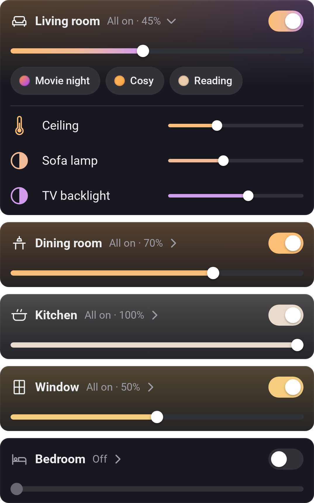

# Lights by Room

[← All widgets](../../README.md#widgets)

For many lights in many rooms. The lights you pick are grouped by their Homey room, a card each with the room's icon, how many lights are on and how bright (the dimmable lights that are on: their average, or the brightest), a switch for the whole room and a bar that dims all of it. Tap a room's name to open it: its Homey Moods as a row of buttons, then a row per light that works as in Light Controls (tap to switch, tap or drag the bar to dim, the colour button for colours and whites). Rooms start closed; open as many as you like. Starting a Mood needs an [API key](../../README.md#api-key) with **Set Moods**.

**Settings:** lights, show the room's Moods, colour palette, room brightness (average or brightest), what the bar's far left does, [colour style](../../README.md#colour-style), [rename tiles](../../README.md#tile-names) (the rooms and lights).

---
[← All widgets](../../README.md#widgets)
