# Light Controls

[← All widgets](../../README.md#widgets)

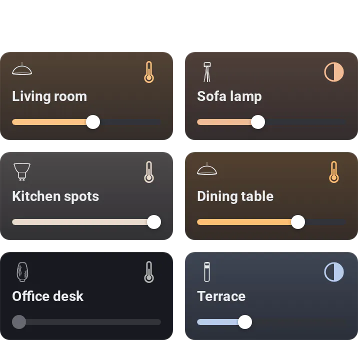

Six lights in the space of three of Homey's light cards. Tap a tile to switch it, drag or tap the bar to dim, and tap the colour button for colours and whites. Lights in a room can share one tile, whose bar shows how bright its dimmable lights that are on are: their average, or the brightest. With the *Room's Moods* palette, the colour button starts the room's Homey Moods instead (needs an [API key](../../README.md#api-key) with **Set Moods**).

**Settings:** lights, group by room, room brightness (average or brightest), widen the last tile, what the bar's far left does, colour palette, [colour style](../../README.md#colour-style), [rename tiles](../../README.md#tile-names).

## Looks

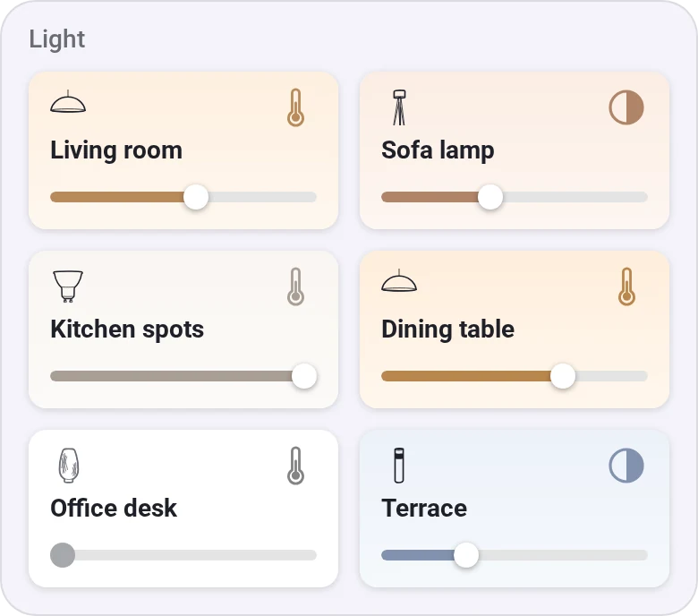
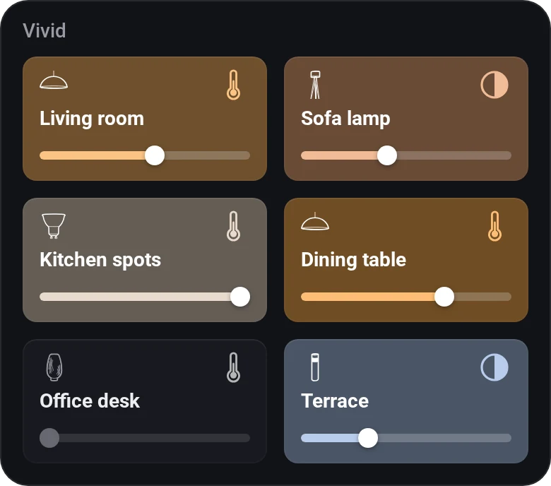
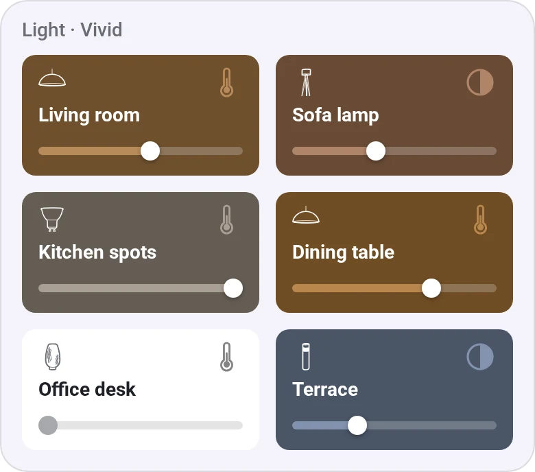
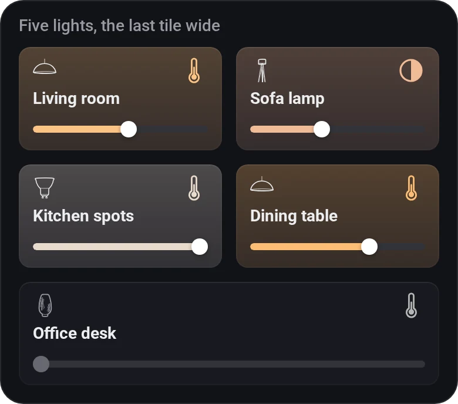
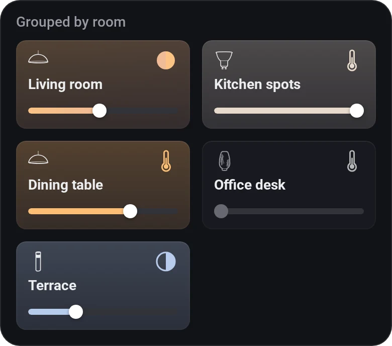
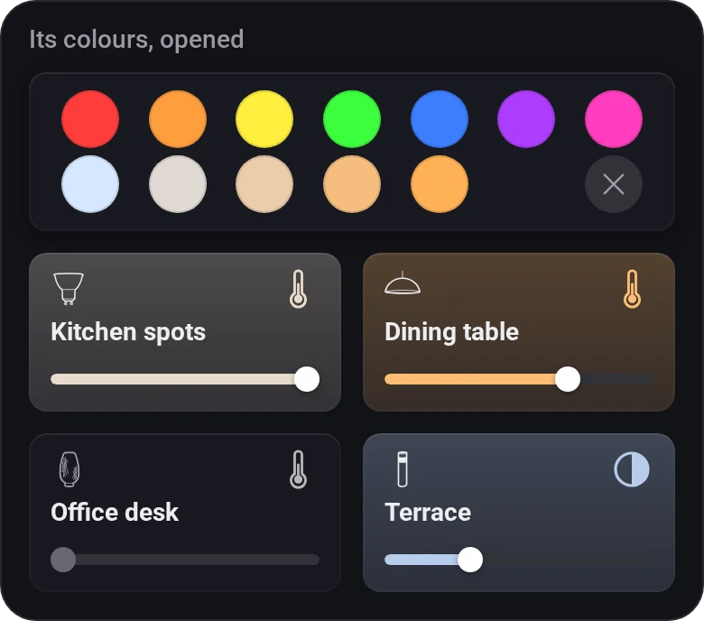
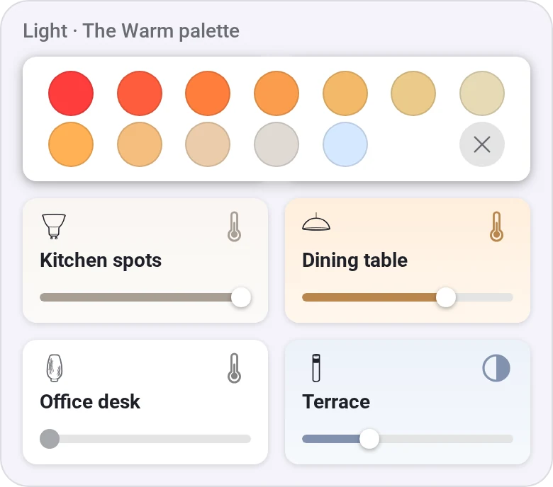
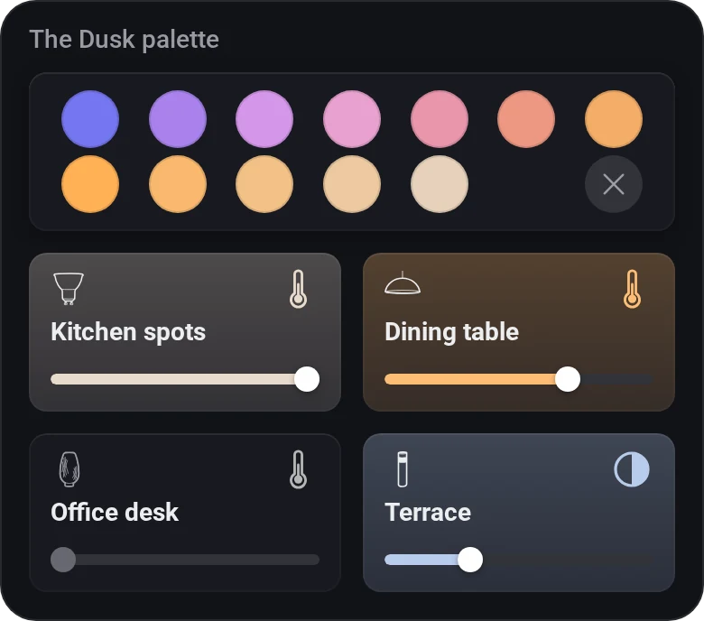
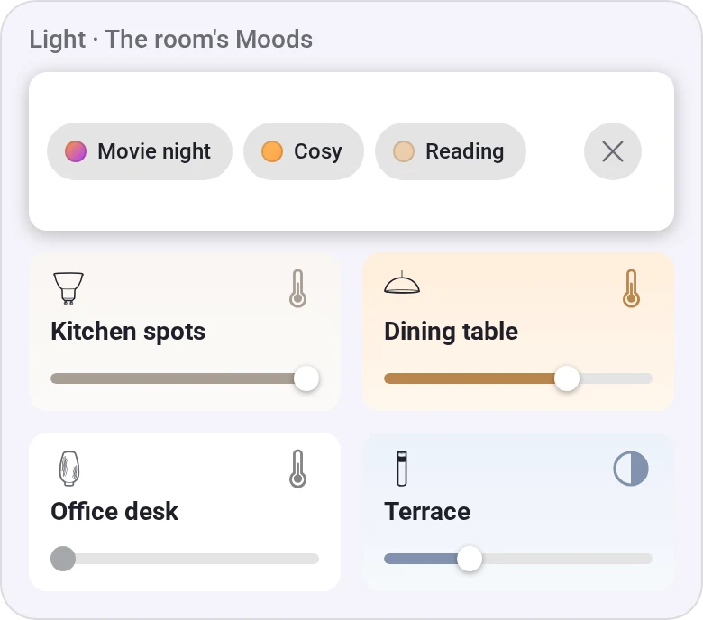
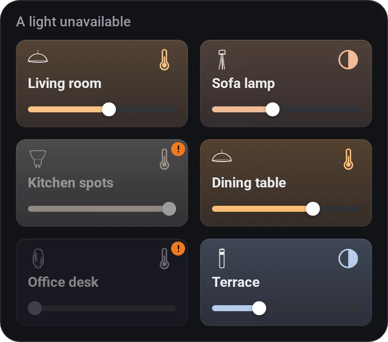

---
[← All widgets](../../README.md#widgets)
