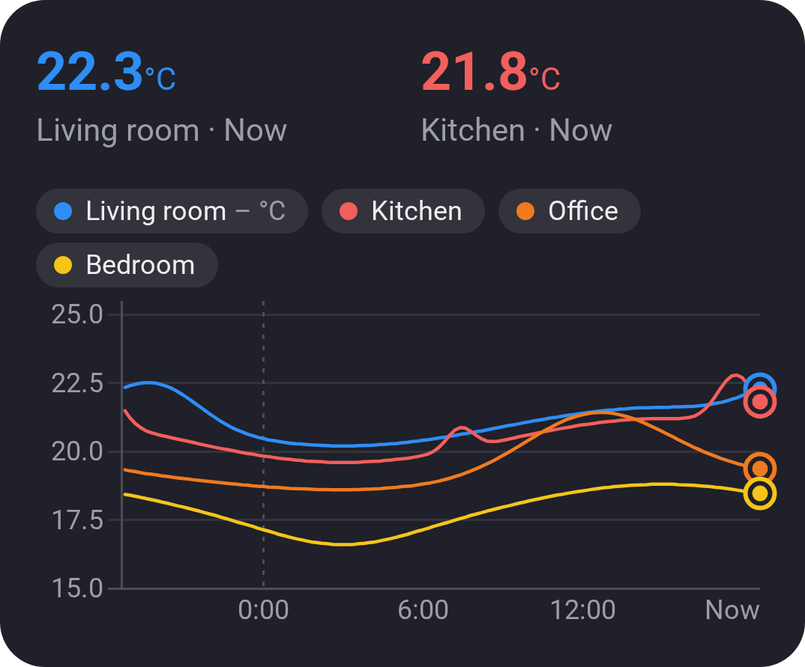
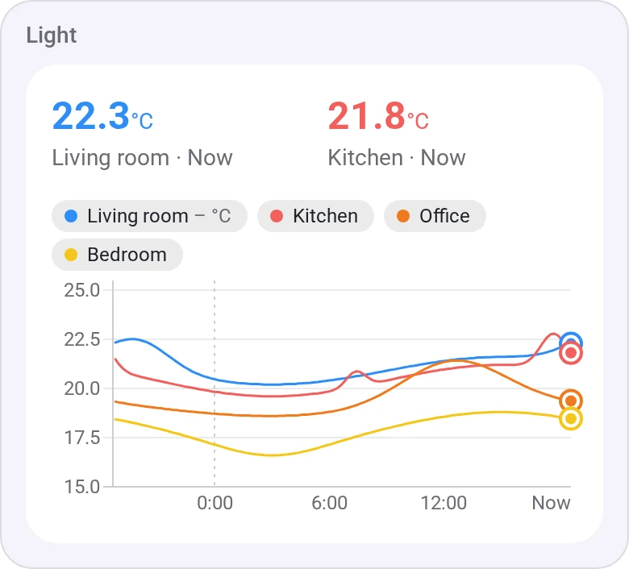
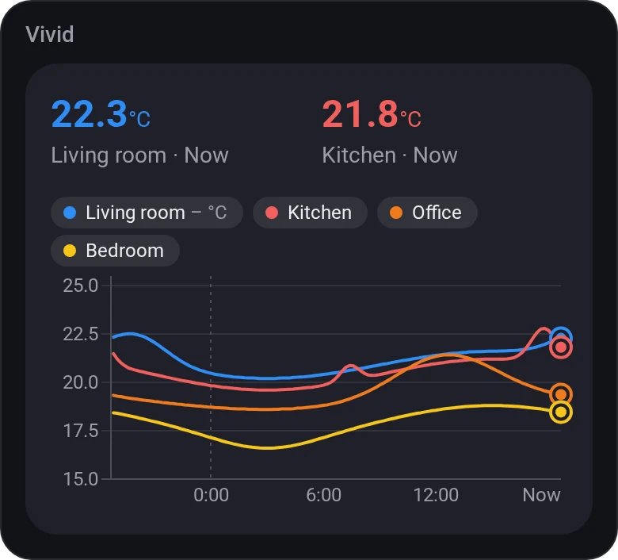
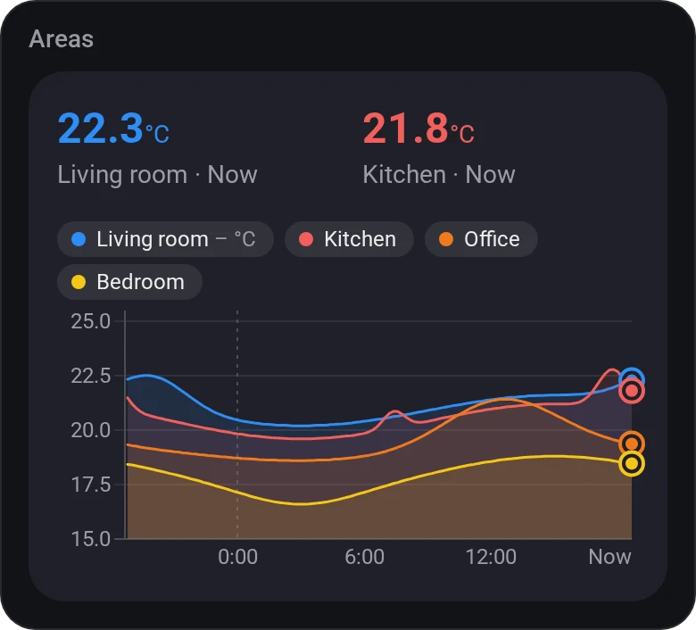
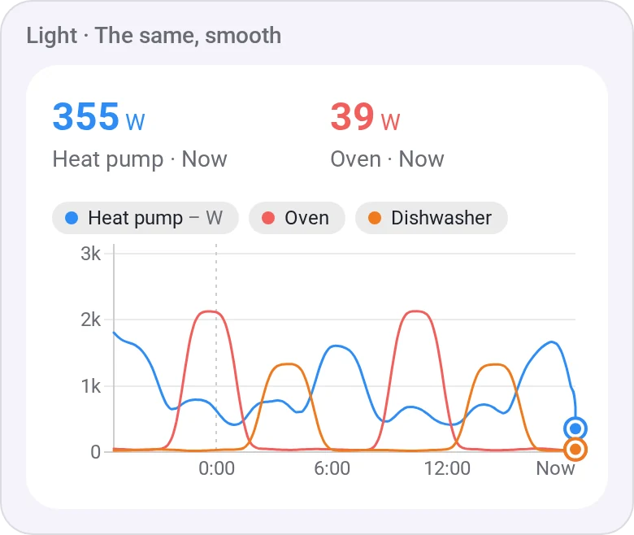

# Chart · Lines

[← All widgets](../../README.md#widgets)

Up to six values over time on one chart, a line each: every room's temperature, each radiator's power. The last 24 hours by default. The first value's kind of units gets the scale on the left (W and kW share one), a second kind, such as power among temperatures, a scale on the right; a third kind is left out.

**Settings:** values 1 to 6 each with its colour, [time span](charts.md#time-spans), style (lines, or lines with areas), scale (fitted or from zero), smooth lines, the legend, title, the values at the top, [colour style](../../README.md#colour-style).

## Looks

---
[← All widgets](../../README.md#widgets)
