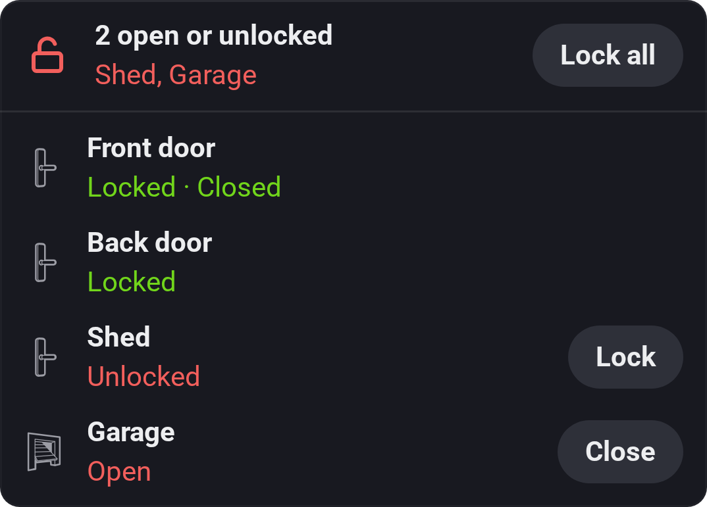
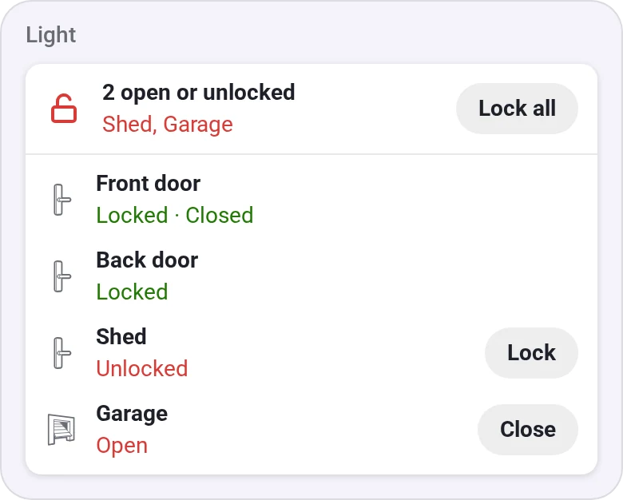
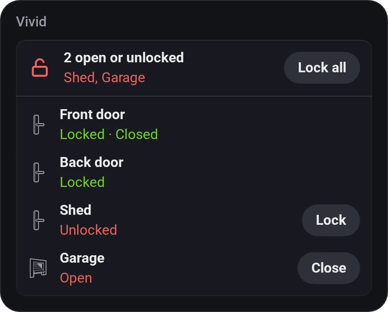
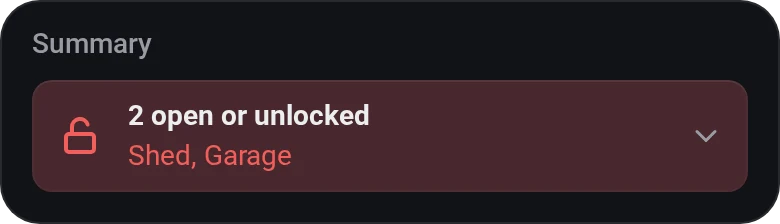
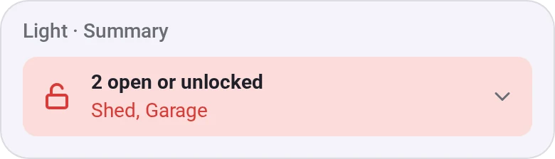

# Locks and Doors

[← All widgets](../../README.md#widgets)

Locks, doors, windows and garage doors in one line: *All locked and closed*, or what isn't, on a red tile. Tap it for the list, with **Lock** and **Close** buttons. A lock that can pull the latch can also get an **Open** button (pick its capability, such as *open_lock* or *open*); tap it twice to open the door.

**Settings:** devices, one line or the full list, allow unlocking, the open door button, [colour style](../../README.md#colour-style), time format, [rename tiles](../../README.md#tile-names).

## Looks

---
[← All widgets](../../README.md#widgets)
