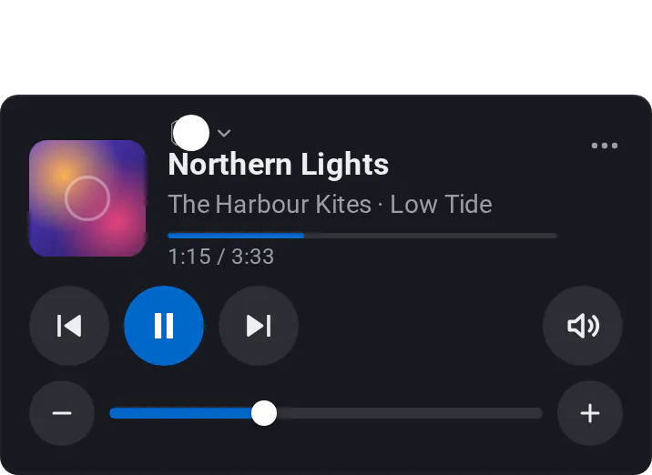

# Media

[← All widgets](../../README.md#widgets)

One speaker as a card: album art, the track, play controls, mute, and a volume that moves on every tap but never overshoots or passes your maximum. TV and line-in show as such, not as old album art. Tap the name to switch speaker. Up to eight buttons behind ⋯ run the speaker's own actions (such as *Set source to TV*), its app's, or flows; they need an [API key](../../README.md#api-key) (**Flows** for actions, **Start Flows** for flows). The large layout puts the album art across the whole widget; tap the art to switch layout (each screen remembers its choice).

**Settings:** layout (compact or large), tap the album art to switch layout, colour, [colour style](../../README.md#colour-style), speaker, speaker switching, volume as a bar or buttons, volume step and maximum, progress, shuffle and repeat, eight buttons with an icon and a name.

---
[← All widgets](../../README.md#widgets)
