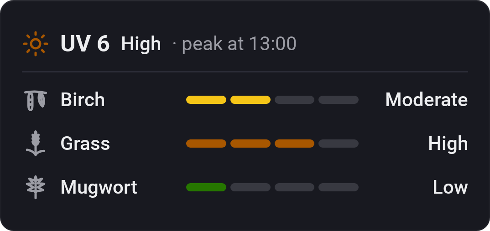
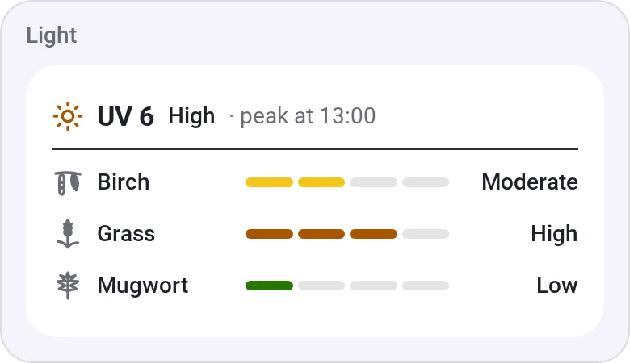
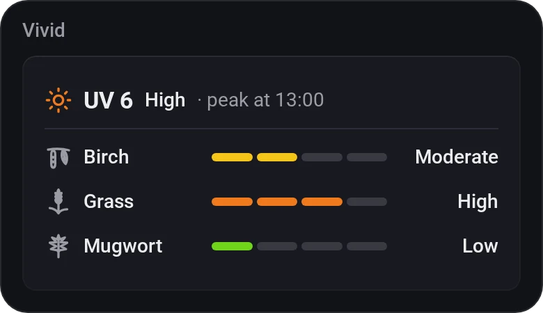
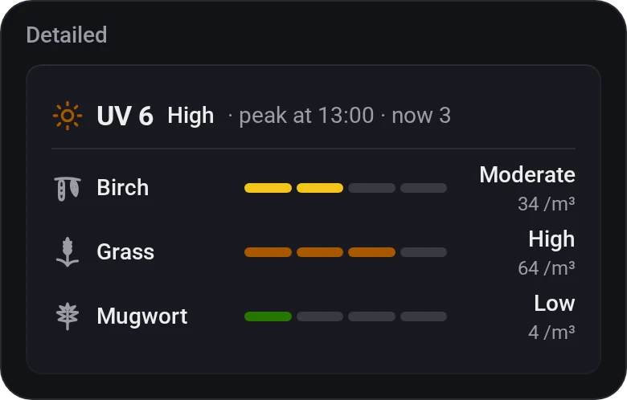
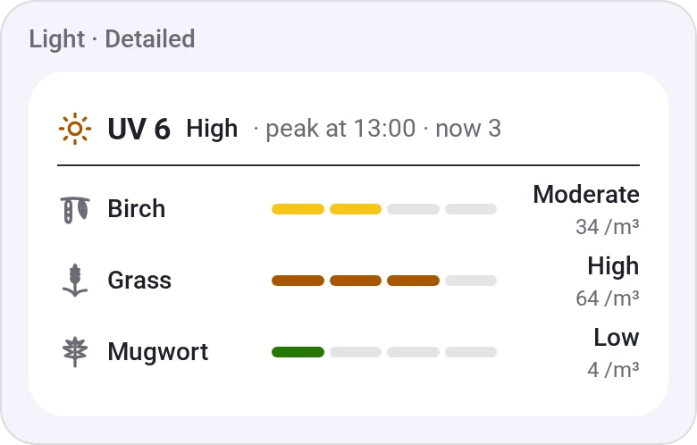

# Pollen and UV

[← All widgets](../../README.md#widgets)

Today's pollen at the Homey's location, a row per type with a bar from low to very high, under the day's UV peak and when it comes. Pollen forecasts cover Europe only; elsewhere the widget says so and shows the UV. Out of season it says there's no pollen in the air.

A level is the day's average in grains per m³, by Astma-Allergi Danmark's bands with a very high band on top. The UV levels are the WHO's.

| From (grains per m³) | Low | Moderate | High | Very high |
|---|---|---|---|---|
| Birch, alder, olive | 1 | 30 | 101 | 1,001 |
| Grass, mugwort, ragweed | 1 | 10 | 51 | 251 |

**Settings:** compact or detailed (with the grains per m³ and the next three days), the UV index, the pollen types (alder, birch, olive, grass, mugwort, ragweed; birch, grass and mugwort by default), [colour style](../../README.md#colour-style), time format.

Pollen and UV data from [Open-Meteo](https://open-meteo.com), licensed under [CC BY 4.0](https://creativecommons.org/licenses/by/4.0/), generated using Copernicus Atmosphere Monitoring Service information.

## Looks

---
[← All widgets](../../README.md#widgets)
