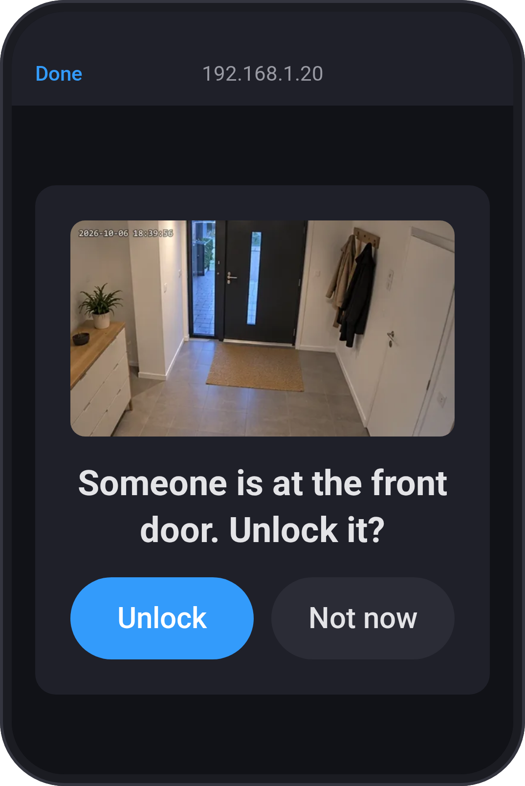
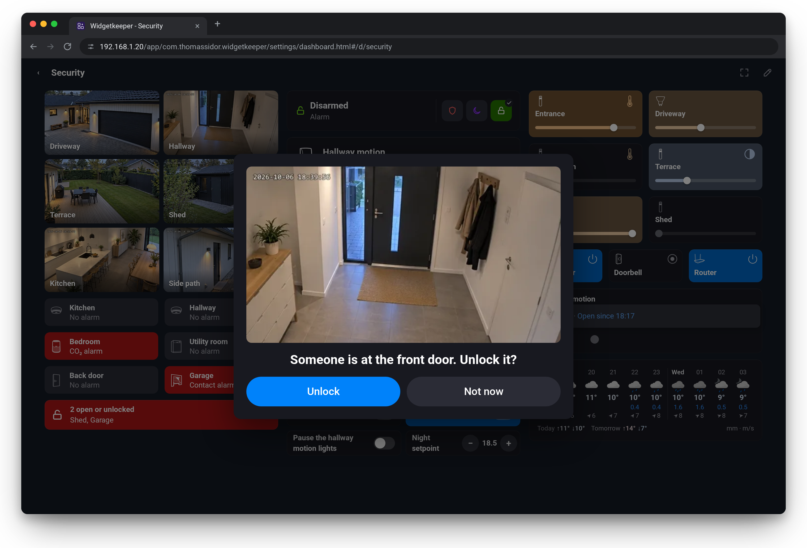
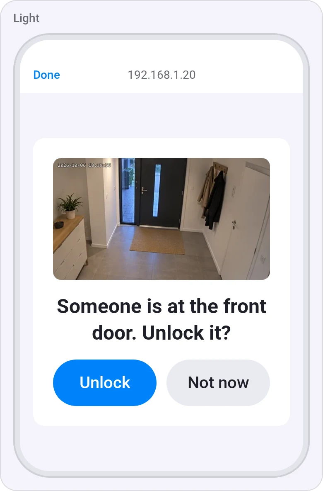
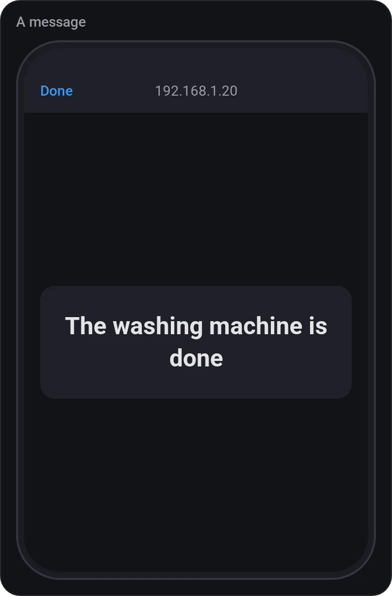
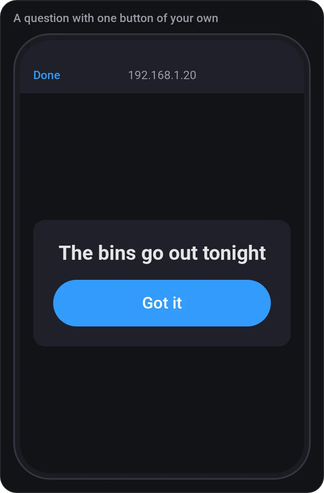
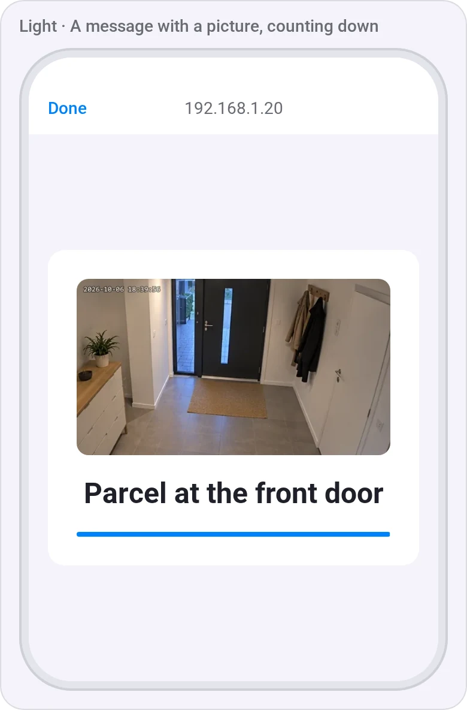

# Popups

[← All widgets](../../README.md#widgets)

A Flow shows a message, or asks a question with one or two buttons of your own (**Yes** and **No** unless you name them), in front of everything on the screens you choose: a web dashboard, or the phones and tablets showing a Homey dashboard with a Popups widget.

- *Show [text] on [screen] for [duration], picture: [picture], sound: [sound]*: closes after the time, or with a tap on that screen.
- *Ask [question] on [screen], buttons: [button] and [second button], picture: [picture], wait up to [seconds] seconds, sound: [sound]*: the buttons are yours, such as *Open* and *Ignore*, or one *Got it*; left empty, they're *Yes* and *No*. The first one is highlighted. The first answer from any screen closes it everywhere and goes back to the Flow as the tags **Answer** (yes for the first button, no for the second), **Button** (its text) and **Answered** (no when nobody answered in time), which only reach the next cards in an **Advanced Flow**. It waits at most 85 seconds, as Homey stops a Flow card after 90.
- *Close the popups on [screen]* closes them early; an open question then ends unanswered.
- **Picture:** a camera (refreshed while the popup is open) or a picture address. The cards *with an image* take an image tag instead, such as a doorbell's snapshot from its own Flow, taken when the Flow runs, or a text tag holding a picture address.
- **Sound:** a chime, a doorbell or an alert. Browsers only play sound on a page that has been tapped, so a wall tablet plays it once someone has used the web dashboard; on phones it may stay silent.

The screen is **Everywhere** or a Popups widget's name. On a [web dashboard](../../README.md#web-dashboards), the popup covers the page in every browser showing a dashboard with a Popups widget of that name (Everywhere: every web dashboard). Homey's own dashboards don't let a widget draw over them, so there the Popups widget, blank itself, opens the popup in the Homey app's built-in browser; close that window when you're done. Put one at the bottom of each dashboard that should get popups, so it doesn't push other widgets down, with the same name on every screen that should get the same ones: *Hallway* on the phones' dashboard and on the hallway tablet's web dashboard reaches both at once.

**Settings:** screen name, countdown (a bar under a message running down to its end; off by default, as the Homey app's browser window doesn't close by itself).

## Looks

---
[← All widgets](../../README.md#widgets)
