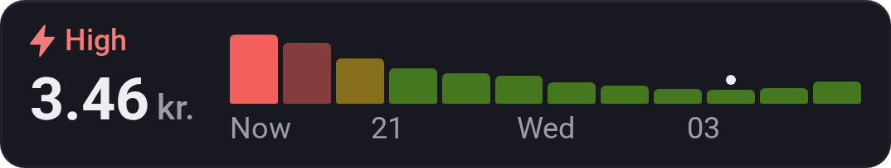
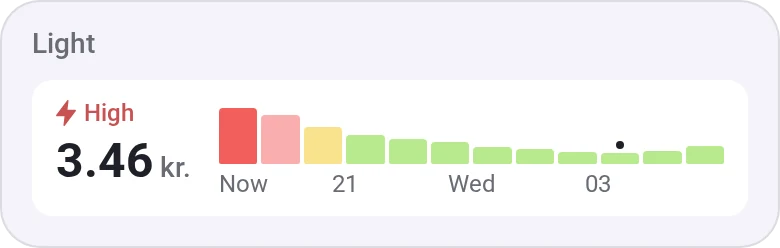
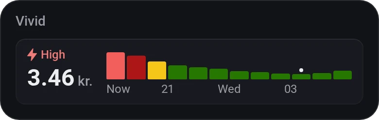
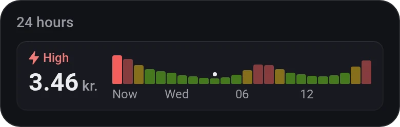
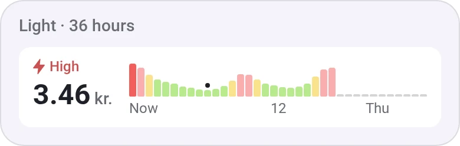
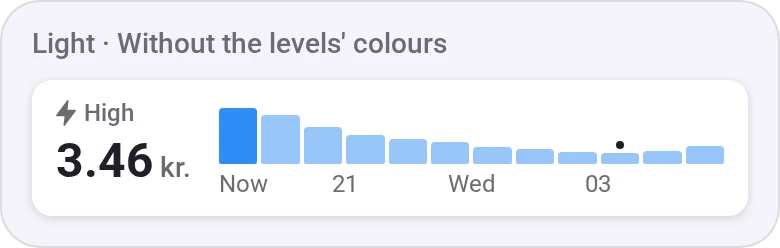
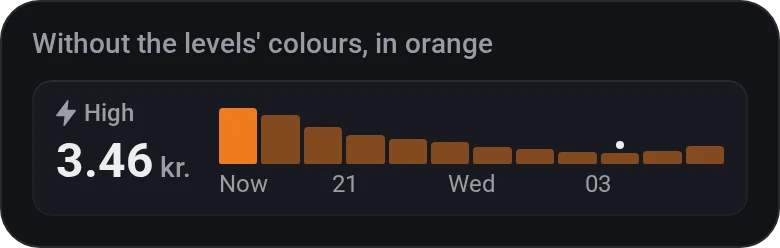

# Energy Price Strip

[← All widgets](../../README.md#widgets)

The electricity price now, and the coming 12, 24 or 36 hours as small bars in one tile: green, yellow or red by each hour's level in its day, with a dot over the cheapest. Uses the Electricity Overview's prices and needs no meter.

**Settings:** hours ahead, colour by level, the bars' colour without it, [colour style](../../README.md#colour-style), tariffs and taxes.

## Looks

---
[← All widgets](../../README.md#widgets)
