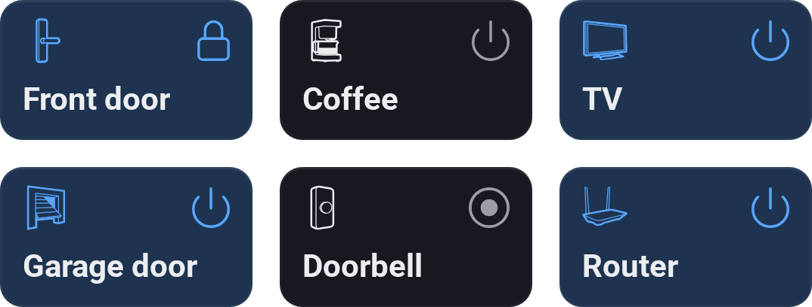
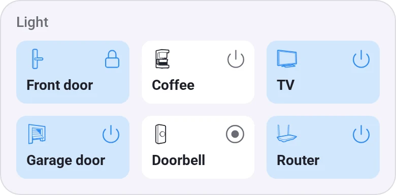
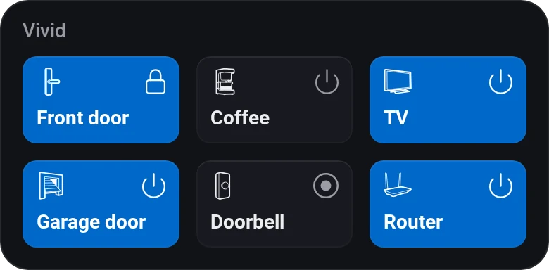
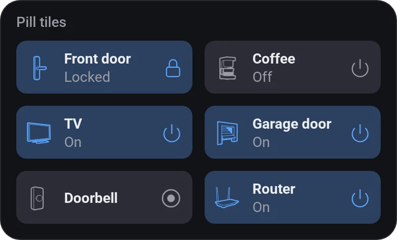
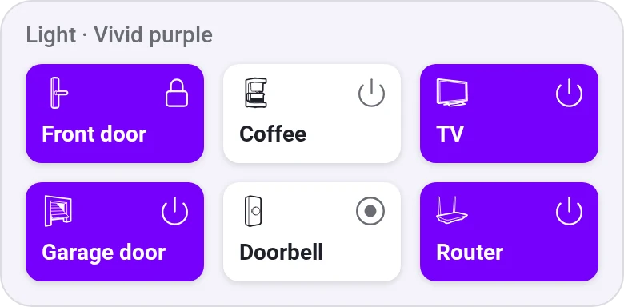

# Device Quick Actions

[← All widgets](../../README.md#widgets)

Half-height tiles that run a device's quick action with one tap (on/off, lock, play/pause, a button), highlighted while it's on.

**Settings:** devices, 2 or 3 per row, widen the last tile (at 2 per row), compact or pill tiles (like Sensor Alarms', with the state under the name), active style, colour, [colour style](../../README.md#colour-style), single, double or long press (for every tile, or only locks and garage doors, so a stray tap can't unlock a door), [rename tiles](../../README.md#tile-names).

## Looks

---
[← All widgets](../../README.md#widgets)
