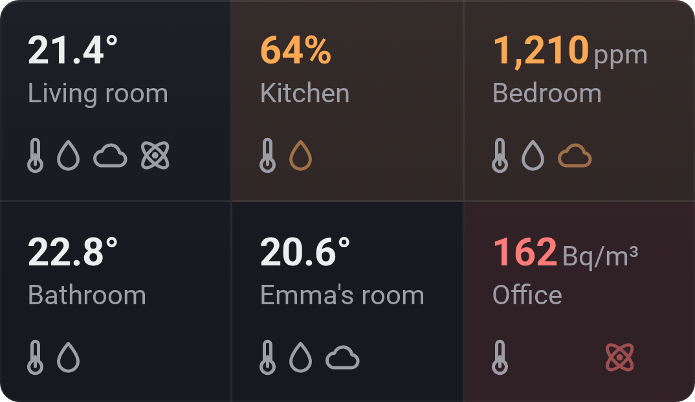

# Room Health

[← All widgets](../../README.md#widgets)

The indoor climate of the whole house on one card. The sensors you pick are grouped by their Homey room: each room shows its worst value large (else the temperature), its name, and a mark per value (an icon, or a bar), lined up in the same order in every room. A comfortable value is grey, or green with *Green when fine*; outside its range it turns yellow, then red the further out it is. Tap a room to step through its readings.

| Value | Comfortable by default | Red at |
|---|---|---|
| Temperature | 18–24 °C (18 °C is WHO's minimum) | 3 °C outside |
| Humidity | 30–60 % | 10 points outside |
| CO₂ | up to 1000 ppm | 1.5 × the limit |
| Radon | up to 100 Bq/m³ (WHO's reference level) | 1.5 × |
| PM2.5 | up to 15 μg/m³ (WHO's 24-hour guideline) | 1.5 × |
| PM10 | up to 45 μg/m³ (WHO's 24-hour guideline) | 1.5 × |
| VOC | up to 1000 ppb | 1.5 × |

A heat pump's room temperature counts; outdoor and water temperatures don't. Left out on purpose: carbon monoxide (a safety alarm: use [Sensor Alarms](sensoralarms.md)), air quality indexes and VOC in μg/m³ or as an index (their scales differ between devices), and PM1 (no guideline).

**Settings:** sensors, [rename tiles](../../README.md#tile-names), [colour style](../../README.md#colour-style), icons or bars, green when fine, the comfortable range of each value (one range for every room).

---
[← All widgets](../../README.md#widgets)
