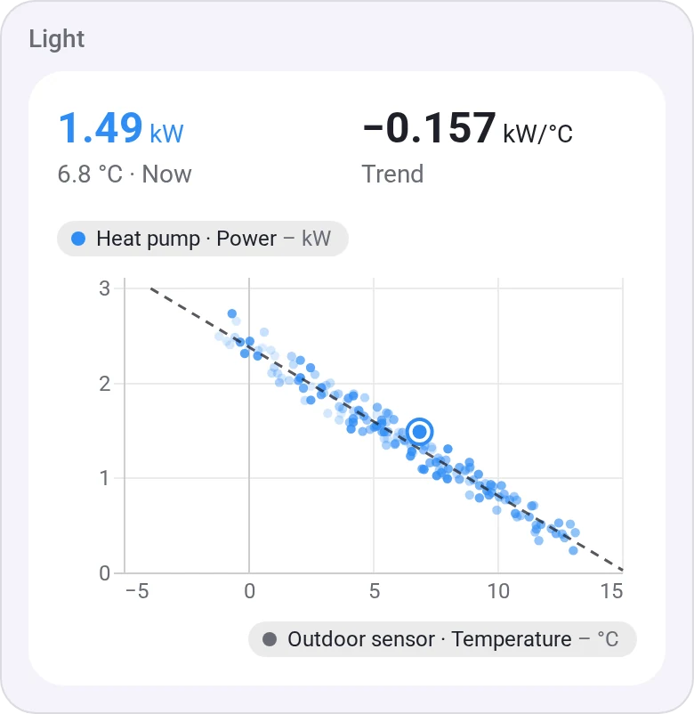
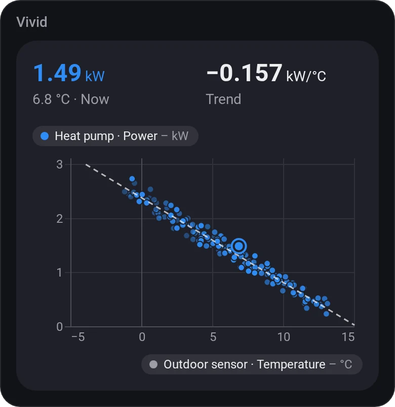
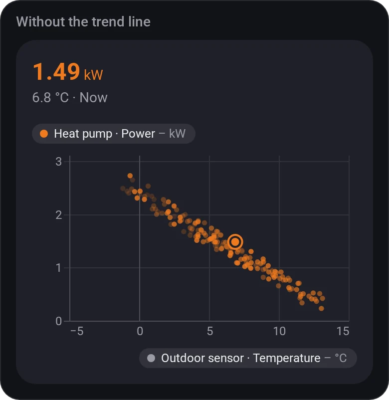
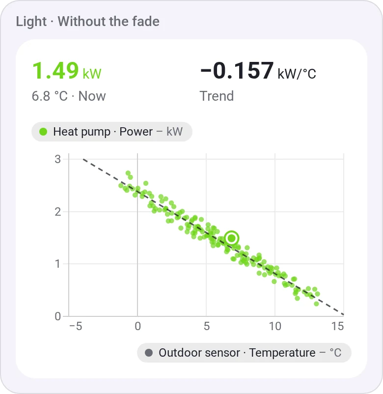
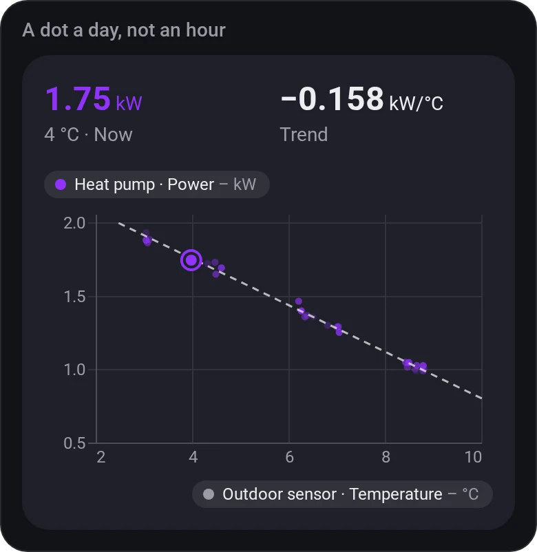
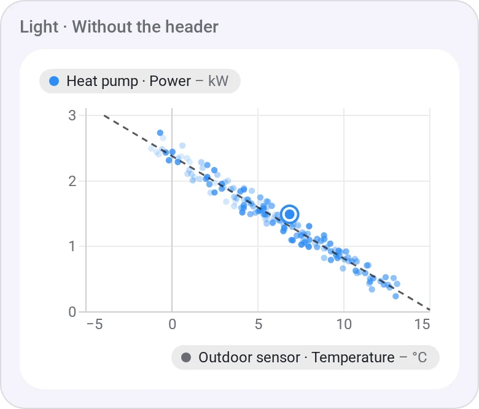
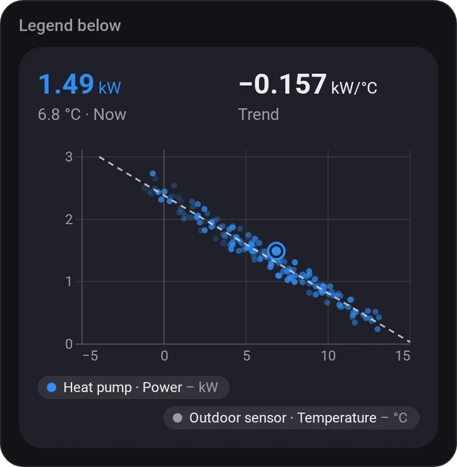
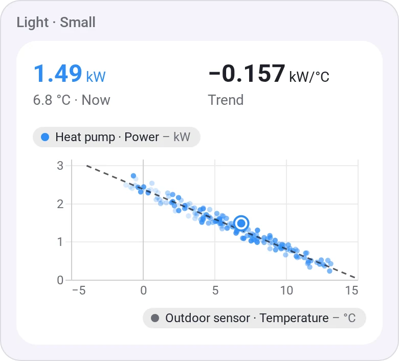

# Chart · Scatter (XY)

[← All widgets](../../README.md#widgets)

One value against another, a dot an hour (a minute to a week, by the [time span](charts.md#time-spans)), newest strongest, with a trend line whose slope shows at the top: how much more the heat pump draws for each degree colder.

**Settings:** the value across (x) and the value up (y), [time span](charts.md#time-spans), one dot per (automatic, hour or day), trend line, fade older dots, chart height (small, normal or tall), the legend (above, below or hidden), title, the values at the top, colour, [colour style](../../README.md#colour-style).

## Looks

---
[← All widgets](../../README.md#widgets)
