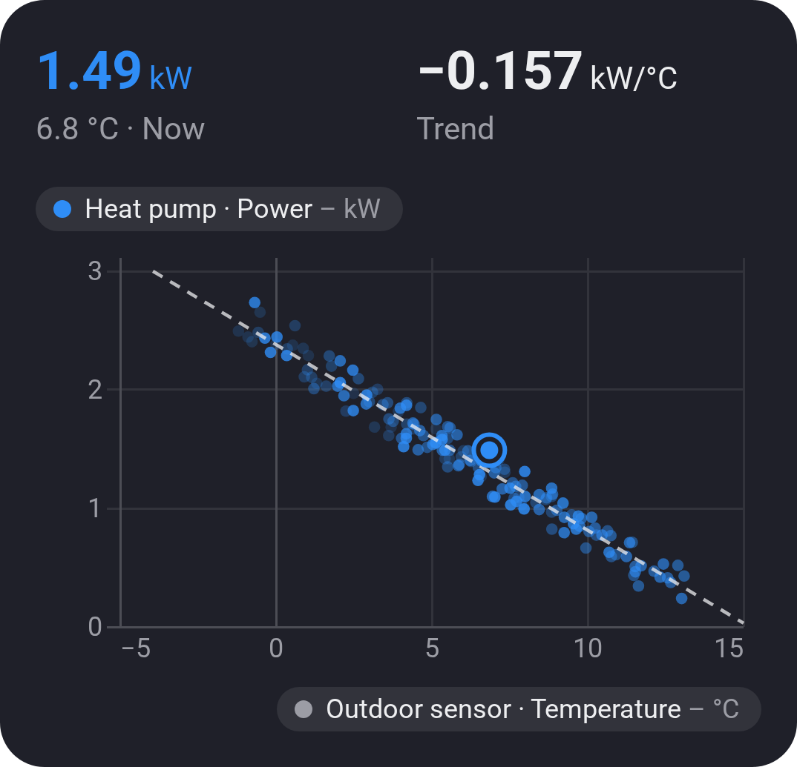

# Chart · Scatter (XY)

[← All widgets](../../README.md#widgets)

One value against another, a dot an hour (a minute to a week, by the [time span](charts.md#time-spans)), newest strongest, with a trend line whose slope shows at the top: how much more the heat pump draws for each degree colder.

**Settings:** the value across (x) and the value up (y), [time span](charts.md#time-spans), one dot per (automatic, hour or day), trend line, fade older dots, title, the values at the top, colour, [colour style](../../README.md#colour-style).

---
[← All widgets](../../README.md#widgets)
