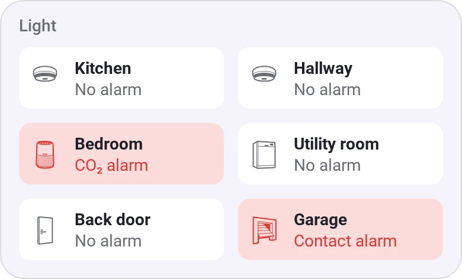
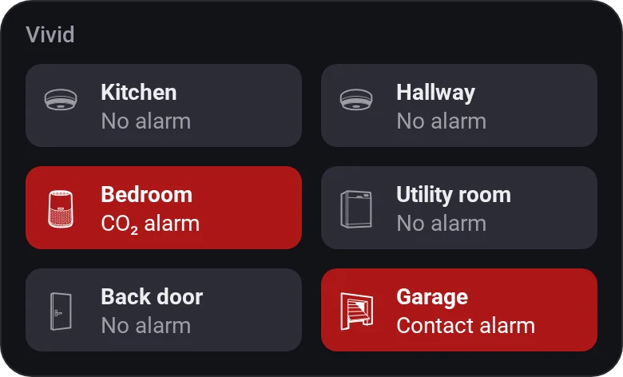
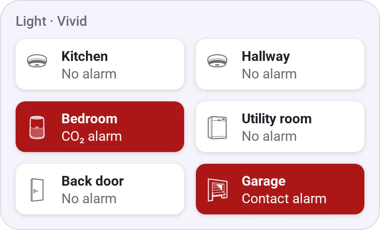
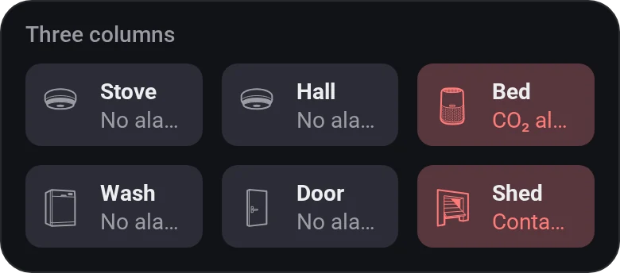
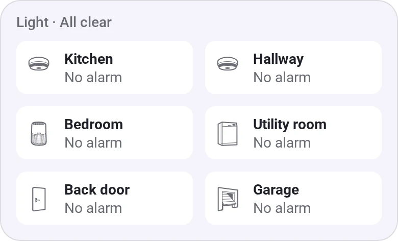
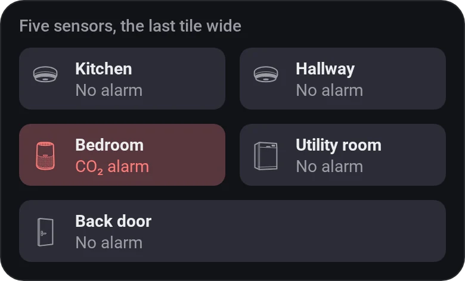
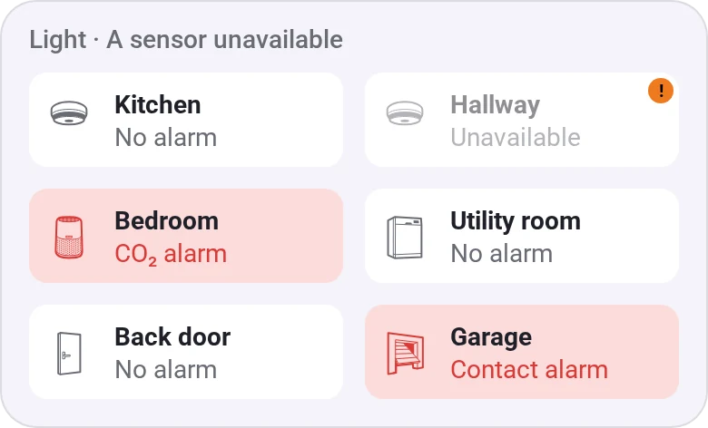

# Sensor Alarms

[← All widgets](../../README.md#widgets)

Tiles that show *No alarm*, the alarm that's on or how many, and turn red while one is. Every alarm counts, including apps' own such as radon. Tap a tile for all of its alarms.

**Settings:** sensors, 2 or 3 per row, widen the last tile (at 2 per row), count motion and contact, [colour style](../../README.md#colour-style), [rename tiles](../../README.md#tile-names).

## Looks

---
[← All widgets](../../README.md#widgets)
