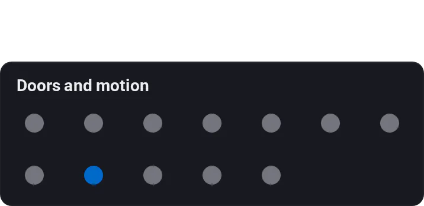
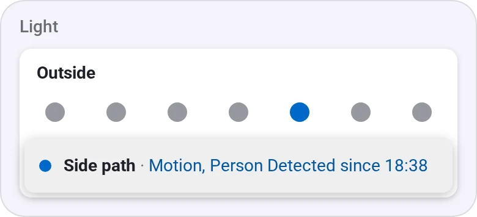
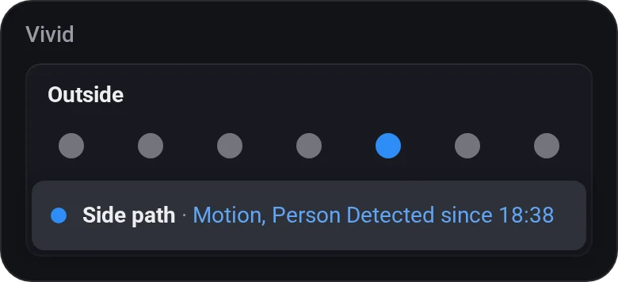
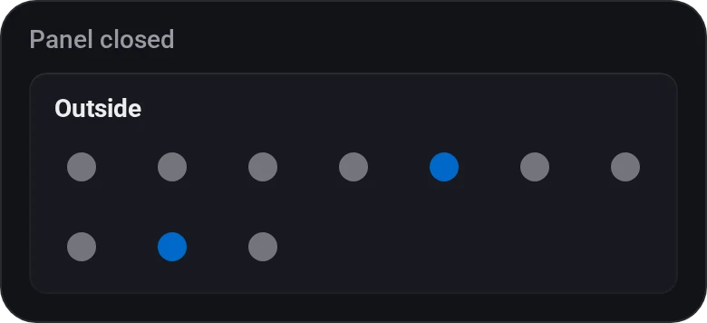
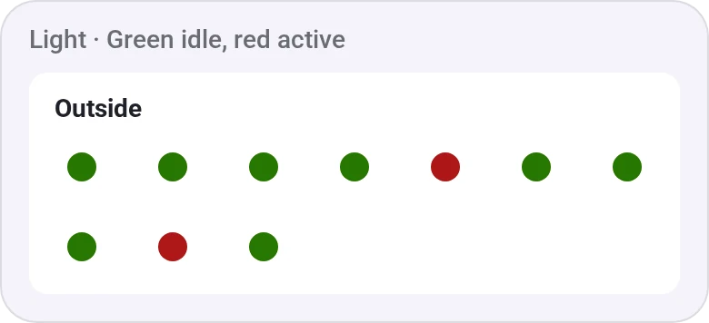

# Activity Dots

[← All widgets](../../README.md#widgets)

Motion, contact, vibration and camera sensors as a grid of dots that light up while active. Tap a dot for its name and since when, such as *Garage · Open since 18:17*.

**Settings:** [rename tiles](../../README.md#tile-names), sensors, title, idle and active colours, [colour style](../../README.md#colour-style). Times follow the app's [time format](../../README.md#time-format).

## Looks

---
[← All widgets](../../README.md#widgets)
