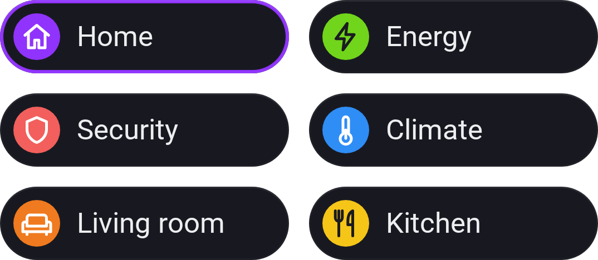

# Dashboard Shortcuts

[← All widgets](../../README.md#widgets)

For [web dashboards](../../README.md#web-dashboards) only: your other web dashboards as buttons, each with a round icon in the colour and icon you pick; a tap opens that dashboard. The one you're on is ringed, so the same widget can go on every dashboard as a menu.

**Settings:** up to eight dashboards, each with a colour and an icon; 1 or 2 columns; [colour style](../../README.md#colour-style); [rename tiles](../../README.md#tile-names).

---
[← All widgets](../../README.md#widgets)
