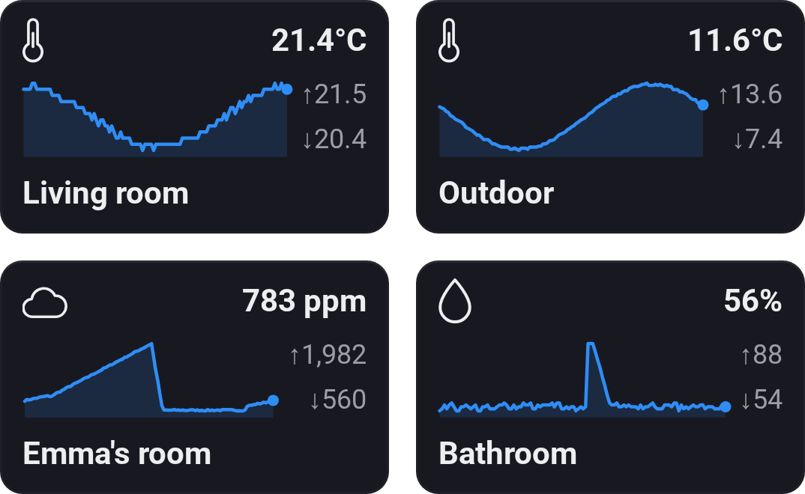
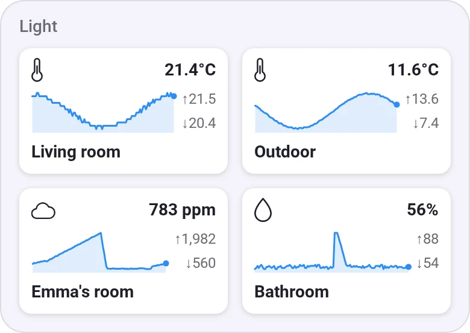
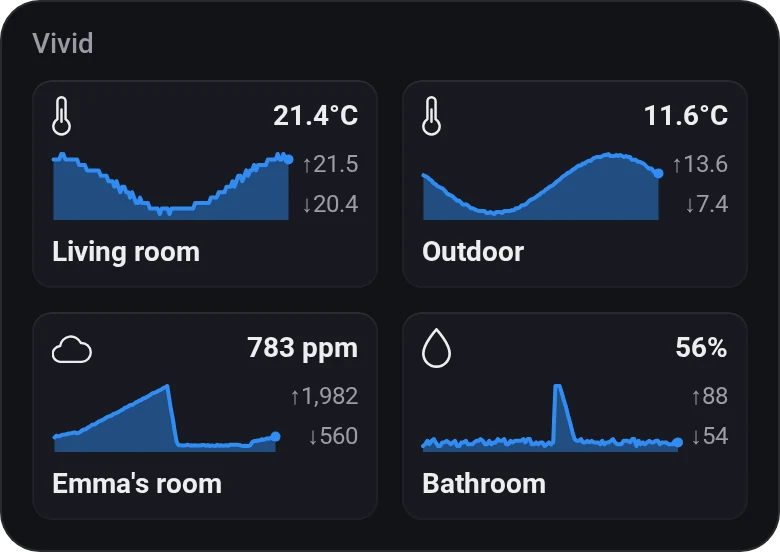
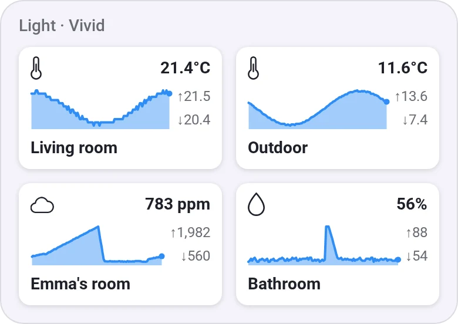
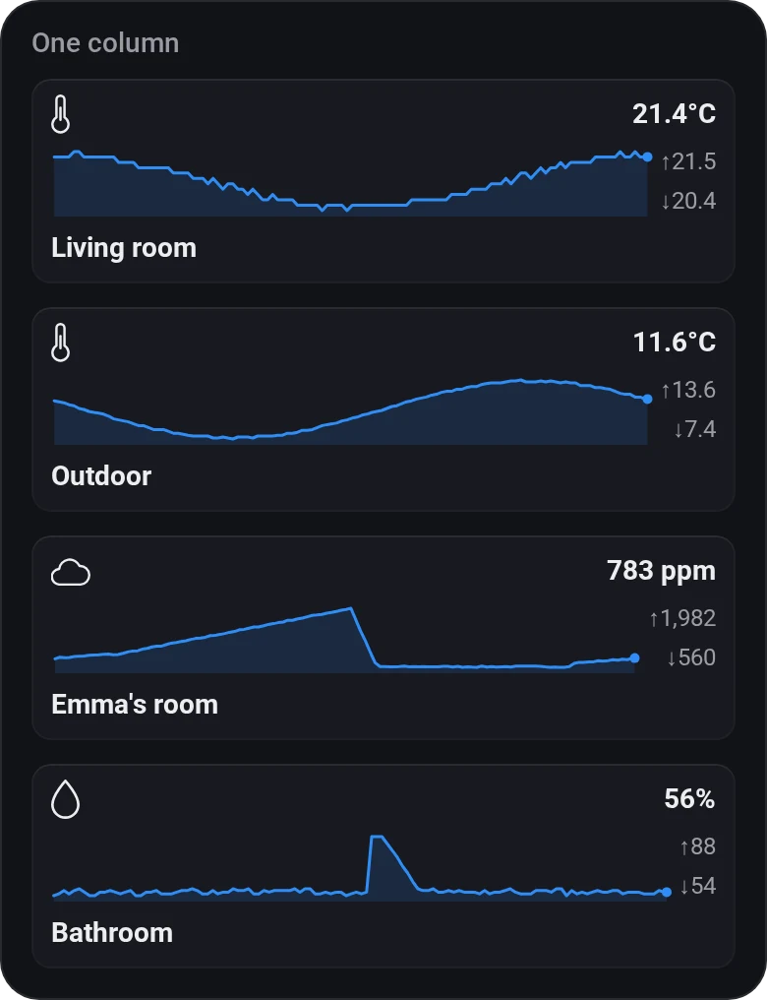
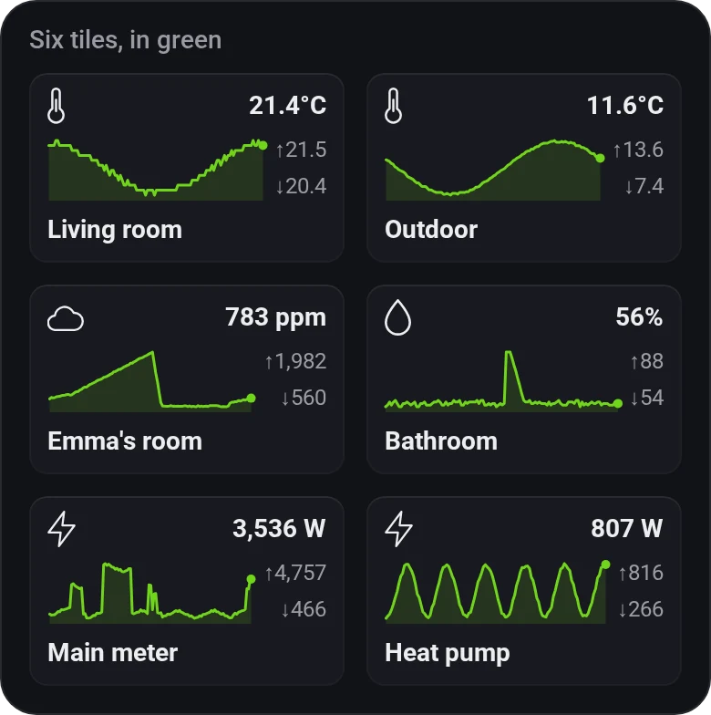
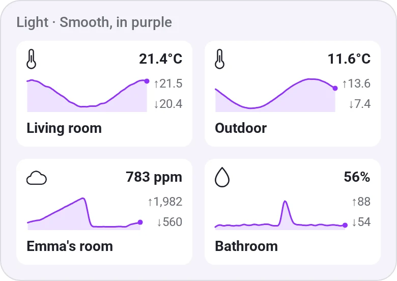
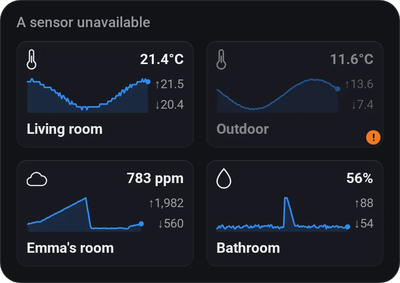

# Sparklines

[← All widgets](../../README.md#widgets)

Device Values' tiles with a small live chart of each value and its highest and lowest.

**Settings:** up to six values, time span (a number and a unit, as [Chart · Basic's](charts.md): 40 minutes, 24 hours, 18 months, or whole days, weeks, months or years such as today or last month), 1 or 2 per row, smooth lines, colour, [colour style](../../README.md#colour-style), [rename tiles](../../README.md#tile-names). Sparklines set up before 1.2.0 keep their span.

## Looks

---
[← All widgets](../../README.md#widgets)
