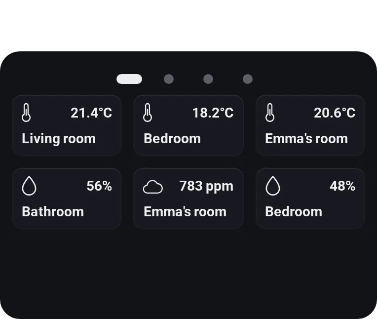
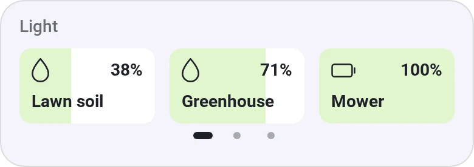
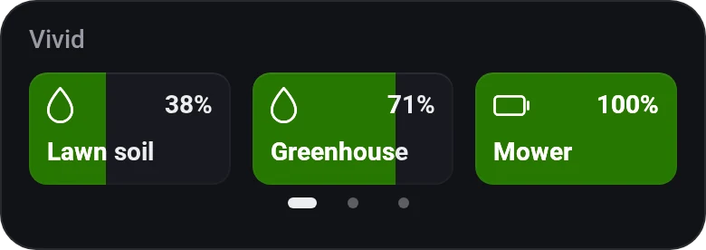
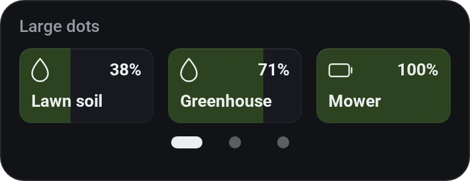
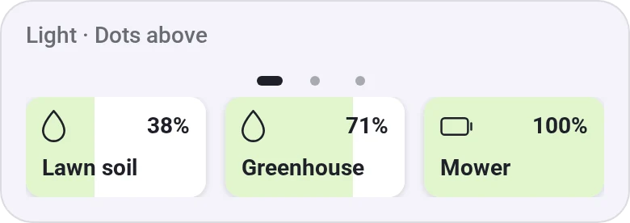
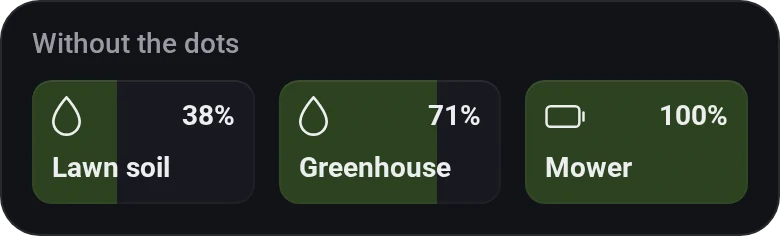
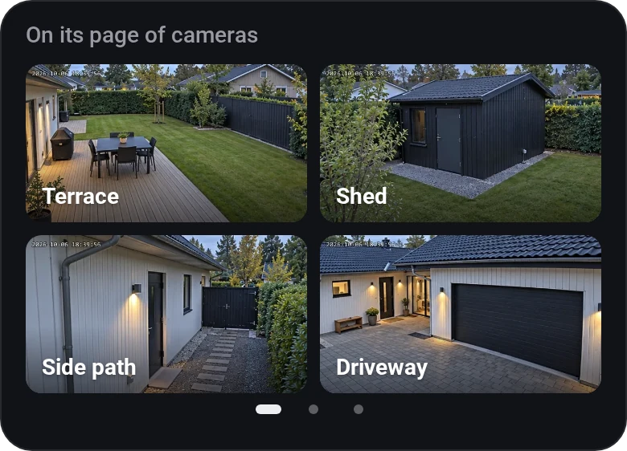
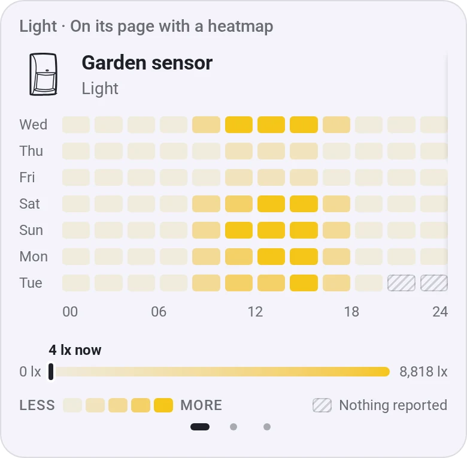

# Smart Stack

[← All widgets](../../README.md#widgets)

Widgetkeeper widgets from another dashboard, one at a time in the space of one. It turns every 30 seconds, and swipes or the dots move it by hand. Smart rotate brings a widget forward while something happens on it: music plays, a timer runs, a camera sees someone, a door is open. A Flow card can bring one forward too. Needs an [API key](../../README.md#api-key) with the **Homey** permission to read the dashboard.

**Settings:** dashboard, interval, smart rotate, pause after a swipe, dots.

## Looks

---
[← All widgets](../../README.md#widgets)
