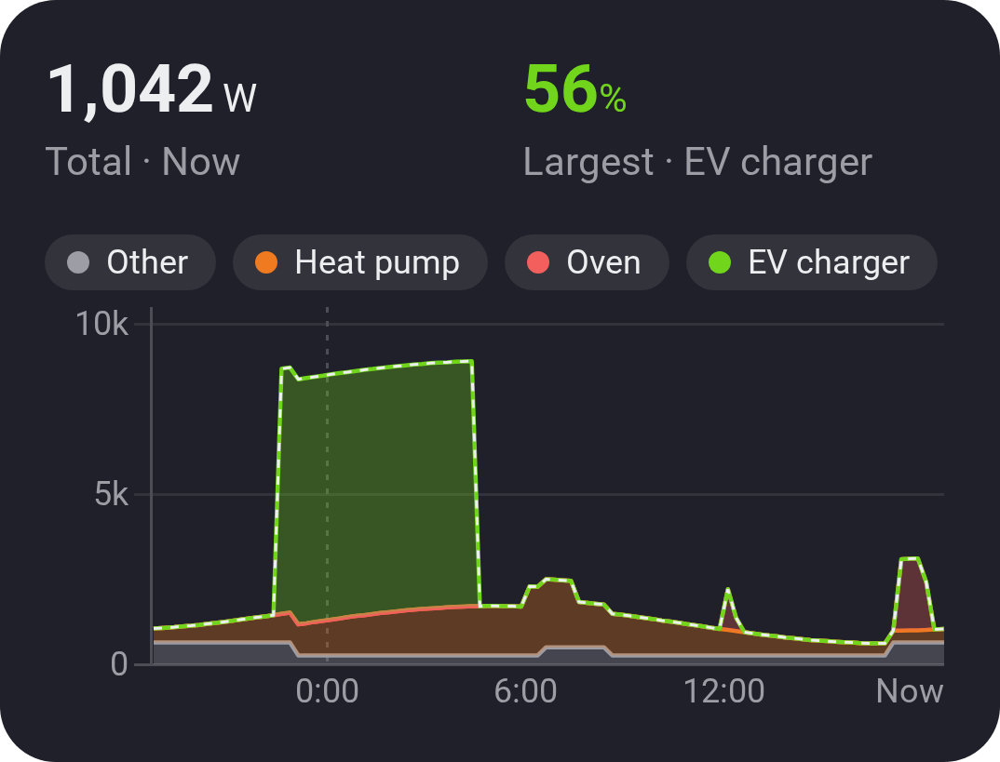

# Chart · Stacked

[← All widgets](../../README.md#widgets)

Who uses the power? Up to six values of one kind stacked over time, the last 24 hours by default: the heat pump, the oven, the EV charger. With a total, such as the house's meter, the rest shows as Other. Values below zero, such as solar, stack downwards.

**Settings:** the total (optional), values 1 to 6 each with its colour, [time span](charts.md#time-spans), style (areas or bars), the legend, title, the values at the top, [colour style](../../README.md#colour-style).

---
[← All widgets](../../README.md#widgets)
