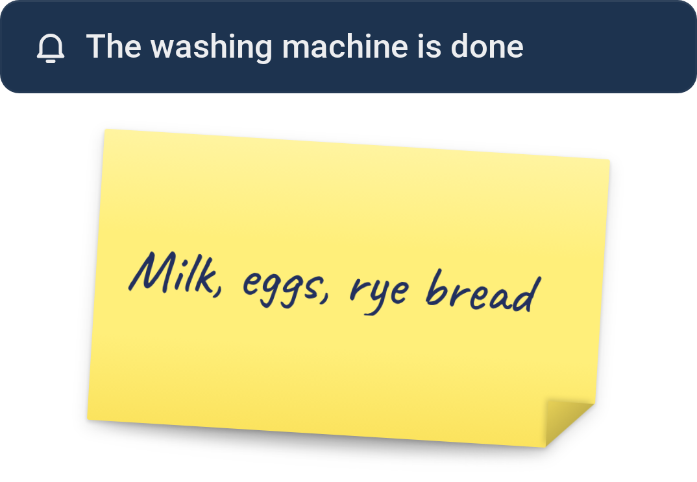
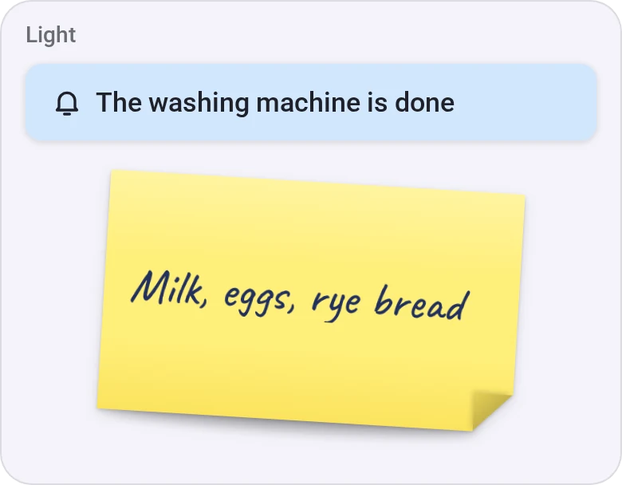
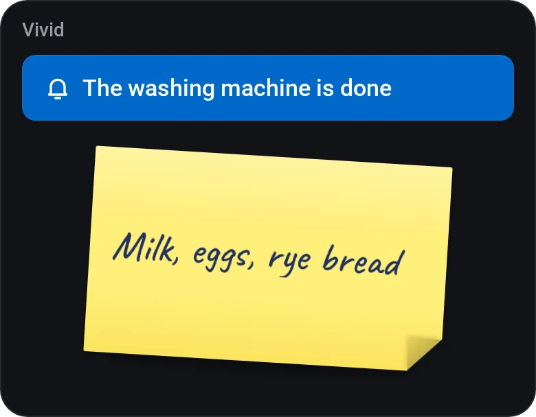
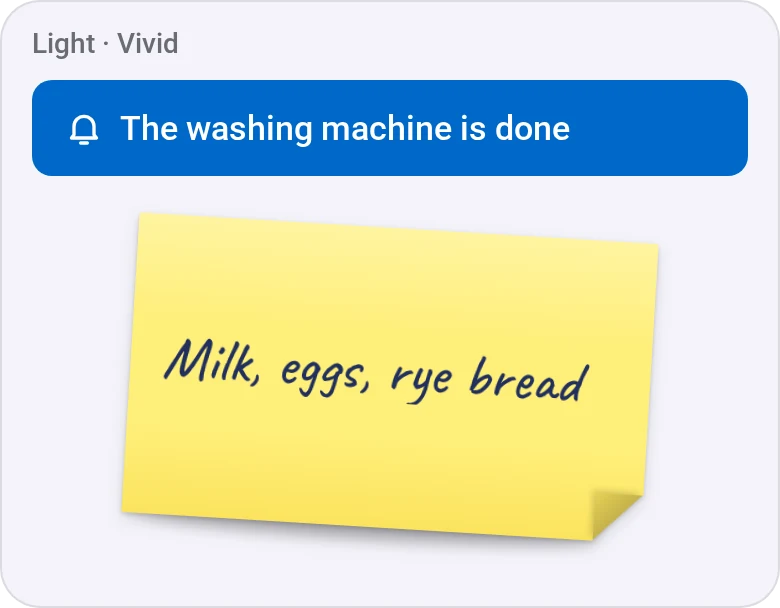
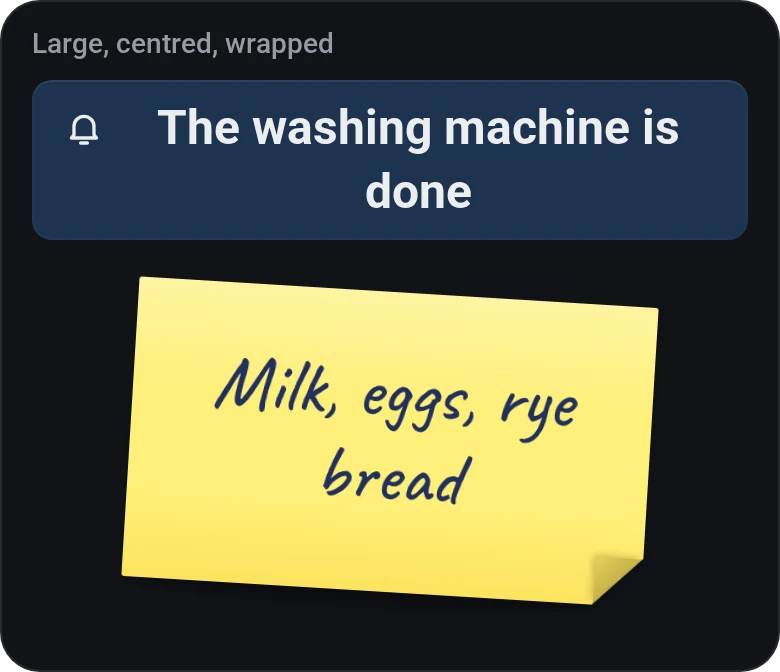
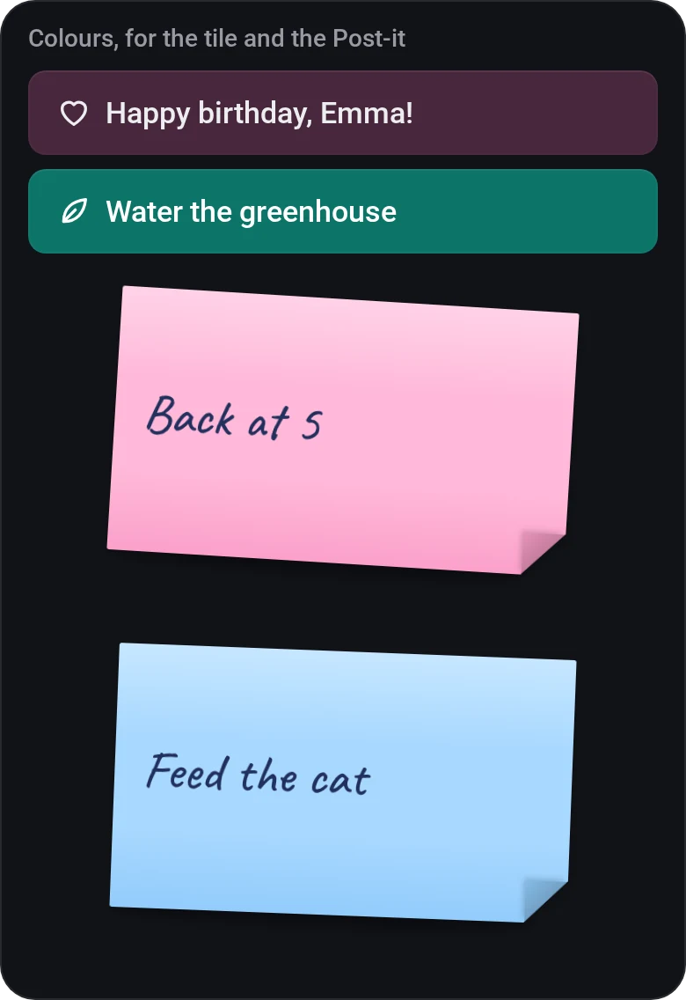
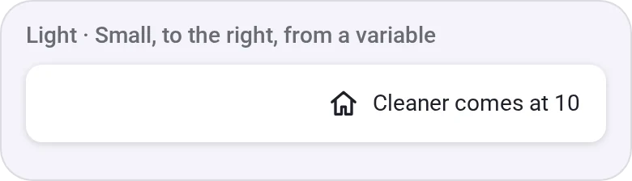
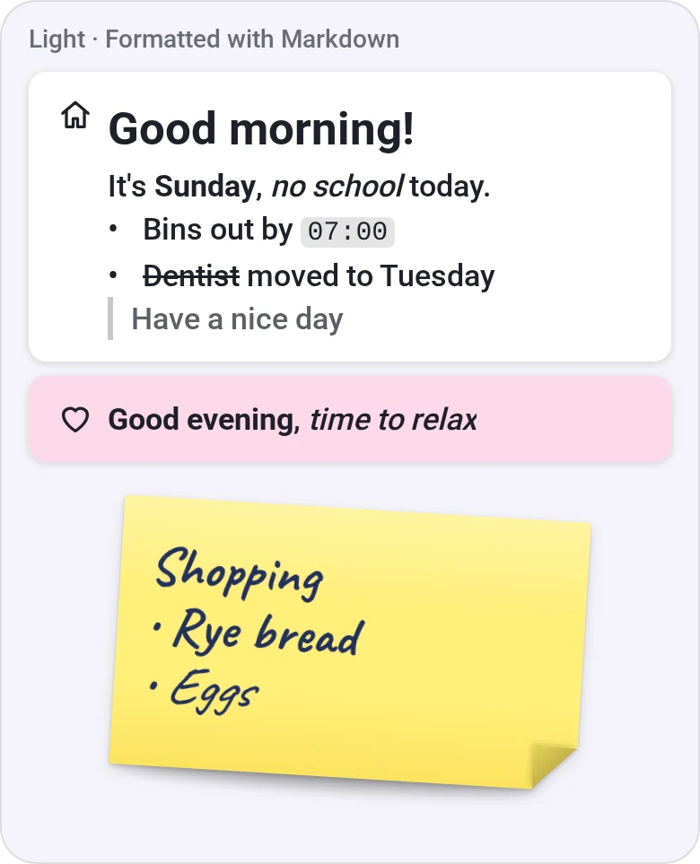

# Notes

[← All widgets](../../README.md#widgets)

A short message on the dashboard: a tile with a line of text or more, or a tilted, handwritten Post-it note. Type it in the settings, show a Logic text variable, or let a Flow write it with *Write [text] on the note [name]* (optionally in a colour, such as red for *Dryer done*, or a custom colour typed as `#FF6347` or `rgb(255, 99, 71)`) and *Clear the note [name]*; every Notes widget with that name shows it at once. On the tile, long text is cut off, scrolls, or shows on as many lines as it needs, with the line breaks you type (the tile grows with it); the Post-it wraps it to three lines.

With *Format with Markdown* (ticked on a widget placed from 1.4.1 on; tick it on an older one), the text can be formatted: `**bold**`, `*italic*`, `~~struck through~~` and `` `code` ``, and, a line each, `# headings` (to `###`), `- lists` or `1. lists` and `> quotes`. A Flow can write it too: *Write `**Good morning**, it's *Sunday*` on the note Greeting*. On more lines, headings are bigger and lists indented; on one line and on the Post-it, headings are bold and lists keep their mark. A `_` inside a word, as in `file_name`, stays as it is; put `\` before a mark to show it as typed.

**Settings:** style (tile or Post-it), text from (the message typed in the settings, a Flow card or a text variable), message, note name, variable, format with Markdown, alignment, text size, long text, icon, colour, [colour style](../../README.md#colour-style).

## Looks

---
[← All widgets](../../README.md#widgets)
