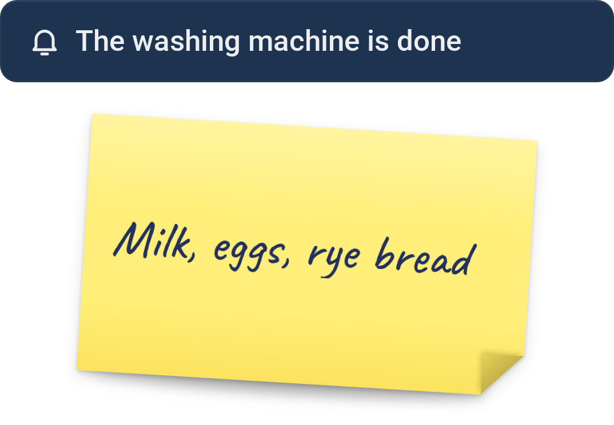

# Notes

[← All widgets](../../README.md#widgets)

A short message on the dashboard: a tile with a line of text or more, or a tilted, handwritten Post-it note. Type it in the settings, show a Logic text variable, or let a Flow write it with *Write [text] on the note [name]* (optionally in a colour, such as red for *Dryer done*) and *Clear the note [name]*; every Notes widget with that name shows it at once. On the tile, long text is cut off, scrolls, or shows on as many lines as it needs, with the line breaks you type (the tile grows with it); the Post-it wraps it to three lines.

**Settings:** style (tile or Post-it), text from (the message typed in the settings, a Flow card or a text variable), message, note name, variable, alignment, text size, long text, icon, colour, [colour style](../../README.md#colour-style).

---
[← All widgets](../../README.md#widgets)
