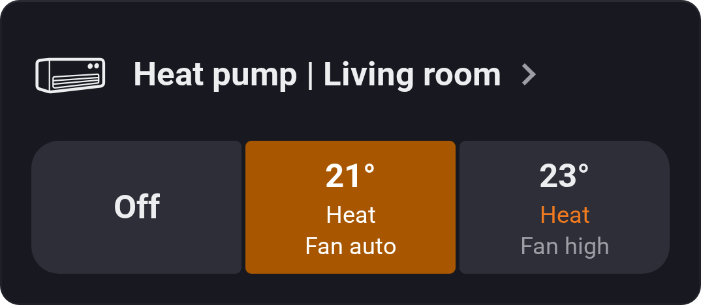
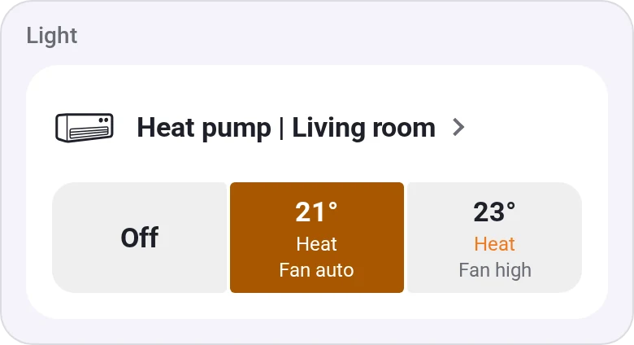
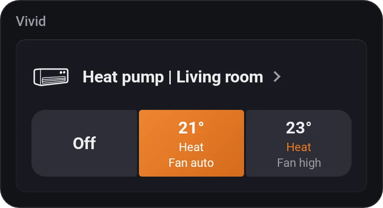
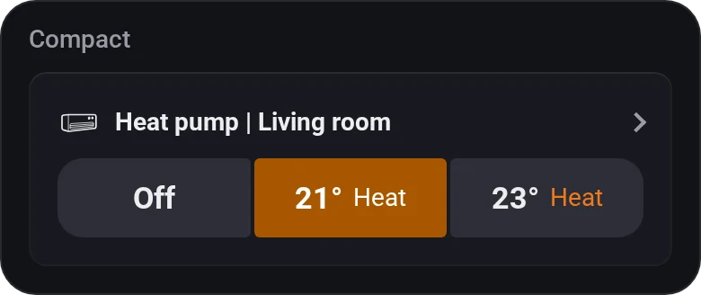
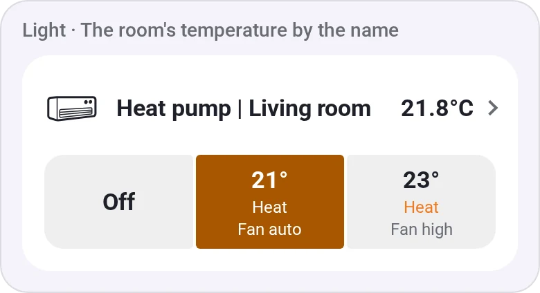
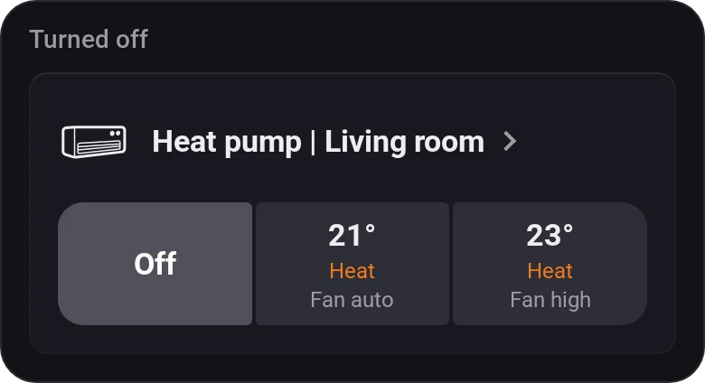
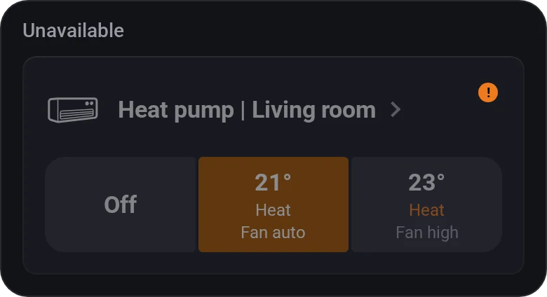

# Thermostat Presets

[← All widgets](../../README.md#widgets)

Three one-tap presets for a thermostat, heat pump or air conditioner, such as *Off*, *Heat 21°* and *Heat 24° · Fan level 5*. The matching preset lights up; a preset without a temperature shows the setpoint under the name. Tap the name for the controls: power, the temperature and every mode, fan or swing setting of the device.

Flow cards: *Run [button]*, the condition *[button] is active* and the trigger *[button] was tapped*, with the thermostat and the button's text as tags; the trigger also takes *Any button*. Each picks a button of a widget on one of your dashboards and follows that button's settings. Buttons on Homey's own dashboards are listed with an [API key](../../README.md#api-key) that has the **Homey** permission; those on web dashboards need none.

**Settings:** the device, a title in place of its name, a value to show beside it (any device value, such as the room temperature), compact layout, [colour style](../../README.md#colour-style), and per button: power, mode, temperature and one extra option such as the fan speed.

## Looks

---
[← All widgets](../../README.md#widgets)
