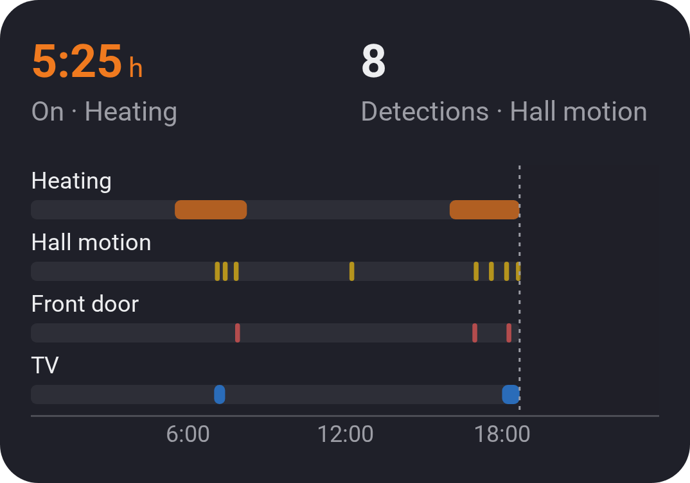
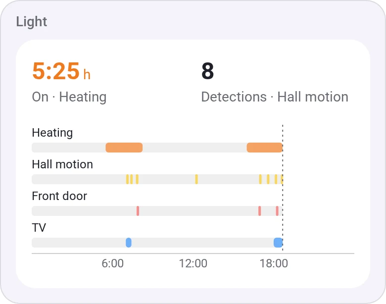
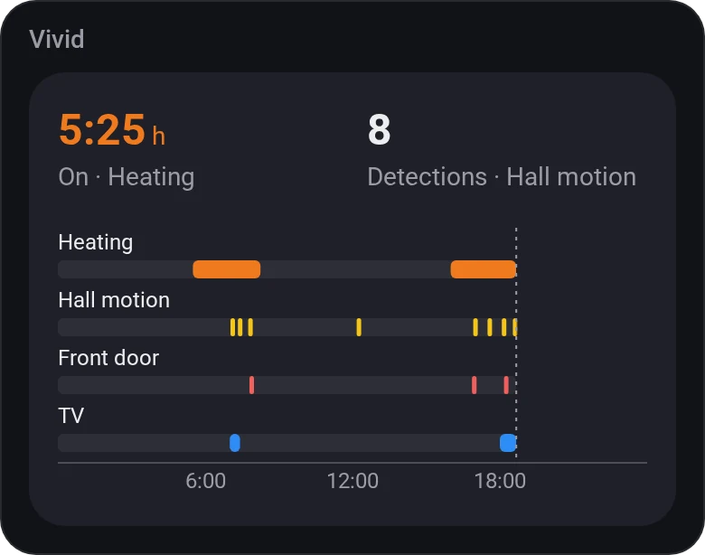
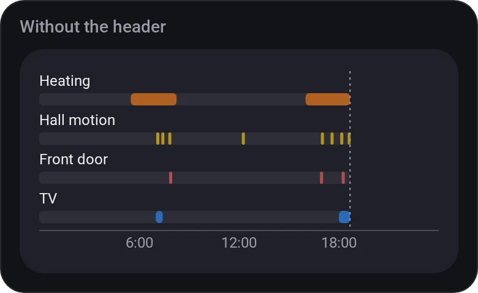
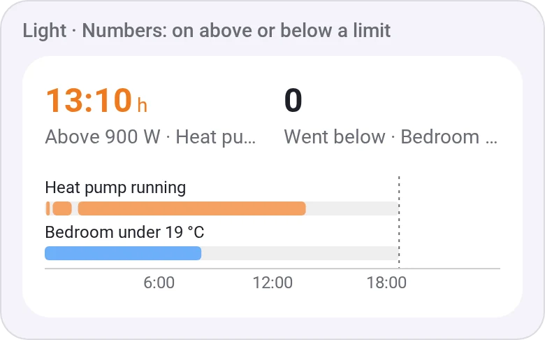
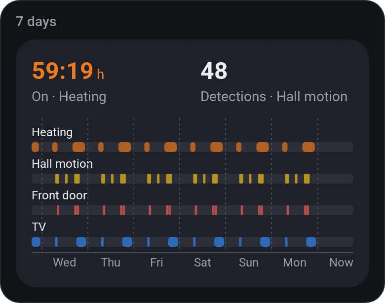
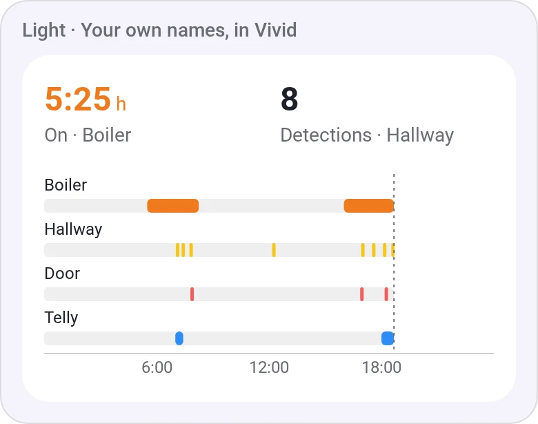

# Chart · Timeline

[← All widgets](../../README.md#widgets)

When was it on, open or moving? A row for each of up to eight on/off values (the heating, a motion sensor, a door), over today or up to about two weeks, with a band where it was. Homey keeps only a value's last 50 changes, so the app records them itself from the first time they're shown, shared with the [Insights Heatmap](heatmap.md); before that, a row is dotted.

A row can also be a number, on above or below a threshold (the heater above 50 W, the bedroom below 18 °C), from Insights' history.

**Settings:** values 1 to 8 each with its colour, for a number its threshold and above or below, and an optional name, [time span](charts.md#time-spans), title, the values at the top, [colour style](../../README.md#colour-style).

## Looks

---
[← All widgets](../../README.md#widgets)
