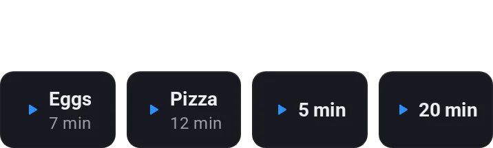

# Timers

[← All widgets](../../README.md#widgets)

Up to four preset buttons, such as *Eggs · 7 min*. A started timer takes their place: tap to pause, **+1** for a minute more, **✕** to cancel. It beeps and turns red when done. The timer runs on Homey, so every screen sees it and the Flow card **A timer on the Timers widget finished** fires with no dashboard open.

**Settings:** colour, [colour style](../../README.md#colour-style), four presets with minutes and an optional name, sound.

---
[← All widgets](../../README.md#widgets)
