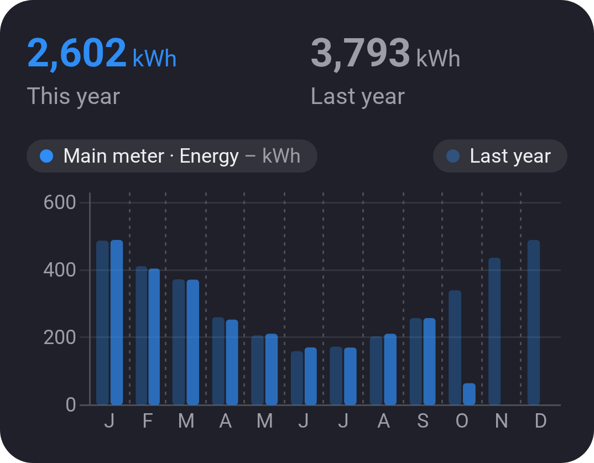

# Chart · Totals

[← All widgets](../../README.md#widgets)

How much a value went up per hour, day or month, like the Homey app's Energy tab, optionally beside the period before (March beside last year's March). Any value that only counts up: a meter's kWh or m³, a rain gauge, hours of TV, or a meter that starts again each month or year.

**Cost:** with *Show* set to *Cost (electricity)*, a meter's kWh become what they cost: each hour's use at that hour's electricity price in Homey Energy, with your tariffs and taxes (or your fixed price). Past days' prices are read once and kept, so a year's first load can take a little while. Hours Homey has no price for are left out, and the chart says so.

**Settings:** the value (meters first), show the amount or the cost, [time span](charts.md#time-spans), compare with the period before, title, the totals at the top, colour, [colour style](../../README.md#colour-style).

---
[← All widgets](../../README.md#widgets)
