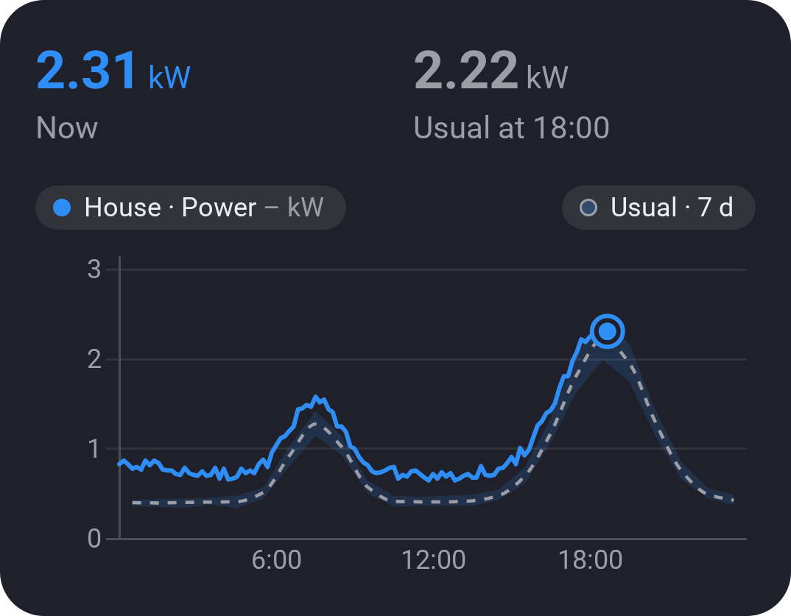

# Chart · Daily Profile

[← All widgets](../../README.md#widgets)

Is today unusual? Today's line over the usual day: each hour's average over the last 7 (or 3) days, dashed, with their lowest to highest as a band.

**Settings:** the value, usual day from (the last 7 or 3 days), show the spread, smooth line, scale (fitted or from zero), title, the values at the top, colour, [colour style](../../README.md#colour-style).

---
[← All widgets](../../README.md#widgets)
