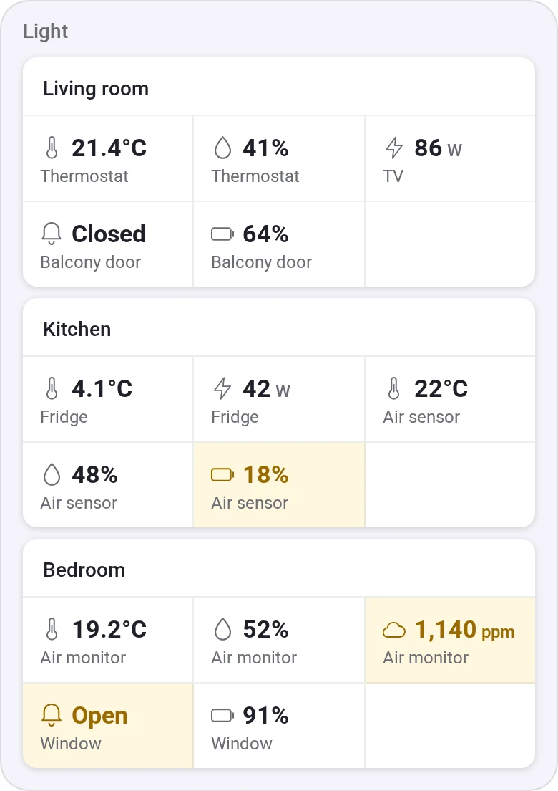
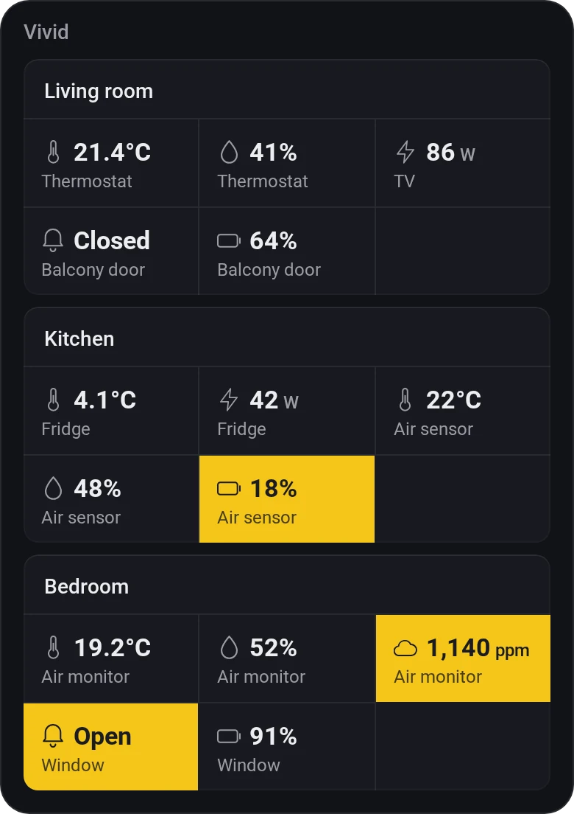
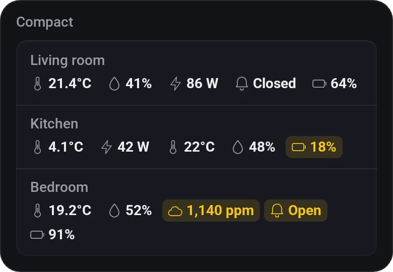
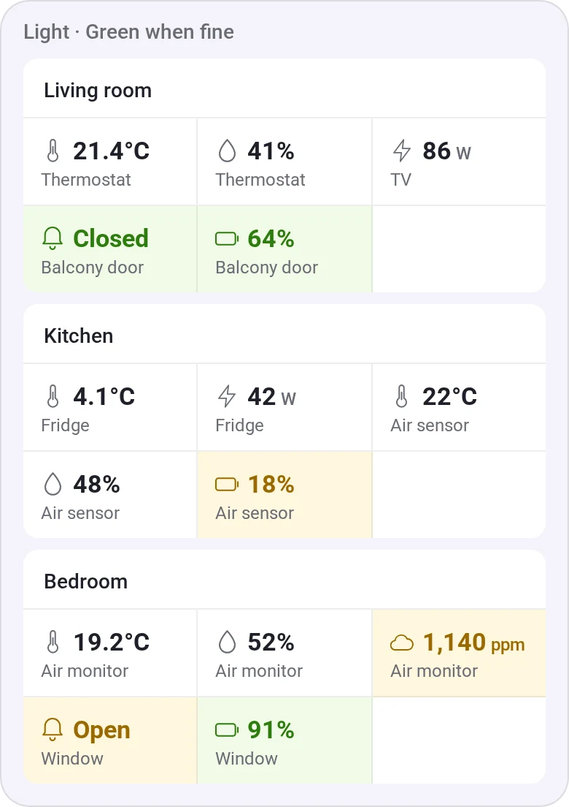

# Value Board

[← All widgets](../../README.md#widgets)

Every value of the devices you pick in one widget, grouped by room or by device, so a house's readings don't take a dozen Device Values widgets. As tiles (a tile per group, its values in a grid) or compact (a line of values per group; tap a value for its name). A low battery, an open contact, an alarm or high CO₂ stands out by itself, and fine values can go green.

**Settings:** [rename tiles](../../README.md#tile-names), layout (tiles or compact), group by room or device, which values (readings, or everything including switches and set temperatures), tiles per row (2, 3 or 4), green when fine, [colour style](../../README.md#colour-style).

## Looks

---
[← All widgets](../../README.md#widgets)
